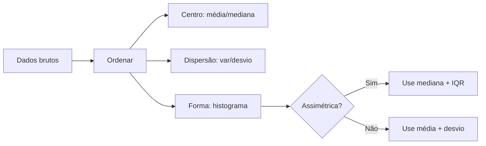

# إحصائية تصريحات لا صفر

> الوسائط، الوسيط والفوارق يروي تاريخاً يخفي جدول ما يتعلمه الباندا.

**Type:** Build
**Languages:** Python
**Prerequisites:** None
**Time:** ~60 minutes

## أهداف التعلم

- الحسابات الوسيطية، الوسيطية، الوساطة، التغيرات، الوضع والقواعد
- إنشاء نظام تاريخي وقطعة في نص/ASCII قبل استخدام المخططات
- اكتشاف الاختلافات مع IQR e z-score و تفسير عندما كل شيء يختلف
- مقارنة التوزيع الإمبريكي مع التوافقات المعتادة للتفسير

## المشكلة

ستحصل على عملة مدنية مع 10.000 رواتب$ 8.500, mas 70% das pessoas ganham menos que isso. Por quê? Um único CEO com R$500 ألف دولار على وسائل الإعلام إذا كنت تقرر فقط وسائل الإعلام، كنت أريد ذلك

في علم البيانات، تلخص البيانات كمتريكا فقط من الأخطاء الأكثر شيوعاً وأكثر تكلفة. قبل أي نموذج، تحتاج إلى وصف: أين هو المركز، كم هو المعلومات التي تم توزيعها، كشكل من أشكال التوزيع.

## المفهوم

### مركز: الوسائط مقابل الوسائط مقابل الوسائط

```
dados = [2, 3, 3, 5, 500]
média   = (2+3+3+5+500)/5 = 102.6  <- sensível a outlier
mediana = valor do meio ordenado = 3  <- robusta
moda    = valor mais frequente = 3
```

قاعدة: توزيع متناظر -> média ~= mediana. Assimétrica à direita -> média > mediana (caso salários).

### التنشر: التباين والحياة

```
variância = média((x - média)^2)
desvio    = sqrt(variância)
```

رد: "إم ميديا، كم كل نقطة بعيدة عن المركز؟"

### الكوارث و IQR (روبستو)

ترتيب البيانات. Q1 = 25 بالمئة، Q2 = الوسط، Q3 = 75 بالمئة.
IQR = Q3 - Q1 (الوسعة في 50٪ من المركز).

قاعدة دو توكي للخروج:
```
limite_inf = Q1 - 1.5*IQR
limite_sup = Q3 + 1.5*IQR
```

### النتيجة Z (البرامتريكي)

```
z = (x - média) / desvio
```
|z| > 3 = candidato a outlier, mas assume distribuição ~normal. Em dados assimétricos, IQR é melhor.



```figure
stats-descriptive-overview
```

## بناءها

### الخطوة الأولى: مركز الإحصائيات والانقسام

```python
import math

def mean(data):
    return sum(data) / len(data)

def median(data):
    s = sorted(data)
    n = len(s)
    mid = n // 2
    return s[mid] if n % 2 == 1 else (s[mid-1] + s[mid]) / 2

def variance(data, sample=False):
    m = mean(data)
    div = len(data) - 1 if sample else len(data)
    return sum((x - m)**2 for x in data) / div

def std(data, sample=False):
    return math.sqrt(variance(data, sample))

def mode(data):
    freq = {}
    for x in data:
        freq[x] = freq.get(x, 0) + 1
    return max(freq, key=freq.get)

data = [2, 3, 3, 5, 500]
print(f"média={mean(data):.1f} mediana={median(data)} moda={mode(data)} std={std(data):.1f}")
```

### الخطوة الثانية: الكوارث و IQR

```python
def percentile(data, p):
    s = sorted(data)
    k = (len(s)-1) * p / 100
    f = math.floor(k)
    c = math.ceil(k)
    if f == c:
        return s[int(k)]
    return s[f] * (c - k) + s[c] * (k - f)

def quartiles(data):
    return percentile(data, 25), percentile(data, 50), percentile(data, 75)

def iqr(data):
    q1, _, q3 = quartiles(data)
    return q3 - q1

q1, q2, q3 = quartiles([1,2,3,4,5,6,7,8,9,100])
print(f"Q1={q1} Q2={q2} Q3={q3} IQR={iqr([1,2,3,4,5,6,7,8,9,100])}")
# outlier: 100 > Q3+1.5*IQR ?
```

### الخطوة الثالثة: إحصاءات ASCII

```python
def histogram(data, bins=5):
    lo, hi = min(data), max(data)
    width = (hi - lo) / bins
    counts = [0]*bins
    for x in data:
        idx = min(int((x - lo) / width), bins-1) if width else 0
        counts[idx] += 1
    for i, c in enumerate(counts):
        bar = "#" * c
        print(f"{lo + i*width:6.1f} | {bar} ({c})")

histogram([1,1,2,2,2,3,3,5,8,9], bins=4)
```

## استخدمها

حتى حسابات`numpy`-أجل`statistics`:

```python
import statistics
import numpy as np

data = [2, 3, 3, 5, 500]
print(statistics.mean(data), statistics.median(data), statistics.stdev(data))
print(np.mean(data), np.median(data), np.std(data, ddof=0))
print(np.percentile(data, [25,50,75]))
# histograma real
# import matplotlib.pyplot as plt
# plt.hist(data, bins=10); plt.show()
```

يجب أن يستخدم نظام الصفر والعصرية في البيت العشري الثاني.

## أرسله

أرتيفاتو: `outputs/skill-estatistica-descritiva.md` قائمة التحقق من جميع المعلومات: "قبل التدريب، تقرير وسائل الإعلام/المنتصف، تحليل/معدل الاستخبارات، إحصاءات النتائج و % من النتائج غير المعتادة".

## التمارين

1. 1000 أوراق إعلامية`exp(λ=1)`و مقارنة الوسائط مقابل الوسائط. لماذا تختلف؟
2. تنفيذ التكافؤ (حذف) = E[(x-média) ^3]/desvio^3 sem libs. اختبارهم من المواصفات المماثلة مقابل المماثلة المماثلة.
3. تغيير قاعدة IQR من 1.5 إلى 3.0. كم من الخروجات التي تفقد؟

## الشروط الرئيسية

| Term | O que dizem | O que realmente é |
|---|---|---|
| Média | "valor típico" | Soma/n, sensível a outliers; só típica se distribuição simétrica |
| Mediana | "meio dos dados" | Valor que corta 50% abaixo/acima; robusta |
| Desvio-padrão | "erro médio" | Raiz da variância; distância típica até a média |
| IQR | "caixa do boxplot" | Q3-Q1; amplitude dos 50% centrais |
| Z-score | "quantos desvios" | (x-média)/desvio; assume normalidade |
| Outlier | "ponto estranho" | Observação além de Q3+1.5*IQR ou |z|>3 |

## المزيد من القراءة

- [Seeing Theory — Descriptive Stats](https://seeing-theory.brown.edu/) تفاعل بصري
- [NIST Engineering Statistics Handbook](https://www.itl.nist.gov/div898/handbook/) إشارة
- [SciPy stats docs](https://docs.scipy.org/doc/scipy/reference/stats.html) للإنتاج
