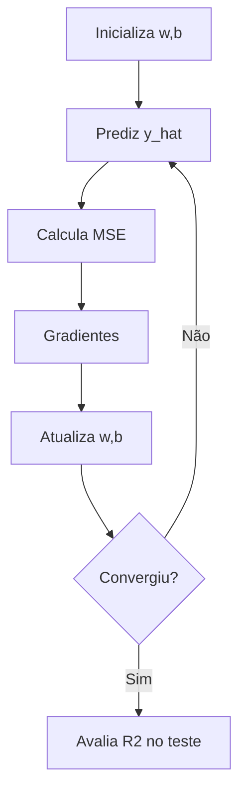

# Regressão خطية للصفر

> قبل أن تتعلم، تكتب أو تراجع إلى يدك وتفهم لماذا تحرك.

**Type:** Build
**Languages:** Python
**Prerequisites:** 01-estatistica-descritiva, 02-limpeza-e-eda
**Time:** ~75 minutes

## أهداف التعلم

- المشتق من تراجيع MSE`y=wx+b`التراجع التنفيذي خطي إلى الصفر
- التدريب مع التراجعية التنازلية ومقارنة مع المعادلة الطبيعية
- المعدات المعدنية المعدنية المعدنية المعدنية المعدنية المعدنية المعدنية المعدنية المعدنية المعدنية المعدنية المعدنية المعدنية المعدنية المعدنية المعدنية المعدنية المعدنية المعدنية المعدنية المعدنية المعدنية المعدنية المعدنية المعدنية المعدنية المعدنية المعدنية المعدنية المعدنية المعدنية المعدنية المعدنية المعدنية المعدنية المعدنية المعدنية المعدنية المعدنية المعدنية المعدنية المعدنية المعدنية المعدنية المعدنية المعدنية المعدنية المعدنية المعدنية المعدنية المعدنية المعدنية المعدنية المعدنية المعدنية المعدنية المعدنية المعدنية المعدنية المعدنية المعدنية المعدنية المعدنية المعدنية المعدنية المعدنية المعدنية المعدنية المعدنية المعدنية المعدنية المعدنية المعدنية المعدنية المعدنية المعدنية المعدنية المعدنية المعدنية المعدنية
- استندر للعودة المتعددة وفهم التوسع

## المشكلة

قبل سعر المبنى مثل هذا. لا تعود إلى الوراء سوف تسقط. مع العودة سوف تتعلم reta الذي يقلل من الخطأ التربيعي.

## المفهوم

النموذج: `y = wx + b`كستو MSE:`(1/n) sum(y_hat - y)^2`. . .
الدرجات: `dw = (2/n) sum((y_hat-y)x)`،`db = (2/n) sum(y_hat-y)`. . .
تحديث: `w -= lr*dw`. . .

المعادلة الطبيعية:`w = (X^T X)^{-1} X^T y` solução fechada، O(n3) em الميزات.

R2 = 1 - SS_res/SS_tot (كم من التباين هو موضح).



```figure
linear-regression-fit
```

## بناءها

انظر`code/main.py`: `LinearRegression`(م)`fit`،`predict`،`r2`.إضافة لمشاهدة سابقة متعددة

## استخدمها

```python
from sklearn.linear_model import LinearRegression
model = LinearRegression().fit(X_train, y_train)
print(model.coef_, model.intercept_, model.score(X_test, y_test))
```

## أرسله

`outputs/skill-regressao.md`عندما تستخدم التدفقات مقابل الطبيعية عندما تتصاعد عندما تتعديل

## التمارين

1. تنفيذ SGD مقابل GD اللحظة
2. اختبار درجة 10 في المربعات
3. تنفيذ Ridge (L2).

## الشروط الرئيسية

| Term | Significado |
|---|---|
| MSE | Erro quadrático médio |
| R² | Variância explicada |
| Learning rate | Passo do gradiente |
| Scaling | Padronizar para convergir |

## المزيد من القراءة

- [ISLR cap 3](https://www.statlearning.com/)
- [CS229 notes](https://cs229.stanford.edu/main_notes.pdf)
