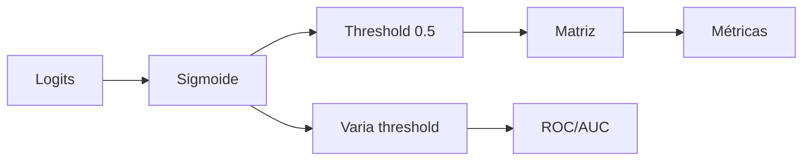

# التصنيف والتقييم

> تحديد المعلومات المزدوجة

**Type:** Build
**Languages:** Python
**Prerequisites:** 03-regressao-do-zero
**Time:** ~70 minutes

## أهداف التعلم

- التنفيذية regressão logística com sigmoide e entropia cruzada do zero
- بناء المصفوفة من الارتباك و استنتاج دقة، دقة، استدعاء، F1
- تراسر منحنى ROC و حساب AUC يدويا
- حد اختيار أفضل شرح للتداول

## المشكلة

النموذج مع 95% من الدقة يبدو أفضل حتى اكتشاف أن 95% من الحالات هي سلبية و هو دائما يمنع سلبية.

## المفهوم

سيقمويد: `σ(z)=1/(1+e^-z)`، mapeia para (0,1).
كستو: BCE = -[y log(p) + (1-y) log(1-p)].
درجة: `dw = (1/n) sum((p-y)x)`. . .

ماتريز:
```
        Pred 0  Pred 1
Real 0   TN      FP
Real 1   FN      TP
```
Precisão = TP/(TP+FP) ، Recall = TP/(TP+FN) ، F1 = 2PR/(P+R).

ROC: المتغيرات عند 0→1، plota TPR مقابل FPR. AUC = منطقة المنحني



```figure
roc-curve
```

## بناءها

```python
def sigmoid(z): return 1/(1+math.exp(-z))
def bce(y,p): return -(y*math.log(p+1e-15)+(1-y)*math.log(1-p+1e-15))
# treino: p=sigmoid(w*x+b), erro=p-y
```

انظر`code/main.py`كاملة

## استخدمها

```python
from sklearn.linear_model import LogisticRegression
from sklearn.metrics import classification_report, roc_auc_score
model = LogisticRegression().fit(X_train, y_train)
print(classification_report(y_test, model.predict(X_test)))
print(roc_auc_score(y_test, model.predict_proba(X_test)[:,1]))
```

## أرسله

`outputs/skill-avaliacao.md` دليل المقاييس من خلال حالة الاستخدام.

## التمارين

1. قم بتحديد العدول لتحقيق أقصى قدر من F1.
2. تمثل عدم التوازن 95/5 و مقارنة الدقة مقابل F1.
3. تنفيذ CV من طراز k

## الشروط الرئيسية

| Term | Definição |
|---|---|
| Precisão | Fração de positivos previstos que são reais |
| Recall | Fração de positivos reais capturados |
| F1 | Média harmônica P/R |
| AUC | Probabilidade de ordenar positivo acima de negativo |

## المزيد من القراءة

- [Google ML — Classification](https://developers.google.com/machine-learning/crash-course/classification)
- [Sklearn metrics](https://scikit-learn.org/stable/modules/model_evaluation.html)
