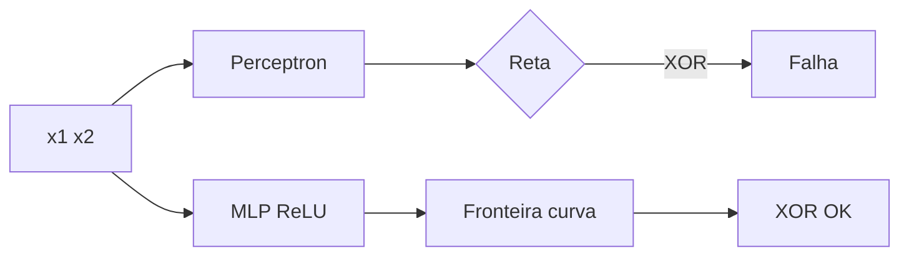

# الفهم والتعلم العميق لا يصل إلى الصفر

> من خط يفرق نقاط إلى خط يعلّم كل شيء.

**Type:** Build
**Languages:** Python
**Prerequisites:** 03-regressao-do-zero, 04-classificacao-e-avaliacao
**Time:** ~80 minutes

## أهداف التعلم

- التطبيق (قاعدة روزنبلات) و إثبات التناقض/الاختلاف
- المكملات المكملة لـ MLP com ReLU/sigmoide، المقدمة والمناسبة
- التدريب مع التراجع التسلسلي ومقارنة`torch.nn.Linear`
- تظهر الحدود القرارية وتفسير كيفية إدراك عدم وجود XOR

## المشكلة

التعلم العميق يستخدم التعلم العميق (camadas) + غير الخطية (ReLU) لخلق الحدود الملتوية. فهم أو الإدراك هو فهم العمق الذي يهم.

## المفهوم

(أفكار)`y = sign(w·x + b)`, تحديث: `w += lr*(y_true - y_pred)*x`. . .

الحد: فقط منفصلة خطياً، ويتطلب XOR كاميراً مخفيةً.

الملفات المختلفة 1 oculta: `h=ReLU(W1 x + b1)`،`y=sigmoid(W2 h + b2)`-مشتقّات الشبكة الخلفية

ريلو:`max(0,z)` تراجعة 1 se z> 0 في حالة عكس ذلك.



```figure
perceptron-vs-mlp
```

## بناءها

انظر`code/main.py`: perceptron + MLP 2 camadas com backprop numpy اختبارهم و XOR

## استخدمها

```python
import torch
model = torch.nn.Sequential(torch.nn.Linear(2,8), torch.nn.ReLU(), torch.nn.Linear(8,1), torch.nn.Sigmoid())
# treino com torch.optim.SGD
```

يجب أن تكون المعدل المعدني المعدني المعدني معدل دقة أقل من 5% من الحجم.

## أرسله

`outputs/skill-perceptron.md`عندما تستخدم خطية مقابل MLP، كمنشطات الحدود.

## التمارين

1. أظهرت أن الإدراك لا يتقارب في XOR (إثبات).
2. هل تتغير الوضع من قبل الإختفاء؟
3. إضافة 2a كاميدا مخفية في غانا

## الشروط الرئيسية

| Term | Definição |
|---|---|
| Perceptron | Classificador linear com update erro-dirigido |
| ReLU | max(0,z) |
| Backprop | Regra da cadeia para gradientes |
| XOR | Problema não-linear que exige oculta |

## المزيد من القراءة

- [Rosenblatt 1958 — Perceptron](https://psycnet.apa.org/record/1959-09865-001)
- [3Blue1Brown — Neural Networks](https://www.3blue1brown.com/topics/neural-networks)
- [PyTorch basics](https://pytorch.org/tutorials/beginner/basics/intro.html)
