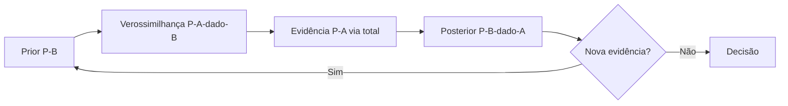

# احتمالات الصفر: شرطية، إجمالي وفقات

> أذا اختبرت إيجابياً، ما هي فرصك الحقيقية لكونك مريضاً؟

**Type:** Build
**Languages:** Python
**Prerequisites:** 01-estatistica-descritiva
**Time:** ~60 minutes

## أهداف التعلم

- الحساب من احتمالية الشرطية P                                                                                                                                                                                                                                                           
- تطبيق قانون احتمالية إجمالي لتفكيك حدث في سيناريوهات حصرية متبادلة
- استنتاج وتطبيق نظرية بايز لتحديد الشروط (اختبارات طبية، البريد الإلكتروني، التشغيل)
- إنشاء مؤشر PMF discreta do zero و حساب الأمل و التباين في الأفراد

## المشكلة

اختبار مرض نادر لديه 99٪ من الحساسية و 95٪ من المحددة. مرض يصل إلى 1 في كل 1000 شخص. اختبارك إيجابي. ما هي فرصك في أن تكون مريضا؟

أو غريزة تقول 99٪. A resposta correta é ~ 2٪. أو خطأ  confondre P(positivo الديندوينت) com P(doente الديندوينت)  se llama falácia da taxa-base, e aparece em churn, fraude, spam e qualquer classificador com classe rara. Sem probabilidade condicional, você interpret todo modelo erroneous.

## المفهوم

### احتمالية مشروطة

```
P(A|B) = P(A ∩ B) / P(B),  com P(B) > 0
```

"احتمالات ما حدث" يحد من الكون إلى الحالات التي حدث فيها "ب".

مثال: dado justo، B = "saiu par" {2,4,6}، A = "saiu 6".

### الإستقلال

A e B são independentes se o conhecimento de B não muda a chance de A:

```
P(A|B) = P(A)  <=>  P(A ∩ B) = P(A) · P(B)
```

اثنين من النشرات من العملة: سارة لا 2o سارة لا 1o = 1/2 = سارة لا. مستقلين.

### إجمالي الاحتمالات

إذا كان هناك جزء من الفضاء (مشتركًا حصريًا ، فكل شيء):

```
P(A) = Σ P(A|Bi) · P(Bi)
```

مثال: P positivo) = P positivo de hacerse) P doente) + P positivo de hacerse)

### نظرية دي بايز

قم بتحويل الشروط إلى صيغين فوق:

```
P(B|A) = P(A|B) · P(B) / P(A)
```

اختبار طبيب: P                                                                                                                                                                                                                                                            



```figure
stats-probability-bayes
```

## بناءها

### الخطوة الأولى: Condicional e independência do zero

```python
def cond_prob(p_ab, p_b):
    if p_b <= 0:
        raise ValueError("P(B) deve ser > 0")
    return p_ab / p_b

def joint_if_independent(p_a, p_b):
    return p_a * p_b

def is_independent(p_a, p_b, p_ab, tol=1e-9):
    return abs(p_ab - p_a * p_b) <= tol

print(cond_prob(1/6, 3/6))          # 0.333: P(6 | par)
print(is_independent(0.5, 0.5, 0.25))  # True: duas moedas
```

### الخطوة الثانية: احتمالية إجمالية

```python
def total_prob(cond_probs, priors):
    # cond_probs[i] = P(A|Bi), priors[i] = P(Bi)
    if abs(sum(priors) - 1.0) > 1e-9:
        raise ValueError("priors devem somar 1")
    return sum(c * p for c, p in zip(cond_probs, priors))

p_pos = total_prob([0.99, 0.05], [0.001, 0.999])
print(f"P(positivo) = {p_pos:.4f}")  # ~0.0509
```

### الخطوة الثالثة: بايز + PMF, esperança e variância

```python
def bayes(p_a_given_b, p_b, p_a):
    return p_a_given_b * p_b / p_a

print(f"P(doente|+) = {bayes(0.99, 0.001, p_pos):.4f}")  # ~0.0194

def pmf(values, probs):
    if abs(sum(probs) - 1.0) > 1e-9:
        raise ValueError("probs devem somar 1")
    return dict(zip(values, probs))

def expected_value(d):
    return sum(x * p for x, p in d.items())

def variance_dist(d):
    mu = expected_value(d)
    return sum(((x - mu) ** 2) * p for x, p in d.items())

dado = pmf([1,2,3,4,5,6], [1/6]*6)
print(expected_value(dado), variance_dist(dado))  # 3.5, ~2.917
```

## استخدمها

أ mesmo cálculo com`fractions`(إكساتو) أو معاناة إمبريكا:

```python
from fractions import Fraction

# Bayes exato com frações
p = Fraction(99,100) * Fraction(1,1000) / (
    Fraction(99,100)*Fraction(1,1000) + Fraction(5,100)*Fraction(999,1000))
print(p, float(p))  # ~0.0194

# Verificação empírica por simulação (lei dos grandes números)
import random
random.seed(0)
n = 200_000
doente_pos = sum(1 for _ in range(n)
                 if random.random() < 0.001 and random.random() < 0.99)
saud_pos = sum(1 for _ in range(n)
               if random.random() >= 0.001 and random.random() < 0.05)
print(doente_pos / (doente_pos + saud_pos))  # ~0.02
```

يجب أن تتوافق محاكاة الصيغة على 2a casa decimal com n grande.

## أرسله

أرتيفاتو: `outputs/skill-probabilidade.md`قائمة التحقق "كلما غيرت شرطاً، أعلنت مقدماً، على نحو صحيح، والبيانات قبل الإنتهاء".

## التمارين

1. تمثل 98% من رسائل البريد الإلكتروني عن طريق الفلترات غير المرسلة و2% من رسائل غير المرسلة عن طريق الرسائل الإلكترونية.`bayes()`. . .
2. إثبات كود أن P  A  B  = P  B                                                                                                                                                                                                                                                     
3. إنشاء صندوق النقد المالي "سومة من اثنين من المعلومات" وتحساب الأمل والفوارق`expected_value()`(إ)`variance_dist()`. . .

## الشروط الرئيسية

| Term | O que dizem | O que realmente é |
|---|---|---|
| Condicional P(A\|B) | "chance de A se B" | P(A∩B)/P(B); restringe o universo a B |
| Independência | "sem relação" | P(A∩B)=P(A)·P(B); saber B não muda A |
| Probabilidade total | "média ponderada" | P(A)=Σ P(A\|Bi)·P(Bi) sobre partição |
| Teorema de Bayes | "inverter a pergunta" | P(B\|A)=P(A\|B)·P(B)/P(A) |
| PMF | "tabela de chances" | P(X=x) para cada valor discreto; soma 1 |
| Esperança | "média teórica" | Σ x·P(x); para onde a média amostral converge |

## المزيد من القراءة

- [Seeing Theory — Probability](https://seeing-theory.brown.edu/) تفاعل بصري
- [Stat Trek: Bayes Theorem](https://stattrek.com/probability/bayes-theorem) مرجع مع أمثلة
- [Python `fractions` docs](https://docs.python.org/3/library/fractions.html) حسابات دقيقة للإنتاج
