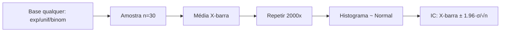

# توزيعات و نظرية مركزية لليميت

> لماذا يُمكن أن يُفسّر متوسط 30 بيانات "تقريباً طبيعية" فترة ثقة كل نموذج؟

**Type:** Build
**Languages:** Python
**Prerequisites:** 01-estatistica-descritiva, 06-probabilidade-fundamentos
**Time:** ~60 minutes

## أهداف التعلم

- التنفيذية PMF/PDF de Bernoulli, ثنائيات, البوشن, الطبيعي و التعريفي باستخدام فقط `math`
- أوسطة التوزيعات`random`e validar média/variância teóricas
- المثالية أو النظرية المركزية الحد: متقاربة الوسطية الأمسطرية إلى الطبيعية
- مقارنة تنفيذ العمل الصفري`numpy`-أجل`statistics`عندما يكون متاحاً

## المشكلة

هل قدمت معدل رد من API: متوسط 200ms، ولكن أعلى من 5s. É "طبيعي"؟ هل يمكنني استخدام متوسط ± 2·desvio كمتوسط؟ Se a distribuição base é exponencial (assimétrica) ، فإن رد الفرد ليس طبيعي  ولكن متوسط 30 طلبات é.

## المفهوم

### الاختفاء: برنولي → ثنائي → البوشون

- **Bernoulli(p):**1 sucesso com prob. p. E[X]=p، Var=p(1-p).
- **Binomial(n,p):**(سومة من برنوليس)`P(X=k) = C(n,k)·p^k·(1-p)^(n-k)`, E=np, Var=np ((1-p).
- **Poisson(λ):**الأحداث نادرة في فترات`P(X=k) = λ^k·e^-λ/k!`, E=Var=λ. الحد من الثنائي عندما n grande, p pequeno, np=λ.

### المواصلات: الطبيعية والعريضة

- **Normal(μ,σ):** `f(x) = e^(-(x-μ)²/2σ²)/(σ√2π)`. . . . . . . . . . . . . . . . . . . . . . . . . . . . . . . . . . . . . . . . . . . . . . . . . . . . . . . . . . . . . . . . . . . . . . . . . . . . . . . . . . . . . . . . . . . . . . . . . . . . . . . . . . . . . . . . . . . . . . . . . . . . . . . . . . . . . . . . . . . . . . . . . . . . . . . . . . . . . . . . . . . . . . . . . . . . . . . . . . . . . . . . . . . . . . . . . . . . . . . . . . . . . . . . . . . . . . . . . . . . . . . . . . . . . . . . . . . . . . . . . . . . . . . . . . . . . . . . . . . . . . . . . . . . . . . . . . . . . . . . . . . . . . . . . . . . . . . . . . . . . . . . . . . . . . . . . . . . . . . . . . . . . . . . . . . . . . . . . . . . . . . . . . . . . . . . . . . . . . . . . . . . . . . . . . . . . . . . . . . . . . . . . . . . . . . . . . . . . . . . . . . . . . . . . . . . . . . . . . . . . . . . . . . . . . . . . . . . . . . . . . . . . . . . . . . . . . . . . . . . . . . . . . . . . . . . . . . . . . . . . . . . . . . . . . . . . . . . . . . . . . . . . . . . . .
- **Exponencial(λ):**الزمات بين أحداث البوزون`f(x) = λ·e^(-λx)`(x≥0), E=1/λ, Var=1/λ2.

### نظرية مركزية ليميت (TCL)

إذا كان X1..Xn são i.i.d. com média μ e variância σ2 finita، ثم:

```
X̄ ~ Normal(μ, σ²/n)  quando n cresce
```

والتي تعتبر من الأساس (وحدة، تعريفة، ثنائية)  por isso médias de n≥30 se tratam como normais em testes A/B.



```figure
stats-distribuicoes-tcl
```

## بناءها

### الخطوة الأولى: إعداد المعلومات المضافة إلى المعلومات المضافة إلى المعلومات المضافة إلى المعلومات المضافة إلى المعلومات المضافة إلى المعلومات المضافة إلى المعلومات المضافة إلى المعلومات المضافة إلى المعلومات المضافة إلى المعلومات المضافة إلى المعلومات المضافة إلى المعلومات المضافة إلى المعلومات المضافة إلى المعلومات المضافة إلى المعلومات المضافة إلى المعلومات المضافة إلى المعلومات المضافة.`math`)

```python
import math

def bernoulli_pmf(k, p):
    return p if k == 1 else (1 - p if k == 0 else 0.0)

def binom_pmf(k, n, p):
    if not 0 <= k <= n:
        return 0.0
    return math.comb(n, k) * p**k * (1-p)**(n-k)

def poisson_pmf(k, lam):
    return lam**k * math.exp(-lam) / math.factorial(k)

def normal_pdf(x, mu=0.0, sigma=1.0):
    return math.exp(-((x-mu)**2)/(2*sigma**2)) / (sigma * math.sqrt(2*math.pi))

def expon_pdf(x, lam):
    return lam * math.exp(-lam*x) if x >= 0 else 0.0

print(binom_pmf(2, 10, 0.5))   # ~0.0439 (= 45/1024)
print(poisson_pmf(3, 2.0))     # ~0.180
print(normal_pdf(0))           # ~0.399
```

### الخطوة الثانية:`random`

```python
import random

def sample_bernoulli(p, rng):
    return 1 if rng.random() < p else 0

def sample_binomial(n, p, rng):
    return sum(sample_bernoulli(p, rng) for _ in range(n))

def sample_poisson(lam, rng):
    # Knuth: conta eventos até exceder e^-λ
    L = math.exp(-lam)
    k, prod = 0, 1.0
    while True:
        k += 1
        prod *= rng.random()
        if prod <= L:
            return k - 1

def sample_expon(lam, rng):
    return -math.log(1 - rng.random()) / lam  # inversa da CDF

def sample_normal(mu, sigma, rng):
    return rng.gauss(mu, sigma)  # Box-Muller interno do CPython

rng = random.Random(0)
print([sample_binomial(10, 0.5, rng) for _ in range(5)])
```

### الخطوة الثالثة: التشابه مع TCL

```python
def sample_means(sampler, n, reps, rng):
    return [sum(sampler() for _ in range(n)) / n for _ in range(reps)]

rng = random.Random(42)
means = sample_means(lambda: rng.expovariate(1.0), n=30, reps=2000, rng=rng)
m = sum(means) / len(means)
v = sum((x-m)**2 for x in means) / len(means)
print(f"base exp(1): E[X̄]={m:.3f} (→1.0) Var={v:.4f} (→1/30≈0.0333)")
```

## استخدمها

مؤتمر`numpy`-أجل`statistics`(اختياري):

```python
try:
    import numpy as np
    rng = np.random.default_rng(0)
    s = rng.binomial(10, 0.5, size=50_000)
    print(f"[numpy] binomial(10,.5): média={s.mean():.3f} (→5.0) var={s.var():.3f} (→2.5)")
    e = rng.exponential(1.0, size=(2000, 30)).mean(axis=1)
    print(f"[numpy] TCL exp: E[X̄]={e.mean():.3f} Var={e.var():.4f}")
except ImportError:
    print("numpy não instalado — comparação pulada (pip install numpy)")
```

- لا`math.comb`يجب أن يتفق القانون على الـ 3a house للـ PMFs.

## أرسله

أرتيفاتو: `outputs/skill-distribuicoes.md` دليل "أي توزيع تستخدم + عندما يسمح TCL بفترة طبيعية".

## التمارين

1. أظهر عدداً أن ثنائي ((n=100، p=0.02) ≈ Poisson ((λ=2): مقارنة كـ PMFs k=0.5.
2. إعادة تحاكي زيّة TCL`random.random()`: E[X̄]→0.5 e Var→1/(12·30) ؟
3. كيبرا دو TCL: استخدام القاعدة كاوشي (`tan(pi*(u-0.5))`"أو تاريخوجراما داس ميديا "نورماليزا" "بور كيو"؟

## الشروط الرئيسية

| Term | O que dizem | O que realmente é |
|---|---|---|
| Bernoulli | "cara ou coroa" | Bloco atômico 0/1 com prob. p |
| Binomial | "k sucessos em n" | Soma de Bernoullis; C(n,k)p^k(1-p)^(n-k) |
| Poisson | "eventos raros" | Limite da Binomial; E=Var=λ |
| Normal | "curva sino" | PDF gaussiana; 68-95-99.7 em ±1/2/3σ |
| Exponencial | "tempo de espera" | Intervalo entre Poissons; sem memória |
| TCL | "média vira normal" | X̄→Normal(μ,σ²/n); exige variância finita |

## المزيد من القراءة

- [Seeing Theory — Distributions & CLT](https://seeing-theory.brown.edu/) تفاعل بصري
- [SciPy stats docs](https://docs.scipy.org/doc/scipy/reference/stats.html) للإنتاج
- [NIST: Probability Distributions](https://www.itl.nist.gov/div898/handbook/eda/section3/eda366.htm) إشارة
