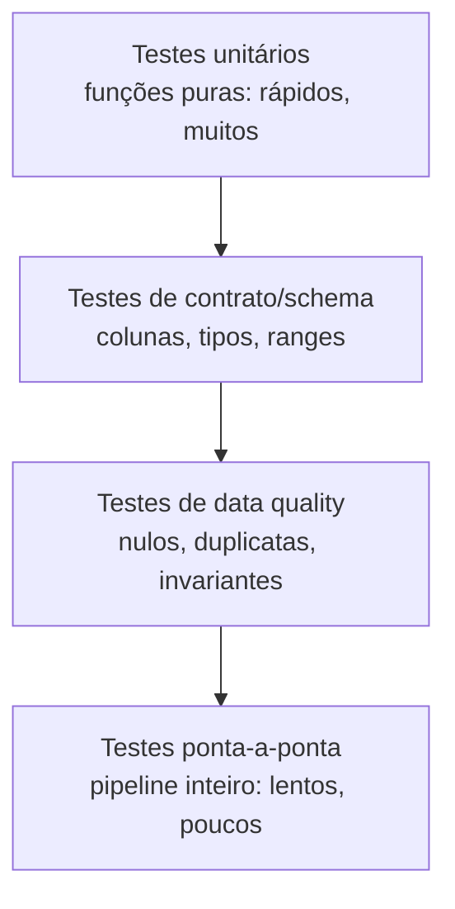

# كود نظيف و اختبارات علم البيانات

> أكتب أدواتها وتعمل في الإنتاج  تعلم تحليل تحليل تحليل في خط أنابيب قابل للتحقق.

**Type:** Build
**Languages:** Python
**Prerequisites:** 01-estatistica-descritiva, 02-limpeza-e-eda
**Time:** ~60 minutes

## أهداف التعلم

- شرح الملاحظات التي تُخسر في الإنتاج (إستادو oculto، تنفيذ للنظام، dependências implícitas)
- إعادة تشكيل المكتب المتحكم في النظام الأساسي
- تطبيق SRP, DRY e validação na borda em código de dados com stdlib
- تستبنى الاختبار الجودة البيانات (الخطط، الصفرات، النطاقات، الثنائيات)
- تفسير الهرمة من الأوراق النسائية المطبقة على DS: unitários rápidos, contrato/schema, ponta-a-ponta lentos

## المشكلة

أنت تسلم دفتر ملاحظات يعمل على أدائه بشكل كامل. زميلك يقوم بتنفيذ "Run All" و يكتشف الخلية 7: متغير يتم كتابته في الخلية 12 يتم تنفيذه بشكل مُتَنَظام، عمود`idade`أتيت كالسلاسل`"32"`في الوقت الحالي`dropna()`إزالة 40% من الخطوط في الإنتاج، أو جدول العمل يقع في منتصف الليل كرسالة مفيدة.

أدوات الملاحظات إضافية الاستكشاف، لا تكرار. Estado global mutável، células executadas fora de orden e tipos implícitos tornam o resultado não-determinístico. O custo aparece depois: retrabalho, modelo treinado com dados corrompidos, decisão errada. A saída é tratar código de dados como software: funções pequenas, entradas validadas, comportamento testado.

## المفهوم

### وظائف نقية: نفس الدخول، نفس الخروج

لم تكن وظيفة طاهرة أو مكتوبة عالمياً، ولم تعتمد على ترتيب تنفيذها:

```python
# impuro: depende de global e muta o argumento
THRESHOLD = 18
def filtrar_adultos(rows):
    return [r for r in rows if r["idade"] >= THRESHOLD]  # quebra se idade for str

# puro: dependências explícitas, sem mutação
def filtrar_adultos(rows, idade_minima=18):
    return [{**r} for r in rows if int(r["idade"]) >= idade_minima]
```

القواعد العملية: um verbo por função (`load`،`validate`،`clean`،`featurize`(I/O فقط على الحدود) ، العودة الجديدة في وقت متأخر.

### (التي لا يهم هنا)

- **S — Single Responsibility:** `validate_schema()`صحيحة`clean()`لم نكن معاً أبداً
- **D — Dependency Inversion (na prática):**مرحلة تتلقى أو تحدد عن طريق المعلم (الحد، الأعمدة) ، لا يهم العالمي.
- **Contrato na borda:**يُؤكد أن النظام المُخطط له (المعطفات الحالية، النوعات المتحولة) هو المُخطط المُخطط لتحويل الرسائل التي تقول خطة وعمدة.

### أوساط الأقدام للطعام



القاعدة (الوحدات + النظام) تتدفق في ثوان كل عمل. أو التو (الخطوط الكاملة مع البيانات الحقيقية) لا تتدفق مع المعلومات. إذا كانت القاعدة ضعيفة، فإن كل خطأ يحدث فقط في الإنتاج.

```figure
clean-code-pipeline-overview
```

## بناءها

### الخطوة الأولى: تقديم جدول كقائمة من المواصفات والمناسبة

كل خط هو أم`dict`، و من الجدول`list[dict]`. . .

```python
SCHEMA = {
    "nome": str,
    "idade": int,   # aceita "32" conversível
    "salario": float,
}

def validate_schema(rows, schema):
    errors = []
    for i, row in enumerate(rows):
        for col, tipo in schema.items():
            if col not in row:
                errors.append(f"linha {i}: coluna ausente '{col}'")
                continue
            try:
                tipo(row[col])
            except (ValueError, TypeError):
                errors.append(f"linha {i}: '{col}'={row[col]!r} não converte para {tipo.__name__}")
    return errors
```

### الخطوة الثانية: خطوط الأنابيب المودولية

```python
def clean_rows(rows):
    out = []
    for r in rows:
        novo = {"nome": str(r["nome"]).strip(), "idade": int(r["idade"]), "salario": float(r["salario"])}
        if novo["idade"] >= 0 and novo["salario"] >= 0:
            out.append(novo)
    return out

def featurize(rows):
    return [{**r, "adulto": r["idade"] >= 18} for r in rows]

def run_pipeline(rows):
    errors = validate_schema(rows, SCHEMA)
    if errors:
        raise ValueError("schema inválido:\n" + "\n".join(errors[:5]))
    return featurize(clean_rows(rows))
```

### الخطوة الثالثة: اختبارات جودة البيانات

```python
def check_quality(rows):
    checks = {
        "sem_nulos": all(v is not None and v != "" for r in rows for v in r.values()),
        "idades_validas": all(0 <= r["idade"] <= 120 for r in rows),
        "sem_duplicatas": len({(r["nome"], r["idade"]) for r in rows}) == len(rows),
    }
    return checks
```

كل شيك يعود إلى اسم بوليان: عندما يقع، أنت تعرف بالضبط ما الذي يتغير من شيك.

## استخدمها

أوسيمبردرو كيبيتريو دي توليد (`pandera`المخططات`pytest`كامي رينر):

```python
# import pandera.pandas as pa
# import pandas as pd
# from pandera import Column, DataFrameSchema, Check
#
# schema = DataFrameSchema({
#     "nome": Column(str),
#     "idade": Column(int, Check.between(0, 120)),
#     "salario": Column(float, Check.ge(0)),
# })
# df = pd.DataFrame([{"nome": "ana", "idade": 30, "salario": 5000.0}])
# print(schema.validate(df))
# # pytest: mesmos asserts do unittest, com fixtures e mensagens melhores
```

لا يوجد مؤكد`pandera`يجب أن تتوافق: خطة صالحة تمر من قبل، خطة صالحة لا تصل من قبل.

## أرسله

أرتيفاتو: `outputs/skill-clean-code-ds.md` قائمة التحقق من تحويل أي دفتر ملاحظات إلى خط أنابيب: "مهمات نقية، مخططات على المجلس، فحص جودة المستخدمين، اختبارات سريعة على متنها".

## التمارين

1. كيبري مقترح: passe `idade="trinta"`و على خطة`salario`رسالة خطأ في الخطوط العمدة؟
2. إضافة إلى التحقق`salario_mediano_positivo`و هو اختبار يخطئ عندما يكون كل أجورنا 0 لماذا يستحق متغيرات العمل أكثر من اختبار النوع؟
3. تحويل وظيفة من عملك العالمي إلى وظيفة نقية (parâmetros explícitos, retorno novo). كم من الاختبارات الجديدة التي تغيرها غير مهمة؟

## الشروط الرئيسية

| Term | O que dizem | O que realmente é |
|---|---|---|
| Função pura | "função limpa" | Mesma entrada -> mesma saída, sem global nem mutação; testável em isolamento |
| Schema | "formato dos dados" | Contrato de colunas + tipos; validado na borda, falha rápido |
| Data quality check | "teste de dados" | Invariante nomeado (nulos, ranges, duplicatas) que explica o que quebrou |
| SRP | "uma coisa só" | Cada função/etapa tem um único motivo para mudar |
| Pirâmide de testes | "testar tudo" | Muitos testes rápidos na base (unit/schema), poucos lentos no topo (e2e) |
| Falhe rápido | "validar cedo" | Erro na entrada com mensagem útil em vez de corrupção silenciosa adiante |

## المزيد من القراءة

- [PEP 8 — Style Guide](https://peps.python.org/pep-0008/) مؤتمرات رسمية
- [unittest docs](https://docs.python.org/3/library/unittest.html) المتسابق
- [Pandera docs](https://pandera.readthedocs.io/) التحقق من التأثيرات
