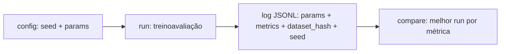

# التكرار والتتبع للتجارب

> "Funcionou ayer" ليس نتيجة علمية  تعلم بذرات ثابتة، مجموعة بيانات نسخة و سجل كل مرة.

**Type:** Build
**Languages:** Python
**Prerequisites:** 01-estatistica-descritiva, 08-clean-code-testes-ds
**Time:** ~60 minutes

## أهداف التعلم

- شرح مثل ثلاثة مصادر غير تحديدية: البذور غير ثابتة، مجموعة بيانات sem versão، hyperparâmetros não registrados
- البذور الثابتة`random`(e `numpy`-أجل`torch`لا استخدمها) لتكرار تقسيمات
- نسخة مجموعة بيانات com hash SHA-256 do conteúdo canônico
- يسجل يعمل (الفرام + المقاييس + مجموعة بيانات_الهاش) em JSONL com stdlib
- مقارنة الجاريات و escolher o melhor por metrica com função pura

## المشكلة

أنت تدور أو تدرب مرتين وتحصل على دقة 0.87 و 0.83 sem تغير أي شيء. أسوأ: أشهر بعد ذلك، أُحديث المجموعة البيانية، أو المذكرة تم تحريرها، ولا أحد يعرف ما هو مزيجك أو 0.87.

لا يوجد أي سجل من المعلمات أو المقاييس، لا يوجد طريقة مقارنة أو مراجعة.

## المفهوم

### البذور: o ponto de partida do aleatório

جيرادورز مزيفي الحوادث São determinísticos dada بذرة:

```python
import random
random.seed(42)
print(random.random())  # sempre 0.6394267984578837
```

إصلاح البذور عندما لا تبدأ (`set_seed(42)`(بعد تكرار كل شيء) البذور مختلفة = تجارب مختلفة؛ لذلك البذور أيضاً هي المرجعة.

### نسخة مجموعة البيانات = hash do conteúdo

اسم الملف (`dados_final_v2_REAL.csv`(). لا:

```
versão = sha256(representação_canônica_das_linhas)
```

جدولين مع نفس الاختلافات لديهم نفس المحتوى، بايت.

### متابعة minimalista: على خط JSON لكل تشغيل



كل مدرسة`timestamp`،`seed`،`dataset_hash`،`params`،`metrics`. أرفع ملف JSONL فقط: histórico imutável, قابل للقراءة بأي أداة.

```figure
reproducibility-tracking-overview
```

## بناءها

### الخطوة الأولى: إصلاح البذور و التقسيم التحديدي

```python
import random

def set_seed(seed):
    random.seed(seed)

def train_test_split(rows, test_ratio=0.2, seed=42):
    rng = random.Random(seed)  # instância local: não polui o global
    idx = list(range(len(rows)))
    rng.shuffle(idx)
    k = int(len(rows) * (1 - test_ratio))
    return [rows[i] for i in idx[:k]], [rows[i] for i in idx[k:]]
```

بذرة مسما + نفس الدوس = mesmo split, sempre.

### الخطوة الثانية: Hash canônico do مجموعة البيانات

```python
import hashlib, json

def dataset_hash(rows):
    canon = json.dumps(rows, sort_keys=True, ensure_ascii=False)
    return hashlib.sha256(canon.encode("utf-8")).hexdigest()[:12]
```

`sort_keys=True`ضمان النظام القنوني للفتاحات؛ أو المقبل من 12 عربة مجرد كإصدار قراءة.

### الخطوة 3: JSONL المتعقب

```python
import json, datetime

def log_run(path, params, metrics, seed, dhash):
    record = {
        "timestamp": datetime.datetime.now(datetime.timezone.utc).isoformat(),
        "seed": seed, "dataset_hash": dhash,
        "params": params, "metrics": metrics,
    }
    with open(path, "a", encoding="utf-8") as f:
        f.write(json.dumps(record, ensure_ascii=False) + "\n")
    return record

def load_runs(path):
    with open(path, encoding="utf-8") as f:
        return [json.loads(line) for line in f if line.strip()]

def best_run(runs, metric="accuracy", higher=True):
    return (max if higher else min)(runs, key=lambda r: r["metrics"][metric])
```

## استخدمها

أو حتى مع مجموعة من الإنتاج (`mlflow`مدينة`numpy`(بأرز)

```python
# import mlflow, numpy as np
#
# np.random.seed(42)  # além de random.seed(42)
# # import torch; torch.manual_seed(42)
#
# # mlflow.start_run()
# # mlflow.log_params({"lr": 0.01, "seed": 42, "dataset_hash": "abc..."})
# # mlflow.log_metric("accuracy", 0.87)
# # mlflow.end_run()
```

استخدام stdlib للتفهم، mlflow/Weights&Biases للإنتاج.

## أرسله

أرتيفاتو: `outputs/skill-reprodutibilidade-tracking.md` قائمة التحقق من كل التجربة: "الذرة ثابتة وتسجل، مجموعة بيانات كهمش، يو JSON لكل تشغيل، أفضل تشغيل تم اختيارها لكل وظيفة طاهرة".

## التمارين

1. العصا`train_test_split`مرتين مع البذور 42 و7 مع البذور 7. ما هي الانقسامات التي تتطابق؟
2. أغير القيمة لا مجموعة بيانات وإعادة حساب الهاشش. ماذا يحدث؟`sort_keys=True`أهمية؟
3. اللوج 3 يعمل بالتغير على المعلم، بعد الاستخدام`best_run`(م)`higher=False`أيتها المنتصرة الصغيرة؟

## الشروط الرئيسية

| Term | O que dizem | O que realmente é |
|---|---|---|
| Seed | "número mágico" | Estado inicial do gerador pseudo-aleatório; fixa toda a sequência sorteada |
| Dataset hash | "versão dos dados" | SHA-256 do conteúdo canônico; prova em quais dados você treinou |
| Run | "um treino" | Uma execução com seed + params + dataset fixos e métricas registradas |
| JSONL | "log de runs" | Um objeto JSON por linha, append-only; histórico auditável |
| Tracking | "acompanhar modelo" | Registrar params/metrics/versões para comparar e reproduzir |
| Determinismo | "sempre igual" | Mesma seed + mesmos dados + mesmo código = mesmo resultado |

## المزيد من القراءة

- [MLflow Tracking docs](https://mlflow.org/docs/latest/tracking.html) نموذج الإنتاج
- [hashlib docs](https://docs.python.org/3/library/hashlib.html) إشارة
- [NumPy random seed docs](https://numpy.org/doc/stable/reference/random/index.html) البذور في الإنتاج
