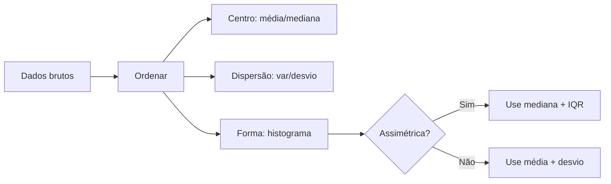

# Estatística Descritiva do Zero

> Medias, medianas y variantes cuentan una historia que una tabla esconde para aprender a extraer a los semipandas.

**Type:** Build
**Languages:** Python
**Prerequisites:** None
**Time:** ~60 minutes

## Objetivos de aprendizaje

- Calculación media, media, moda, variancia, desvio-padrão e quartis usando apenas stdlib
- Construir un histograma e boxplot en texto/ASCII antes de utilizar el matplotlib
- Detectar valores excepcionales con el coeficiente intelectual y el z-score y explicar cuando cada error ocurre
- Comparar una distribución empírica con una asimetría interpretativa normal y corta

## El problema

Usted recibe un CSV con 10.000 salarios.$ 8.500, mas 70% das pessoas ganham menos que isso. Por quê? Um único CEO com R$Si usted reporta sólo a un medio, no quiero.

En ciencias de los datos, resumir los datos como una métrica sólo es un error más común y más caro. Antes de cualquier modelo, usted necesita describir: donde está o centro, cuanto los datos se distribuyen, como una forma de distribución.

## El concepto

### Centro: media vs mediana vs moda

```
dados = [2, 3, 3, 5, 500]
média   = (2+3+3+5+500)/5 = 102.6  <- sensível a outlier
mediana = valor do meio ordenado = 3  <- robusta
moda    = valor mais frequente = 3
```

Regra: distribución simétrica -> media ~= mediana. Assimétrica a direita -> media > mediana (caso salaria).

### Dispersão: variância e desvio-padrão

```
variância = média((x - média)^2)
desvio    = sqrt(variância)
```

Desvio responde: "en media, ¿cuánto se afasta cada punto del centro?"

### Cuartis e IQR (robusto)

El orden de datos. Q1 = percentil 25, Q2 = mediana, Q3 = percentil 75.
El RIC = Q3 - Q1 (amplitud de 50% de centrais).

Regra de Tukey para los valores excepcionales:
```
limite_inf = Q1 - 1.5*IQR
limite_sup = Q3 + 1.5*IQR
```

### Punto de Z (parámétrico)

```
z = (x - média) / desvio
```
|z| > 3 = candidato a outlier, mas assume distribuição ~normal. Em dados assimétricos, IQR é melhor.



```figure
stats-descriptive-overview
```

## Construye el mismo

### Paso 1: Centros estadísticos y dispersión de cero

```python
import math

def mean(data):
    return sum(data) / len(data)

def median(data):
    s = sorted(data)
    n = len(s)
    mid = n // 2
    return s[mid] if n % 2 == 1 else (s[mid-1] + s[mid]) / 2

def variance(data, sample=False):
    m = mean(data)
    div = len(data) - 1 if sample else len(data)
    return sum((x - m)**2 for x in data) / div

def std(data, sample=False):
    return math.sqrt(variance(data, sample))

def mode(data):
    freq = {}
    for x in data:
        freq[x] = freq.get(x, 0) + 1
    return max(freq, key=freq.get)

data = [2, 3, 3, 5, 500]
print(f"média={mean(data):.1f} mediana={median(data)} moda={mode(data)} std={std(data):.1f}")
```

### Paso 2: Cuartis e RIC

```python
def percentile(data, p):
    s = sorted(data)
    k = (len(s)-1) * p / 100
    f = math.floor(k)
    c = math.ceil(k)
    if f == c:
        return s[int(k)]
    return s[f] * (c - k) + s[c] * (k - f)

def quartiles(data):
    return percentile(data, 25), percentile(data, 50), percentile(data, 75)

def iqr(data):
    q1, _, q3 = quartiles(data)
    return q3 - q1

q1, q2, q3 = quartiles([1,2,3,4,5,6,7,8,9,100])
print(f"Q1={q1} Q2={q2} Q3={q3} IQR={iqr([1,2,3,4,5,6,7,8,9,100])}")
# outlier: 100 > Q3+1.5*IQR ?
```

### Paso 3: Histograma ASCII

```python
def histogram(data, bins=5):
    lo, hi = min(data), max(data)
    width = (hi - lo) / bins
    counts = [0]*bins
    for x in data:
        idx = min(int((x - lo) / width), bins-1) if width else 0
        counts[idx] += 1
    for i, c in enumerate(counts):
        bar = "#" * c
        print(f"{lo + i*width:6.1f} | {bar} ({c})")

histogram([1,1,2,2,2,3,3,5,8,9], bins=4)
```

## Usalo

Incluso cálculo com `numpy`- ¿ Qué ?`statistics`¿Qué es esto ?

```python
import statistics
import numpy as np

data = [2, 3, 3, 5, 500]
print(statistics.mean(data), statistics.median(data), statistics.stdev(data))
print(np.mean(data), np.median(data), np.std(data, ddof=0))
print(np.percentile(data, [25,50,75]))
# histograma real
# import matplotlib.pyplot as plt
# plt.hist(data, bins=10); plt.show()
```

Su código de hacer cero y numpy debe bater en la segunda casa decimal.

## Envío

Artefato: `outputs/skill-estatistica-descritiva.md` Lista de control para todo EDA: "antes de entrenamiento, reporte media/mediana, desvio/IQR, histograma e % de valores excepcionales".

## Los ejercicios

1. Gere 1000 amostras de`exp(λ=1)`¿Por qué difieren?
2. Implementar asimetría (skew) = E[(x-média) ^3]/desvio^3 sem libs.
3. ¿Cuántos valores extraños pierdes?

## Términos clave

| Term | O que dizem | O que realmente é |
|---|---|---|
| Média | "valor típico" | Soma/n, sensível a outliers; só típica se distribuição simétrica |
| Mediana | "meio dos dados" | Valor que corta 50% abaixo/acima; robusta |
| Desvio-padrão | "erro médio" | Raiz da variância; distância típica até a média |
| IQR | "caixa do boxplot" | Q3-Q1; amplitude dos 50% centrais |
| Z-score | "quantos desvios" | (x-média)/desvio; assume normalidade |
| Outlier | "ponto estranho" | Observação além de Q3+1.5*IQR ou |z|>3 |

## Leer más

- [Seeing Theory — Descriptive Stats](https://seeing-theory.brown.edu/) Interativo visual
- [NIST Engineering Statistics Handbook](https://www.itl.nist.gov/div898/handbook/) referencia
- [SciPy stats docs](https://docs.scipy.org/doc/scipy/reference/stats.html) para la producción
