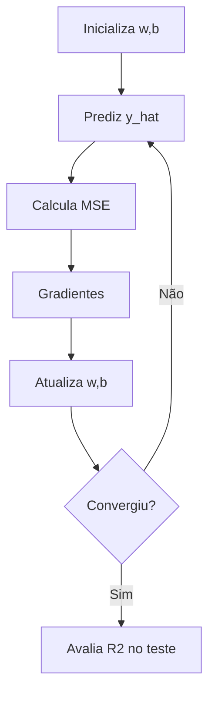

# Regresão Linear do Zero

> Antes de aprender, usted escribe o gradiente a mano y entiende por qué una reta se mueve.

**Type:** Build
**Languages:** Python
**Prerequisites:** 01-estatistica-descritiva, 02-limpeza-e-eda
**Time:** ~75 minutes

## Objetivos de aprendizaje

- Derivar o gradiente del MSE para`y=wx+b`El regreso lineal de la implementación es de cero
- El curso de formación con gradiente descendente y comparación con una ecuación normal
- Computación de diagnóstico y de exámenes
- Estender para regreso múltiple y entender la escala

## El problema

Prever precio de inmueble dado tamanho. Sem regreso usted cae. Con regreso usted aprende un reta que minimiza o error cuadrático. É o "hola mundo" que introduce todo o ciclo de ML: modelo → costo → optimización.

## El concepto

Modelo: `y = wx + b`. Custo MSE: `(1/n) sum(y_hat - y)^2`¿ Qué ?
Gradientes: `dw = (2/n) sum((y_hat-y)x)`¿ Qué ?`db = (2/n) sum(y_hat-y)`¿ Qué ?
Actualización: `w -= lr*dw`¿ Qué ?

Equación normal: `w = (X^T X)^{-1} X^T y` solución fechada, O(n3) em características.

R2 = 1 - SS_res/SS_tot (quanto da variância é explicada).



```figure
linear-regression-fit
```

## Construye el mismo

Ver `code/main.py`¿ Qué es esto ?`LinearRegression`Com `fit`¿ Qué ?`predict`¿ Qué ?`r2`Incluye varias visitas de la Ridge.

## Usalo

```python
from sklearn.linear_model import LinearRegression
model = LinearRegression().fit(X_train, y_train)
print(model.coef_, model.intercept_, model.score(X_test, y_test))
```

## Envío

`outputs/skill-regressao.md`Cuando usamos la gradiente frente a lo normal, cuando escalamos, cuando regularizamos.

## Los ejercicios

1. Implementar SGD vs. GD de lote.
2. Las pruebas de grado 10 en los cuadráticos se muestran sobreajustadas.
3. Implementar la cuesta (L2).

## Términos clave

| Term | Significado |
|---|---|
| MSE | Erro quadrático médio |
| R² | Variância explicada |
| Learning rate | Passo do gradiente |
| Scaling | Padronizar para convergir |

## Leer más

- [ISLR cap 3](https://www.statlearning.com/)
- [CS229 notes](https://cs229.stanford.edu/main_notes.pdf)
