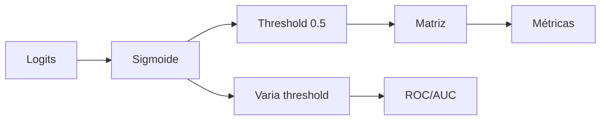

# Clasificación y evaluación

> La precisión de los datos desequilibrados es precisa, recuerda el ROC.

**Type:** Build
**Languages:** Python
**Prerequisites:** 03-regressao-do-zero
**Time:** ~70 minutes

## Objetivos de aprendizaje

- Regreso logístico con sigmoide e entropia cruzada do zero
- Construir matriz de confusión e derivar acurácia, precisión, recuerdo, F1
- Traçar curva ROC y calcular AUC manualmente
- Escoger el umbral óptimo y explicar la precisión de compensación frente al retiro

## El problema

El modelo con un 95% de precisión parece óptimo hasta descubrir que el 95% de los casos son negativos y siempre prevén negativo.

## El concepto

Sigmoide: `σ(z)=1/(1+e^-z)`, mapeia para (0,1).
Custo: BCE = -[y log(p) + (1-y) log(1-p)].
Gradiente: `dw = (1/n) sum((p-y)x)`¿ Qué ?

Matriz:
```
        Pred 0  Pred 1
Real 0   TN      FP
Real 1   FN      TP
```
Precisão = TP/(TP+FP), Recall = TP/(TP+FN), F1 = 2PR/(P+R.

ROC: variable de umbral 0→1, plota TPR vs FPR. AUC = área sob curva.



```figure
roc-curve
```

## Construye el mismo

```python
def sigmoid(z): return 1/(1+math.exp(-z))
def bce(y,p): return -(y*math.log(p+1e-15)+(1-y)*math.log(1-p+1e-15))
# treino: p=sigmoid(w*x+b), erro=p-y
```

Ver `code/main.py`- ¿Qué?

## Usalo

```python
from sklearn.linear_model import LogisticRegression
from sklearn.metrics import classification_report, roc_auc_score
model = LogisticRegression().fit(X_train, y_train)
print(classification_report(y_test, model.predict(X_test)))
print(roc_auc_score(y_test, model.predict_proba(X_test)[:,1]))
```

## Envío

`outputs/skill-avaliacao.md` guía de métricas por caso de uso.

## Los ejercicios

1. Mude el umbral para maximizar F1.
2. Simulo desequilibrio 95/5 e comparación de acurácia vs F1.
3. Implemente el CV de doble k.

## Términos clave

| Term | Definição |
|---|---|
| Precisão | Fração de positivos previstos que são reais |
| Recall | Fração de positivos reais capturados |
| F1 | Média harmônica P/R |
| AUC | Probabilidade de ordenar positivo acima de negativo |

## Leer más

- [Google ML — Classification](https://developers.google.com/machine-learning/crash-course/classification)
- [Sklearn metrics](https://scikit-learn.org/stable/modules/model_evaluation.html)
