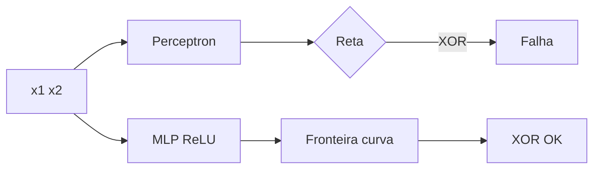

# Percepción y aprendizaje profundo hace cero

> De una línea que separa puntos hasta una red que aprende todo lo que se necesita.

**Type:** Build
**Languages:** Python
**Prerequisites:** 03-regressao-do-zero, 04-classificacao-e-avaliacao
**Time:** ~80 minutes

## Objetivos de aprendizaje

- Implementar la "regla de Rosenblatt" y probar la convergencia/divergencia
- Estender para MLP com ReLU/sigmoide, manual de apoyo hacia adelante y hacia atrás
- Formación con gradiente descendente y comparación`torch.nn.Linear`
- Visualizar la frontera de decisión y explicar por qué no se percibe la falta de RSI

## El problema

El aprendizaje profundo emplea redes (camadas) + no linearidades (ReLU) para crear fronteras curvas.

## El concepto

Perceptron: `y = sign(w·x + b)`, actualización: `w += lr*(y_true - y_pred)*x`¿ Qué ?

Limite: sólo separar linealmente.

MLP 1 oculta: `h=ReLU(W1 x + b1)`¿ Qué ?`y=sigmoid(W2 h + b2)`- Derivados de encadenadas de la espalda.

ReLU: `max(0,z)` gradiente 1 se z> 0, en caso contrario.



```figure
perceptron-vs-mlp
```

## Construye el mismo

Ver `code/main.py`El sistema de detección de la velocidad de la velocidad de la velocidad de la velocidad de la velocidad de la velocidad de la velocidad de la velocidad de la velocidad de la velocidad de la velocidad de la velocidad de la velocidad de la velocidad de la velocidad de la velocidad de la velocidad de la velocidad de la velocidad de la velocidad de la velocidad de la velocidad de la velocidad de la velocidad de la velocidad de la velocidad de la velocidad de la velocidad de la velocidad de la velocidad de la velocidad de la velocidad de la velocidad de la velocidad de la velocidad de la velocidad de la velocidad de la velocidad de la velocidad de la velocidad de la velocidad de la velocidad de la velocidad de la velocidad de la velocidad de la velocidad de la velocidad de la velocidad de la velocidad de la velocidad de la velocidad de la velocidad de la velocidad de la velocidad de la velocidad de la velocidad de la velocidad de la velocidad de la velocidad de la velocidad de la velocidad de la velocidad de la velocidad de la velocidad de la velocidad de la velocidad de la velocidad de la velocidad de la velocidad de la velocidad de la velocidad de la velocidad de la velocidad de la velocidad de la velocidad de la velocidad de la velocidad de la velocidad de la velocidad de la velocidad de la velocidad de la velocidad de la velocidad de la velocidad de la velocidad de la velocidad de la velocidad de la velocidad de la velocidad de la velocidad de la velocidad de la velocidad de la velocidad de la velocidad de la velocidad de la velocidad de la velocidad de la velocidad de la velocidad de la velocidad de la velocidad de la velocidad de la velocidad de la velocidad de la velocidad de la velocidad de la velocidad de la velocidad de la velocidad de la velocidad de la velocidad de la velocidad de la velocidad de la velocidad de la velocidad de la velocidad de la velocidad de la velocidad de la velocidad de la velocidad de la velocidad de la velocidad de la velocidad de la velocidad de la velocidad de la velocidad de

## Usalo

```python
import torch
model = torch.nn.Sequential(torch.nn.Linear(2,8), torch.nn.ReLU(), torch.nn.Linear(8,1), torch.nn.Sigmoid())
# treino com torch.optim.SGD
```

El MLP no debe tener una precisión de menos del 5% sin RSI.

## Envío

`outputs/skill-perceptron.md`Cuando se usa lineal vs MLP, como debugar frontera.

## Los ejercicios

1. Muestras que no se perciben convergen en XOR (prueba).
2. ¿Qué pasa si no se entrena?
3. Adicione 2a camada oculta y meça ganho.

## Términos clave

| Term | Definição |
|---|---|
| Perceptron | Classificador linear com update erro-dirigido |
| ReLU | max(0,z) |
| Backprop | Regra da cadeia para gradientes |
| XOR | Problema não-linear que exige oculta |

## Leer más

- [Rosenblatt 1958 — Perceptron](https://psycnet.apa.org/record/1959-09865-001)
- [3Blue1Brown — Neural Networks](https://www.3blue1brown.com/topics/neural-networks)
- [PyTorch basics](https://pytorch.org/tutorials/beginner/basics/intro.html)
