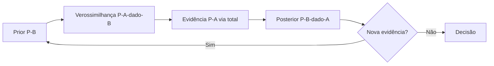

# Probabilidad de la situación: Condicional, Total y Bayes

> ¿Cuál es la probabilidad real de que estés enfermo?

**Type:** Build
**Languages:** Python
**Prerequisites:** 01-estatistica-descritiva
**Time:** ~60 minutes

## Objetivos de aprendizaje

- Calculación de la probabilidad condicional P  A  B) y la independencia de la prueba con una regla del producto
- Aplicar la ley de probabilidad total para la descomposición de un evento en escenarios mutuamente exclusivos
- Derivar y aplicar el teorema de Bayes para inverter condicionales (teste médico, spam, churn)
- Construir un FPM discreta do zero y calcular la esperanza y la variancia de los libs

## El problema

Una prueba de enfermedad rara tiene un 99% de sensibilidad y un 95% de especificidad. Una enfermedad que alcanza a 1 de cada 1000 personas. Su prueba es positiva. ¿Cuál es la probabilidad de que esté enfermo?

El error es confundir P (positivo) con P (doente) con P (doente) se llama falácia da taxa-base, aparece en churn, fraude, spam y cualquier clasificador con clase rara.

## El concepto

### Probabilidad condicional

```
P(A|B) = P(A ∩ B) / P(B),  com P(B) > 0
```

Leia: "la probabilidad de que B haya ocurrido" restringe el universo a los casos en que B ocurrió.

Ejemplo: dado justo, B = "saiu par" {2,4,6}, A = "saiu 6".

### Independencia

A e B são independentes se o conhecimento de B não muda a chance de A:

```
P(A|B) = P(A)  <=>  P(A ∩ B) = P(A) · P(B)
```

Dos lanzamientos de moneda: cara no 2o, cara no 1o = 1/2 = cara. independientes. mas "chover" y "levar guarda-chuva" no son.

### Leí da probabilidad total

Se B1..Bn particionam o espacio (mutuamente exclusivos, cobrem todo):

```
P(A) = Σ P(A|Bi) · P(Bi)
```

Exemplo: P positivo) = P positivo que sea saludable) P doente) + P positivo que sea saludable) P saudável).

### Teorema de Bayes

Inverte a condicional combinando como dos fórmulas anteriores:

```
P(B|A) = P(A|B) · P(B) / P(A)
```

Test médico: P(No se hace ningún trabajo positivo) = 0,99·0,001 / (0,99·0,001 + 0,05·0,999) ≈ 0,0194 ≈ 2%.



```figure
stats-probability-bayes
```

## Construye el mismo

### Paso 1: Condicional e independencia hacer cero

```python
def cond_prob(p_ab, p_b):
    if p_b <= 0:
        raise ValueError("P(B) deve ser > 0")
    return p_ab / p_b

def joint_if_independent(p_a, p_b):
    return p_a * p_b

def is_independent(p_a, p_b, p_ab, tol=1e-9):
    return abs(p_ab - p_a * p_b) <= tol

print(cond_prob(1/6, 3/6))          # 0.333: P(6 | par)
print(is_independent(0.5, 0.5, 0.25))  # True: duas moedas
```

### Paso 2: Probabilidad total

```python
def total_prob(cond_probs, priors):
    # cond_probs[i] = P(A|Bi), priors[i] = P(Bi)
    if abs(sum(priors) - 1.0) > 1e-9:
        raise ValueError("priors devem somar 1")
    return sum(c * p for c, p in zip(cond_probs, priors))

p_pos = total_prob([0.99, 0.05], [0.001, 0.999])
print(f"P(positivo) = {p_pos:.4f}")  # ~0.0509
```

### Paso 3: Bayes + PMF, esperanza y variancia

```python
def bayes(p_a_given_b, p_b, p_a):
    return p_a_given_b * p_b / p_a

print(f"P(doente|+) = {bayes(0.99, 0.001, p_pos):.4f}")  # ~0.0194

def pmf(values, probs):
    if abs(sum(probs) - 1.0) > 1e-9:
        raise ValueError("probs devem somar 1")
    return dict(zip(values, probs))

def expected_value(d):
    return sum(x * p for x, p in d.items())

def variance_dist(d):
    mu = expected_value(d)
    return sum(((x - mu) ** 2) * p for x, p in d.items())

dado = pmf([1,2,3,4,5,6], [1/6]*6)
print(expected_value(dado), variance_dist(dado))  # 3.5, ~2.917
```

## Usalo

O mesmo cálculo com`fractions`(exato) o contagem empírica:

```python
from fractions import Fraction

# Bayes exato com frações
p = Fraction(99,100) * Fraction(1,1000) / (
    Fraction(99,100)*Fraction(1,1000) + Fraction(5,100)*Fraction(999,1000))
print(p, float(p))  # ~0.0194

# Verificação empírica por simulação (lei dos grandes números)
import random
random.seed(0)
n = 200_000
doente_pos = sum(1 for _ in range(n)
                 if random.random() < 0.001 and random.random() < 0.99)
saud_pos = sum(1 for _ in range(n)
               if random.random() >= 0.001 and random.random() < 0.05)
print(doente_pos / (doente_pos + saud_pos))  # ~0.02
```

La simulación y la fórmula deben estar de acuerdo en la casa decimal con n grande.

## Envío

Artefato: `outputs/skill-probabilidade.md` lista de verificación "cuando se inverta una condición, se declara previo, verosimilaráncia e evidencia antes de concluir".

## Los ejercicios

1. El filtro de spam marca el 98% de los spam y el 2% de los no spam. ¿Si el 30% de los correos electrónicos son spam, ¿qué tipo de spam se comercializa?`bayes()`¿ Qué ?
2. Prove con código que P  A  B  = P  B  A                                                                                                                                                                                                                                                    
3. Construir un FPM de "soma de dos dados" y calcular la esperanza y la varianza con`expected_value()`El`variance_dist()`¿ Qué ?

## Términos clave

| Term | O que dizem | O que realmente é |
|---|---|---|
| Condicional P(A\|B) | "chance de A se B" | P(A∩B)/P(B); restringe o universo a B |
| Independência | "sem relação" | P(A∩B)=P(A)·P(B); saber B não muda A |
| Probabilidade total | "média ponderada" | P(A)=Σ P(A\|Bi)·P(Bi) sobre partição |
| Teorema de Bayes | "inverter a pergunta" | P(B\|A)=P(A\|B)·P(B)/P(A) |
| PMF | "tabela de chances" | P(X=x) para cada valor discreto; soma 1 |
| Esperança | "média teórica" | Σ x·P(x); para onde a média amostral converge |

## Leer más

- [Seeing Theory — Probability](https://seeing-theory.brown.edu/) Interativo visual
- [Stat Trek: Bayes Theorem](https://stattrek.com/probability/bayes-theorem) referencia con ejemplos
- [Python `fractions` docs](https://docs.python.org/3/library/fractions.html) cálculo exato para la producción
