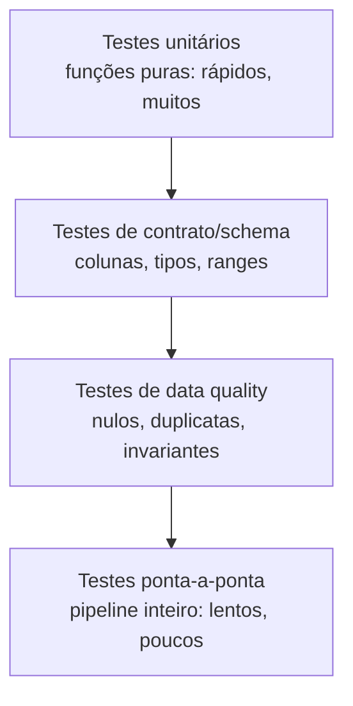

# Codificación y pruebas limpias para la ciencia de datos

> El libro de notas rodó su máquina y se descompuso en la producción y aprendió un análisis exploratorio transformador en el tubo de ensayo.

**Type:** Build
**Languages:** Python
**Prerequisites:** 01-estatistica-descritiva, 02-limpeza-e-eda
**Time:** ~60 minutes

## Objetivos de aprendizaje

- Explicar por qué cuadernos quebram en producción (estado oculto, ejecución fora de orden, dependencias implícitas)
- Refactorar un portátil monolítico en tubería modular con funciones puras e contratos de esquema
- Aplicar el RRS, DRY y validación en el código de datos de la oficina de administración
- Los testes de calidad de los datos (esquema, nulos, rangos, invariantes)
- Interpretación de un pirámide de testes aplicado en un DS: unidades rápidas, contrato/esquema, ponta-a-ponta lentos

## El problema

El colega ejecuta "Run All" en la célula 7: una variable fue sobrescrita en la célula 12 ejecutada de forma ordenada, una columna`idade`Vienes como una cuerda`"32"`En vez de int, e um `dropna()`En la producción, el programa de trabajo fallece a medianoche como mensaje útil.

Los libros de notas optimizan la exploración, no repetición. Estado global mutável, células ejecutadas fuera de orden y tipos implícitos de vuelta o resultado no determinístico. O costo aparece después: retrabalho, modelo entrenado con datos corrompidos, decisión errada. A salida é tratar código de datos como software: funciones pequeñas, entradas validadas, comportamiento probado.

## El concepto

### Funções puras: misma entrada, misma salida

Una función pura no es ni se escribe global, no depende del orden de ejecución:

```python
# impuro: depende de global e muta o argumento
THRESHOLD = 18
def filtrar_adultos(rows):
    return [r for r in rows if r["idade"] >= THRESHOLD]  # quebra se idade for str

# puro: dependências explícitas, sem mutação
def filtrar_adultos(rows, idade_minima=18):
    return [{**r} for r in rows if int(r["idade"]) >= idade_minima]
```

Regras prácticas: un verbo por función (`load`¿ Qué ?`validate`¿ Qué ?`clean`¿ Qué ?`featurize`), como I/O no medio do pipeline (I/O só nas bordas), retorno novo em vez de mutar.

### SOLID em versão DS (solo que importa aquí)

- **S — Single Responsibility:** `validate_schema()`valida, `clean()`Nunca estamos juntos.
- **D — Dependency Inversion (na prática):**Una etapa recibe o que precisa por parámetro (línea, columnas), no importa global.
- **Contrato na borda:**El mensaje que se transmite en línea y en columna es un mensaje que se transmite rápidamente.

### Pirámide de testículos para dados



Una base (unitarios + esquema) se ejecuta en segundos a cada uno de los compromisos.

```figure
clean-code-pipeline-overview
```

## Construye el mismo

### Paso 1: Representar una tabla como lista de dictados y el esquema de validez

Sem pandas: cada línea é um `dict`, una tabla es una`list[dict]`¿ Qué ?

```python
SCHEMA = {
    "nome": str,
    "idade": int,   # aceita "32" conversível
    "salario": float,
}

def validate_schema(rows, schema):
    errors = []
    for i, row in enumerate(rows):
        for col, tipo in schema.items():
            if col not in row:
                errors.append(f"linha {i}: coluna ausente '{col}'")
                continue
            try:
                tipo(row[col])
            except (ValueError, TypeError):
                errors.append(f"linha {i}: '{col}'={row[col]!r} não converte para {tipo.__name__}")
    return errors
```

### Paso 2: Componencias modulares de tuberías

```python
def clean_rows(rows):
    out = []
    for r in rows:
        novo = {"nome": str(r["nome"]).strip(), "idade": int(r["idade"]), "salario": float(r["salario"])}
        if novo["idade"] >= 0 and novo["salario"] >= 0:
            out.append(novo)
    return out

def featurize(rows):
    return [{**r, "adulto": r["idade"] >= 18} for r in rows]

def run_pipeline(rows):
    errors = validate_schema(rows, SCHEMA)
    if errors:
        raise ValueError("schema inválido:\n" + "\n".join(errors[:5]))
    return featurize(clean_rows(rows))
```

### Paso 3: Pruebas de calidad de los datos

```python
def check_quality(rows):
    checks = {
        "sem_nulos": all(v is not None and v != "" for r in rows for v in r.values()),
        "idades_validas": all(0 <= r["idade"] <= 120 for r in rows),
        "sem_duplicatas": len({(r["nome"], r["idade"]) for r in rows}) == len(rows),
    }
    return checks
```

Cada cheque vuelve a un nombre booleano: cuando falla, sabe exactamente cuál es la quebrada invariante.

## Usalo

O mesmo padrão com a biblioteca de producción (`pandera`para esquemas, `pytest`Como corredor:

```python
# import pandera.pandas as pa
# import pandas as pd
# from pandera import Column, DataFrameSchema, Check
#
# schema = DataFrameSchema({
#     "nome": Column(str),
#     "idade": Column(int, Check.between(0, 120)),
#     "salario": Column(float, Check.ge(0)),
# })
# df = pd.DataFrame([{"nome": "ana", "idade": 30, "salario": 5000.0}])
# print(schema.validate(df))
# # pytest: mesmos asserts do unittest, com fixtures e mensagens melhores
```

Su valido estdlib e `pandera`Deben concordar: línea válida pasa nos dos, línea inválida falha nos dos.

## Envío

Artefato: `outputs/skill-clean-code-ds.md` Lista de verificación para convertir cualquier portátil en línea: "funciones puras, esquema na borda, controles de calidad denominados, testes rápidos embaixo e ponta-a-ponta en cima".

## Los ejercicios

1. Quebre propositalmente: pase `idade="trinta"`y una línea sem `salario`¿Un mensaje de error en la columna?
2. Adicione un cheque`salario_mediano_positivo`¿Por qué vale la inversión de negocios más que la de tipo que prueba?
3. Convirtiendo una función que mude global en función pura (parâmetros explícitos, retorno novo).

## Términos clave

| Term | O que dizem | O que realmente é |
|---|---|---|
| Função pura | "função limpa" | Mesma entrada -> mesma saída, sem global nem mutação; testável em isolamento |
| Schema | "formato dos dados" | Contrato de colunas + tipos; validado na borda, falha rápido |
| Data quality check | "teste de dados" | Invariante nomeado (nulos, ranges, duplicatas) que explica o que quebrou |
| SRP | "uma coisa só" | Cada função/etapa tem um único motivo para mudar |
| Pirâmide de testes | "testar tudo" | Muitos testes rápidos na base (unit/schema), poucos lentos no topo (e2e) |
| Falhe rápido | "validar cedo" | Erro na entrada com mensagem útil em vez de corrupção silenciosa adiante |

## Leer más

- [PEP 8 — Style Guide](https://peps.python.org/pep-0008/) convenciones oficiales
- [unittest docs](https://docs.python.org/3/library/unittest.html) corredor stdlib
- [Pandera docs](https://pandera.readthedocs.io/) validación de esquema en producción
