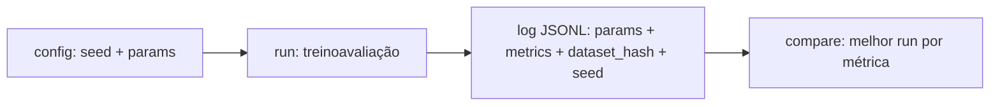

# Reprodutibilidad y seguimiento de experimentos

> "Funcionou ayer" no es un resultado científico  aprende una fixar de semillas, versionar conjuntos de datos y registrar cada ejecución.

**Type:** Build
**Languages:** Python
**Prerequisites:** 01-estatistica-descritiva, 08-clean-code-testes-ds
**Time:** ~60 minutes

## Objetivos de aprendizaje

- Explicar como tres fuentes de no-determinismo: semilla no fijada, conjunto de datos sem versão, hiperparâmetros no registrados
- Semillas fijas de`random`(e `numpy`- ¿ Qué ?`torch`No Use It) para repetir las particiones de los amostrados
- Versión de un conjunto de datos con hash SHA-256 do conteúdo canônico
- Registrador ejecuta (parámetros + métricas + conjunto de datos_hash) em JSONL com stdlib
- Comparar las carreras e escolher o mejor por métrica con función pura

## El problema

¿Has rodado o entrenado dos veces y obtuviste acuradas 0.87 y 0.83 sem mudar nada? ¿Qué reportero? Pior: un mes después, el conjunto de datos fue actualizado, o el cuaderno fue editado, y nadie sabe cuál es la combinación de 0.87.

Se ha fijado la semilla, cada mezcla/dividida/amostragem muda. Se ha hecho un conjunto de datos, no sabe en qué se ha elaborado. Se log de parámetros/metricas, no hay cómo comparar ni auditar.

## El concepto

### Semilla: o ponto de partida do aleatório

Los geradores pseudo-aleatórios son determinísticos dada una semilla:

```python
import random
random.seed(42)
print(random.random())  # sempre 0.6394267984578837
```

Se fija una semilla una vez que no comience (`set_seed(42)`Las semillas diferentes = experimentos diferentes; por lo tanto, una semilla también es un parámetro registrado.

### Versión de conjunto de datos = hash do conteúdo

Nome de arquivo mente (`dados_final_v2_REAL.csv`¿Qué es lo que se dice?

```
versão = sha256(representação_canônica_das_linhas)
```

Dos tablas con el mismo contenido tienen el mismo contenido, un byte.

### Tracker minimalista: una línea JSON por ejecución



Cada registro de ejecución`timestamp`¿ Qué ?`seed`¿ Qué ?`dataset_hash`¿ Qué ?`params`¿ Qué ?`metrics`. El archivo JSONL es sólo un apéndice: histórico imutable, legible por cualquier herramienta.

```figure
reproducibility-tracking-overview
```

## Construye el mismo

### Paso 1: Fija una semilla y cara dividida determinístico

```python
import random

def set_seed(seed):
    random.seed(seed)

def train_test_split(rows, test_ratio=0.2, seed=42):
    rng = random.Random(seed)  # instância local: não polui o global
    idx = list(range(len(rows)))
    rng.shuffle(idx)
    k = int(len(rows) * (1 - test_ratio))
    return [rows[i] for i in idx[:k]], [rows[i] for i in idx[k:]]
```

Semilla de mesma + mismos dados = mesmo dividido, siempre.

### Paso 2: Hash canônico hacer conjunto de datos

```python
import hashlib, json

def dataset_hash(rows):
    canon = json.dumps(rows, sort_keys=True, ensure_ascii=False)
    return hashlib.sha256(canon.encode("utf-8")).hexdigest()[:12]
```

`sort_keys=True`garante orden canónica de las llaves; o prefijo de 12 carros basta como versión legible.

### Paso 3: JSONL de seguimiento

```python
import json, datetime

def log_run(path, params, metrics, seed, dhash):
    record = {
        "timestamp": datetime.datetime.now(datetime.timezone.utc).isoformat(),
        "seed": seed, "dataset_hash": dhash,
        "params": params, "metrics": metrics,
    }
    with open(path, "a", encoding="utf-8") as f:
        f.write(json.dumps(record, ensure_ascii=False) + "\n")
    return record

def load_runs(path):
    with open(path, encoding="utf-8") as f:
        return [json.loads(line) for line in f if line.strip()]

def best_run(runs, metric="accuracy", higher=True):
    return (max if higher else min)(runs, key=lambda r: r["metrics"][metric])
```

## Usalo

O mesmo com una pila de producción (`mlflow`ciudadado, `numpy`para semillas):

```python
# import mlflow, numpy as np
#
# np.random.seed(42)  # além de random.seed(42)
# # import torch; torch.manual_seed(42)
#
# # mlflow.start_run()
# # mlflow.log_params({"lr": 0.01, "seed": 42, "dataset_hash": "abc..."})
# # mlflow.log_metric("accuracy", 0.87)
# # mlflow.end_run()
```

Su rastreador JSONL e o mlflow registram o mesmo contrato: params + metrics + dataset_hash + seed.

## Envío

Artefato: `outputs/skill-reprodutibilidade-tracking.md` lista de control de todo el experimento: "seed fixed e registered, dataset com hash, um JSON por ejecución, mejor ejecución seleccionada por función pura".

## Los ejercicios

1. - ¿ Qué ?`train_test_split`Dos veces con semilla 42 y una con semilla 7. ¿Qué se divide en los idénticos?
2. Mude un valor en un conjunto de datos y recalcule o hash. ¿Qué sucede?`sort_keys=True`¿Qué importa?
3. Logue 3 se ejecuta variando un parámetro, después de usar `best_run`Com `higher=False`Una métrica de error. ¿O vencedor muda?

## Términos clave

| Term | O que dizem | O que realmente é |
|---|---|---|
| Seed | "número mágico" | Estado inicial do gerador pseudo-aleatório; fixa toda a sequência sorteada |
| Dataset hash | "versão dos dados" | SHA-256 do conteúdo canônico; prova em quais dados você treinou |
| Run | "um treino" | Uma execução com seed + params + dataset fixos e métricas registradas |
| JSONL | "log de runs" | Um objeto JSON por linha, append-only; histórico auditável |
| Tracking | "acompanhar modelo" | Registrar params/metrics/versões para comparar e reproduzir |
| Determinismo | "sempre igual" | Mesma seed + mesmos dados + mesmo código = mesmo resultado |

## Leer más

- [MLflow Tracking docs](https://mlflow.org/docs/latest/tracking.html) padrão de producción
- [hashlib docs](https://docs.python.org/3/library/hashlib.html) referencia stdlib
- [NumPy random seed docs](https://numpy.org/doc/stable/reference/random/index.html) semillas en producción
