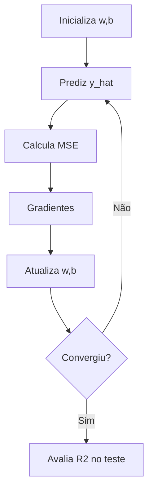

# Regressão خطی صفر

> قبل از اینکه یاد بگیری، باید gradiente a mão را بنویسی و بفهمی که حرکتش رو نگه داری.

**Type:** Build
**Languages:** Python
**Prerequisites:** 01-estatistica-descritiva, 02-limpeza-e-eda
**Time:** ~75 minutes

## اهداف یادگیری

- مشتق یا گرادینت MSE برای`y=wx+b`و بازگشت عملی خطی به صفر
- آموزش با درجه پایین و مقایسه با معادله عادی
- مسافت تشخیصی و بیش از حد مناسب
- استاندار برای بازگشت چندگانه و درک مقیاس بندی

## مشکل

پیش از قیمت مسکن در این مدت، شما به عقب نشینی نمی روید. با عقب نشینی شما یک خطای کوچک را یاد می گیرید که اشتباهات مربع را به حداقل می رساند.

## مفهوم

مدل:`y = wx + b`. کوستو MSE:`(1/n) sum(y_hat - y)^2`. .
درجه بندی: `dw = (2/n) sum((y_hat-y)x)`،`db = (2/n) sum(y_hat-y)`. .
تازه: `w -= lr*dw`. .

معادله ی عادی: `w = (X^T X)^{-1} X^T y` حل فاقد، O(n3) em ویژگی ها.

R2 = 1 - SS_res/SS_tot (quanto da variância é explicada)



```figure
linear-regression-fit
```

## آن را بسازید

ببین`code/main.py`.`LinearRegression`.`fit`،`predict`،`r2`شامل چند تا نسخه پيشين از "ريج" هست

## ازش استفاده کن

```python
from sklearn.linear_model import LinearRegression
model = LinearRegression().fit(X_train, y_train)
print(model.coef_, model.intercept_, model.score(X_test, y_test))
```

## -باده

`outputs/skill-regressao.md`وقتی از گرادینت به نسبت نرمال استفاده می کنیم، وقتی بالا می رسیم، وقتی تنظیم می کنیم.

## تمرینات

1. اجرای SGD در مقابل GD دسته
2. تست درجه 10 در داده های مربع  بیش از حد مناسب است.
3. پیاده سازی ریج (L2).

## اصطلاحات کلیدی

| Term | Significado |
|---|---|
| MSE | Erro quadrático médio |
| R² | Variância explicada |
| Learning rate | Passo do gradiente |
| Scaling | Padronizar para convergir |

## خواندن بیشتر

- [ISLR cap 3](https://www.statlearning.com/)
- [CS229 notes](https://cs229.stanford.edu/main_notes.pdf)
