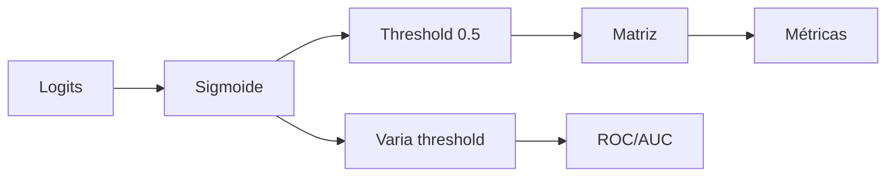

# طبقه بندی و ارزیابی

> دقت در داده های متوازن  شما باید دقت را به یاد داشته باشید ROC.

**Type:** Build
**Languages:** Python
**Prerequisites:** 03-regressao-do-zero
**Time:** ~70 minutes

## اهداف یادگیری

- اجرای بازپسین لوژیستیک com sigmoide e entropia cruzada do zero
- ساخت ماتریز اشتباهات و اخذ دقت، دقت، بازپسین، F1
- تراسر منحنی ROC و محاسبه AUC به صورت دستی
- انتخاب حداکثر حد و توضیح دقیقیت تعویض در مقابل بازپسین

## مشکل

مدل با 95٪ دقت به نظر می رسد بهترین است تا زمانی که متوجه شوید که 95٪ از موارد منفی هستند و همیشه منفی را پیش بینی می کنند.

## مفهوم

سیگمائید: `σ(z)=1/(1+e^-z)`, mapeia para (0,1)
Custo: BCE = -[y log(p) + (1-y) log(1-p)].
درجه بندی:`dw = (1/n) sum((p-y)x)`. .

ماترز:
```
        Pred 0  Pred 1
Real 0   TN      FP
Real 1   FN      TP
```
Precisão = TP/(TP+FP) ، Recall = TP/(TP+FN) ، F1 = 2PR/(P+R).

ROC: محدوده ی 0→1، plota TPR در مقابل FPR. AUC = area sob curve.



```figure
roc-curve
```

## آن را بسازید

```python
def sigmoid(z): return 1/(1+math.exp(-z))
def bce(y,p): return -(y*math.log(p+1e-15)+(1-y)*math.log(1-p+1e-15))
# treino: p=sigmoid(w*x+b), erro=p-y
```

ببین`code/main.py`کامل

## ازش استفاده کن

```python
from sklearn.linear_model import LogisticRegression
from sklearn.metrics import classification_report, roc_auc_score
model = LogisticRegression().fit(X_train, y_train)
print(classification_report(y_test, model.predict(X_test)))
print(roc_auc_score(y_test, model.predict_proba(X_test)[:,1]))
```

## -باده

`outputs/skill-avaliacao.md` راهنمای متریکاس از لحاظ استفاده

## تمرینات

1. حد حد تعویض برای حداکثر F1
2. مثل عدم تعادل 95/5 در مقایسه با دقت و F1.
3. برنامه ی CV را به صورت k-fold اجرا کنید.

## اصطلاحات کلیدی

| Term | Definição |
|---|---|
| Precisão | Fração de positivos previstos que são reais |
| Recall | Fração de positivos reais capturados |
| F1 | Média harmônica P/R |
| AUC | Probabilidade de ordenar positivo acima de negativo |

## خواندن بیشتر

- [Google ML — Classification](https://developers.google.com/machine-learning/crash-course/classification)
- [Sklearn metrics](https://scikit-learn.org/stable/modules/model_evaluation.html)
