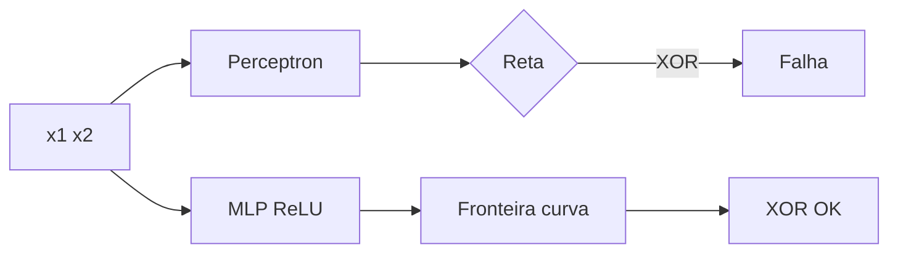

# درک و یادگیری عمیق صفر

> از یک خط که نقاط را به یک خط جدا می کند تا همه چیز را می آموزد.

**Type:** Build
**Languages:** Python
**Prerequisites:** 03-regressao-do-zero, 04-classificacao-e-avaliacao
**Time:** ~80 minutes

## اهداف یادگیری

- اجرای قانون Rosenblatt و اثبات زمانی که متقابل/متغیر است
- استندر برای MLP com ReLU/sigmoide، پیش و پشت دستی
- آموزش و پرورش با درجه پایین و مقایسه با`torch.nn.Linear`
- برقراری برقراری تصمیم گیری و توضیح دادن آن به دلیل درک اشتباهات XOR

## مشکل

بازپسین لوژیستیک به صورت جداگانه. اما داده ها در دایره یا XOR؟ یک ذخیره حل نمی شود. یادگیری عمیق به شبکه ها (کامادا) + غیر خطی (ReLU) برای ایجاد خطوط منحنی کمک می کند. درک یا درک است برای درک عمیق اهمیت.

## مفهوم

پرسپترون:`y = sign(w·x + b)`, تازه: `w += lr*(y_true - y_pred)*x`. .

حد: فقط جدا به صورت خطي XOR تقاضا ميکنه که کماد مخفی باشه

MLP 1 oculta: `h=ReLU(W1 x + b1)`،`y=sigmoid(W2 h + b2)`. مشتق هاي پشت پشت

رلو:`max(0,z)` gradiente 1 se z> 0, 0 در برعکس.



```figure
perceptron-vs-mlp
```

## آن را بسازید

ببین`code/main.py`: perceptron + MLP 2 camadas com backprop numpy.

## ازش استفاده کن

```python
import torch
model = torch.nn.Sequential(torch.nn.Linear(2,8), torch.nn.ReLU(), torch.nn.Linear(8,1), torch.nn.Sigmoid())
# treino com torch.optim.SGD
```

این MLP باید با کمترین دقت 5٪ بدون XOR مطابقت داشته باشد.

## -باده

`outputs/skill-perceptron.md` وقتی از خطی در مقابل MLP استفاده می کنیم، مثل "دیبگ بارتریرا".

## تمرینات

1. نمونه هایی که درک نمی شوند در XOR (دليل) متقابل هستند.
2. تا چه وقت آموزش نداري؟
3. همش هم يه کمدي پنهان و هم ميشا گانو

## اصطلاحات کلیدی

| Term | Definição |
|---|---|
| Perceptron | Classificador linear com update erro-dirigido |
| ReLU | max(0,z) |
| Backprop | Regra da cadeia para gradientes |
| XOR | Problema não-linear que exige oculta |

## خواندن بیشتر

- [Rosenblatt 1958 — Perceptron](https://psycnet.apa.org/record/1959-09865-001)
- [3Blue1Brown — Neural Networks](https://www.3blue1brown.com/topics/neural-networks)
- [PyTorch basics](https://pytorch.org/tutorials/beginner/basics/intro.html)
