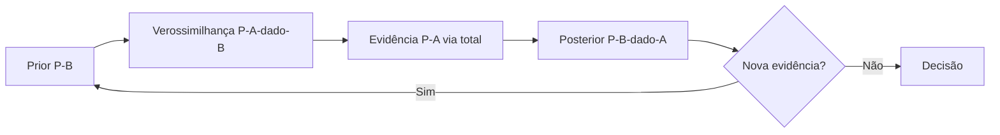

# احتمال صفر: شرایط، کل و بیز

> چه شانس واقعي داري که بيمار باشي؟

**Type:** Build
**Languages:** Python
**Prerequisites:** 01-estatistica-descritiva
**Time:** ~60 minutes

## اهداف یادگیری

- محاسبه احتمال شرط بندی P((B) استقلال آزمون با یک قانون محصول
- اعمال قانون احتمال کل برای تجزیه یک رویداد در سناریوهای متقابل انحصاری
- اخذ و کاربرد نظریه Bayes برای شرایط معکوس (تست پزشکی، اسپم، چرن)
- ساخت یک PMF discreta do zero e محاسبه امید و تفاوت در libs

## مشکل

یک آزمایش بیماری نادر با 99 درصد حساسیت و 95 درصد مشخصیت یک بیماری در هر 1000 نفر رخ می دهد. آزمایش شما مثبت است. چه شانس هایی دارید؟

O instinto diz 99%. A resposta correta é ~2%. O erro  confundir P(positivo dizerdoente) com P(doente dizerpositivo)  se chama falácia da taxa-base, e aparece em churn, fraude, spam e qualquer classificador com classe rara. Sem probabilidade condicional, você interpreta todo modelo errado.

## مفهوم

### احتمال شرط بندی

```
P(A|B) = P(A ∩ B) / P(B),  com P(B) > 0
```

"احتمالي" "بايد اتفاق افتاده"

مثال: dado justo، B = "saiu par" {2,4,6}، A = "saiu 6".

### استقلال

A e B são independentes se o conhecimento de B não muda a chance de A:

```
P(A|B) = P(A)  <=>  P(A ∩ B) = P(A) · P(B)
```

دو شروع به عمل: کار دوم، کار یک، کار نیم، کار مستقل، کار دو، کار دو، کار دو، کار دو، کار دو، کار دو، کار دو، کار دو، کار دو، کار دو، کار دو، کار دو، کار دو، کار دو، کار دو، کار دو، کار دو، کار دو، کار دو، کار دو، کار دو، کار دو، کار دو، کار دو، کار دو، کار دو، کار دو، کار دو، کار دو، کار دو، کار دو، کار دو، کار دو، کار دو، کار دو، کار دو، کار دو، کار دو، کار دو، کار دو، کار دو، کار دو، کار دو، کار دو، کار دو، کار دو، کار دو، کار دو، کار دو، کار دو، کار دو، کار دو، کار دو، کار دو، کار دو، کار دو، کار دو، کار دو، کار دو، کار دو، کار دو، کار دو، کار دو، کار دو، کار دو، کار دو، کار دو، کار دو، کار دو، کار دو، کار دو، کار دو، کار دو، کار دو، کار دو، کار دو، کار دو، کار دو، کار دو، کار دو، کار دو، کار دو، کار دو، کار دو، کار دو، کار دو، کار دو، کار دو، کار دو، کار دو، کار دو، کار دو، کار دو، کار دو، کار دو، کار دو، کار دو، کار دو، کار دو، کار دو، کار دو، کار دو، کار دو، کار دو، کار دو، کار دو، کار دو، کار دو، کار دو، کار دو، کار دو، کار دو، کار دو، کار، کار دو، کار دو، کار دو، کار دو، کار، کار دو، کار دو، کار دو، کار دو، کار، کار دو، کار، کار، کار دو، کار، کار دو، کار دو، کار، کار دو، کار، کار، کار دو، کار، کار، کار دو، کار، کار دو، کار دو، کار، کار، کار، کار، کار دو، کار، کار، کار دو، کار، کار، کار، کار، کار، کار، کار، کار، کار، کار، کار، کار، کار، کار، کار، کار، کار، کار، کار، کار، کار، کار، کار، کار، کار، کار، کار، کار، کار، کار، کار

### لی د احتمالات کل

Se B1..Bn particionam o espaço (به طور انحصاری، همه چیز را به اشتراک می گذاریم):

```
P(A) = Σ P(A|Bi) · P(Bi)
```

مثال: P positivo) = P positivo de fazer o fazer o fazer o fazer o fazer o fazer o fazer o fazer o fazer o fazer o fazer o fazer o fazer o fazer o fazer o fazer o fazer o fazer o fazer o fazer o fazer o fazer o fazer o fazer o fazer o fazer o fazer o fazer o fazer o fazer o fazer o fazer o fazer o fazer o fazer o fazer o fazer o fazer o fazer o fazer o fazer o fazer o fazer o fazer o fazer o fazer o fazer o fazer o fazer o fazer o fazer o fazer o fazer o fazer o fazer o fazer o fazer o fazer o fazer o fazer o fazer o fazer o fazer o fazer o fazer o fazer o fazer o fazer o fazer o fazer o fazer o fazer o fazer o fazer o fazer o fazer o fazer o fazer o fazer o fazer o fazer o fazer o fazer o fazer o fazer o fazer o fazer o fazer o fazer o fazer o fazer o fazer o fazer o fazer o fazer o fazer o fazer o fazer o fazer o fazer o fazer o fazer o fazer o fazer o fazer o fazer o fazer o fazer o fazer o fazer o fazer o fazer o fazer o fazer o fazer o fazer o fazer o fazer o fazer o fazer o fazer o fazer o fazer o fazer o fazer o fazer o fazer o fazer o fazer o fazer o fazer o fazer o fazer o fazer o fazer o fazer o fazer o fazer o fazer o fazer o fazer o fazer o fazer o fazer o fazer o fazer o fazer o fazer o fazer o fazer o fazer o fazer o fazer o fazer o fazer o fazer o fazer o fazer o fazer o fazer o fazer o o o fazer o fazer o o o o o o o fazer o o o fazer o o o o o o o o o o o o o o o o o o o o o o o o o o o o o o o o o o o o o o o o o o o o o o o o o o o o o o o o o o o o o o o o o o o o o o o o o o o o o o o o o o o o o o o o o o o o o o o o o o o o o o o o o o o o o o o o o o o o o o o o o o o o o o o o o o o o o o o o o o o o o o o o o o o o o o o o o o o o

### تئورما دی بایز

این را به عنوان دو فرمول بالا ترکیب کنید:

```
P(B|A) = P(A|B) · P(B) / P(A)
```

تست پزشکی: P  Noente De Positivo) = 0.99·0.001 / (0.99·0.001 + 0.05·0.999) ≈ 0.0194 ≈ 2%.



```figure
stats-probability-bayes
```

## آن را بسازید

### مرحله ی اول: شرط استقلال صفر

```python
def cond_prob(p_ab, p_b):
    if p_b <= 0:
        raise ValueError("P(B) deve ser > 0")
    return p_ab / p_b

def joint_if_independent(p_a, p_b):
    return p_a * p_b

def is_independent(p_a, p_b, p_ab, tol=1e-9):
    return abs(p_ab - p_a * p_b) <= tol

print(cond_prob(1/6, 3/6))          # 0.333: P(6 | par)
print(is_independent(0.5, 0.5, 0.25))  # True: duas moedas
```

### مرحله دوم: احتمالات کل

```python
def total_prob(cond_probs, priors):
    # cond_probs[i] = P(A|Bi), priors[i] = P(Bi)
    if abs(sum(priors) - 1.0) > 1e-9:
        raise ValueError("priors devem somar 1")
    return sum(c * p for c, p in zip(cond_probs, priors))

p_pos = total_prob([0.99, 0.05], [0.001, 0.999])
print(f"P(positivo) = {p_pos:.4f}")  # ~0.0509
```

### مرحله سوم: بایس + PMF, esperança e variância

```python
def bayes(p_a_given_b, p_b, p_a):
    return p_a_given_b * p_b / p_a

print(f"P(doente|+) = {bayes(0.99, 0.001, p_pos):.4f}")  # ~0.0194

def pmf(values, probs):
    if abs(sum(probs) - 1.0) > 1e-9:
        raise ValueError("probs devem somar 1")
    return dict(zip(values, probs))

def expected_value(d):
    return sum(x * p for x, p in d.items())

def variance_dist(d):
    mu = expected_value(d)
    return sum(((x - mu) ** 2) * p for x, p in d.items())

dado = pmf([1,2,3,4,5,6], [1/6]*6)
print(expected_value(dado), variance_dist(dado))  # 3.5, ~2.917
```

## ازش استفاده کن

او mesmo cálculo com`fractions`(exato) ou contagem empírica:

```python
from fractions import Fraction

# Bayes exato com frações
p = Fraction(99,100) * Fraction(1,1000) / (
    Fraction(99,100)*Fraction(1,1000) + Fraction(5,100)*Fraction(999,1000))
print(p, float(p))  # ~0.0194

# Verificação empírica por simulação (lei dos grandes números)
import random
random.seed(0)
n = 200_000
doente_pos = sum(1 for _ in range(n)
                 if random.random() < 0.001 and random.random() < 0.99)
saud_pos = sum(1 for _ in range(n)
               if random.random() >= 0.001 and random.random() < 0.05)
print(doente_pos / (doente_pos + saud_pos))  # ~0.02
```

شبیه سازی و فرمول باید با 2a casa decimal com n grande مطابقت داشته باشد.

## -باده

آرتیفاتو:`outputs/skill-probabilidade.md` چک لیست "هر زمان که یک شرط را تغییر دهید، پیش از آن اعلام کنید، درست است و قبل از پایان".

## تمرینات

1. یک فیلتر اسپام 98 درصد از اسپام ها و 2 درصد از غیر اسپام ها را نشان می دهد. اگر 30 درصد از ایمیل ها اسپام هستند، چه اسپام هایی باید به بازار عرضه شود؟`bayes()`. .
2. ثابت کنید که P  A  B  = P  B                                                                                                                                                                                                                                                       
3. ساخت یک PMF "soma de dos dados" و محاسبه امید و تفاوت`expected_value()`ا`variance_dist()`. .

## اصطلاحات کلیدی

| Term | O que dizem | O que realmente é |
|---|---|---|
| Condicional P(A\|B) | "chance de A se B" | P(A∩B)/P(B); restringe o universo a B |
| Independência | "sem relação" | P(A∩B)=P(A)·P(B); saber B não muda A |
| Probabilidade total | "média ponderada" | P(A)=Σ P(A\|Bi)·P(Bi) sobre partição |
| Teorema de Bayes | "inverter a pergunta" | P(B\|A)=P(A\|B)·P(B)/P(A) |
| PMF | "tabela de chances" | P(X=x) para cada valor discreto; soma 1 |
| Esperança | "média teórica" | Σ x·P(x); para onde a média amostral converge |

## خواندن بیشتر

- [Seeing Theory — Probability](https://seeing-theory.brown.edu/) interativo بصری
- [Stat Trek: Bayes Theorem](https://stattrek.com/probability/bayes-theorem) اشاره به نمونه ها
- [Python `fractions` docs](https://docs.python.org/3/library/fractions.html) محاسبه دقیق برای تولید
