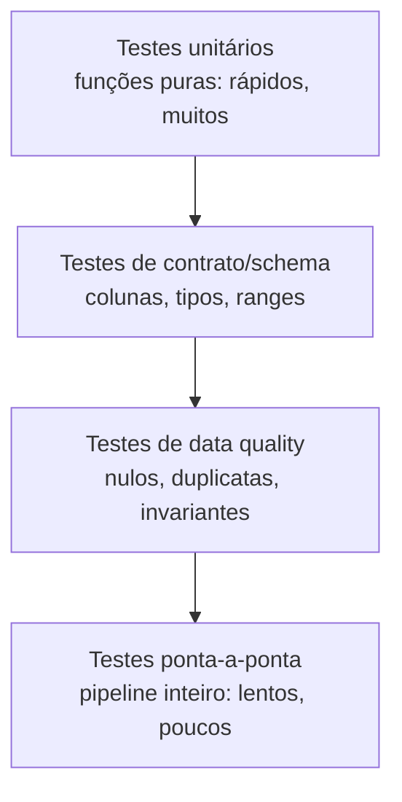

# کد پاک و تست های علوم داده

> در این زمینه، در حال حاضر یک نمونه ی تحقیقی در این زمینه وجود دارد.

**Type:** Build
**Languages:** Python
**Prerequisites:** 01-estatistica-descritiva, 02-limpeza-e-eda
**Time:** ~60 minutes

## اهداف یادگیری

- توضیح اینکه نوتیبها در تولید (استاد مخفی، اجرای امر، وابستگی های ضمنی)
- اصلاح یک دفترچه ی نوتیو مونوولیتیک و یک خط لوله ی ماژولار با عملکردهای خالص و قراردادهای طرح
- اعمال SRP, DRY و اعتبار بر روی کد داده ها
- تست های کیفیت داده (نمونه، صفر، محدوده، متغیر)
- تفسیر یک پيرامیداساساساساساساساساساساساساساساساساساساساساساساساساساساساساساساساساساساساساساساساساساساساساساساساساساساساساساساساساساساساساساساساساساساساساساساساساساساساساساساساساساساساساساساساساساساساساساساساساساساساساساساساساساساساساساساساساساساساساساساساساساساساساساساساساساساساساساساساساساساساساساساساساساساساساساساساساساساساساساساساساساساساساساساساساساساساساساساساساساساساساساساساساساساساساساساساساساساساساساساساساساساساساساساساساساساساساساساساساساساساساساساساساساساساساساساساساساساساساساساساساساساساساساساساساساساساساساساساساساساساساساساساساساساساساساساساساساساساساساساساساساساساساساساساساساساساساساساساساساساساساساساساساساساساساساساساساساساساساساساساساساساساساساساساساساساساساساساساساساساساساساساساساساساساساساساساساساساساساساساساساساساساساساساساساساساساساساساساساساساساساساساساساساساساساساساساساساساساساساساساساساساساساساساساساساساساساساساساساساساساساساساساساساساساساساساساساساساساساساساساساساساساساساساساساساساساساساساساساساساساساساساساساساساساساساساساساساساساساساساساساساساساساساساساساساساساساساساساساساساساساساساساساس

## مشکل

شما یک دفترچه یادداشت را تحویل می دهید که به طور کامل در ماشین خود حرکت می کند. او همکار "Run All" را اجرا می کند و در سلول 7: یک متغیر به صورت زیرنویس در سلول 12 اجرا می شود.`idade`اومدم مثل رشته`"32"`در حال حاضر`dropna()`در تولید، برنامه کاری در نیمه شب به عنوان پیام مفید انجام می شود.

لپ تاپ های بهینه سازی استغراق، تکرار نیست. Estado global mutável، células executadas fora de orden e tipos implícitos tornam o resultado não-determinístico. O custo aparece depois: retrabalho, modelo treinado com dados corrompidos, decisão errada. A saída é tratar código de dados como software: funções pequenas, entradas validadas, comportamento testado.

## مفهوم

### عملکردهای خالص: همان ورود، همان خروج

یک عملکرد خالص نه در سطح جهانی نوشته شده است، نه به ترتیب اجرا بستگی دارد:

```python
# impuro: depende de global e muta o argumento
THRESHOLD = 18
def filtrar_adultos(rows):
    return [r for r in rows if r["idade"] >= THRESHOLD]  # quebra se idade for str

# puro: dependências explícitas, sem mutação
def filtrar_adultos(rows, idade_minima=18):
    return [{**r} for r in rows if int(r["idade"]) >= idade_minima]
```

قوانین عملی: um verbo por função (`load`،`validate`،`clean`،`featurize`، به طور کامل به طور کامل به طور کامل به طور کامل به طور کامل به طور کامل به طور کامل به طور کامل به طور کامل به طور کامل به طور کامل به طور کامل به طور کامل به طور کامل به طور کامل به طور کامل به طور کامل به طور کامل به طور کامل به طور کامل به طور کامل به طور کامل به طور کامل به طور کامل به طور کامل به طور کامل به طور کامل به طور کامل به طور کامل به طور کامل به طور کامل به طور کامل به طور کامل به طور کامل به طور کامل به طور کامل به طور کامل به طور کامل به طور کامل به طور کامل به طور کامل به طور کامل به طور کامل به طور کامل به طور کامل به طور کامل به طور کامل به طور کامل به طور کامل به طور کامل به طور کامل به طور کامل به طور کامل به طور کامل به طور کامل به طور کامل به طور کامل به طور کامل به طور کامل به طور کامل به طور کامل به طور کامل به طور کامل به طور کامل به طور کامل به طور کامل به طور کامل به طور کامل به طور کامل به طور کامل به طور کامل به طور کامل به طور کامل به طور کامل به طور کامل به طور کامل به طور کامل به طور کامل به طور کامل به طور کامل به طور کامل به طور کامل به طور کامل به طور کامل به طور کامل به طور کامل به طور کامل به طور کامل به طور کامل به طور کامل به طور کامل به طور کامل به طور کامل به طور کامل به طور کامل به طور کامل به طور کامل به طور کامل به طور کامل به.

### SOLID em versão DS (فقط اینجا مهم است)

- **S — Single Responsibility:** `validate_schema()`معتبر`clean()`نميتونم با هم دوتا رو ببينم
- **D — Dependency Inversion (na prática):**یک مرحله دریافتی که مشخص است به پارامتر (حرم، ستون ها) ، نه مهم جهانی.
- **Contrato na borda:**یک علامت (لوگو) را در داخل (برگه های موجود، انواع تبدیل) اعمال کنید.

### پیرامید دی تستس برای دانستن



یک پایه (یگان ها + طرح) در ثانیه در هر واحد عمل می کند. یا یک پایپ لاین کامل با داده های واقعی (Topo) در هیچ CI / noturno عمل نمی کند. اگر یک پایه ضعیف باشد، همه اشتباهات تنها در تولید انجام می شود.

```figure
clean-code-pipeline-overview
```

## آن را بسازید

### مرحله ی اول: ارائه یک جدول به عنوان یک لیست و یک طرح معتبر

سِم پاندا: هر خط`dict`، یک جدول است`list[dict]`. .

```python
SCHEMA = {
    "nome": str,
    "idade": int,   # aceita "32" conversível
    "salario": float,
}

def validate_schema(rows, schema):
    errors = []
    for i, row in enumerate(rows):
        for col, tipo in schema.items():
            if col not in row:
                errors.append(f"linha {i}: coluna ausente '{col}'")
                continue
            try:
                tipo(row[col])
            except (ValueError, TypeError):
                errors.append(f"linha {i}: '{col}'={row[col]!r} não converte para {tipo.__name__}")
    return errors
```

### مرحله دوم: کامونسون های ماژولار لوله

```python
def clean_rows(rows):
    out = []
    for r in rows:
        novo = {"nome": str(r["nome"]).strip(), "idade": int(r["idade"]), "salario": float(r["salario"])}
        if novo["idade"] >= 0 and novo["salario"] >= 0:
            out.append(novo)
    return out

def featurize(rows):
    return [{**r, "adulto": r["idade"] >= 18} for r in rows]

def run_pipeline(rows):
    errors = validate_schema(rows, SCHEMA)
    if errors:
        raise ValueError("schema inválido:\n" + "\n".join(errors[:5]))
    return featurize(clean_rows(rows))
```

### مرحله سوم: آزمایش کیفیت داده ها

```python
def check_quality(rows):
    checks = {
        "sem_nulos": all(v is not None and v != "" for r in rows for v in r.values()),
        "idades_validas": all(0 <= r["idade"] <= 120 for r in rows),
        "sem_duplicatas": len({(r["nome"], r["idade"]) for r in rows}) == len(rows),
    }
    return checks
```

هر چک به نام booleano میرسد: وقتی شکست می خورد، دقیقا میدونستی که چه چیزی غیر متغیر است.

## ازش استفاده کن

او mesmo padrão com a biblioteca de produção (`pandera`برای طرح ها`pytest`(که به عنوان دوچرخه)

```python
# import pandera.pandas as pa
# import pandas as pd
# from pandera import Column, DataFrameSchema, Check
#
# schema = DataFrameSchema({
#     "nome": Column(str),
#     "idade": Column(int, Check.between(0, 120)),
#     "salario": Column(float, Check.ge(0)),
# })
# df = pd.DataFrame([{"nome": "ana", "idade": 30, "salario": 5000.0}])
# print(schema.validate(df))
# # pytest: mesmos asserts do unittest, com fixtures e mensagens melhores
```

شما اعتبار دارین`pandera`باید موافق: خط معتبر از دو عبور کند، خط ناقص از دو عبور کند.

## -باده

آرتیفاتو:`outputs/skill-clean-code-ds.md` چک لیست برای تبدیل هر یک از لپ تاپ های خط خط: "funkções puras, schema na board, quality checks nomeados, tests rápidos embaixo e ponta-a-ponta em cima".

## تمرینات

1. Quebre propositalmente: گذران`idade="trinta"`و در خط`salario`. پیام خطا در خط ستون ؟
2. اضافه کردن چک`salario_mediano_positivo`و یک تست که وقتی همه دستمزد ها 0 هستند اشتباه می کند چرا یک متغیر تجاری ارزش بیشتری دارد که از نوع تست استفاده کند؟
3. تبدیل یک عملکرد خود را که تغییر جهانی em função pura (parâmetros explícitos، بازگشت جدید).

## اصطلاحات کلیدی

| Term | O que dizem | O que realmente é |
|---|---|---|
| Função pura | "função limpa" | Mesma entrada -> mesma saída, sem global nem mutação; testável em isolamento |
| Schema | "formato dos dados" | Contrato de colunas + tipos; validado na borda, falha rápido |
| Data quality check | "teste de dados" | Invariante nomeado (nulos, ranges, duplicatas) que explica o que quebrou |
| SRP | "uma coisa só" | Cada função/etapa tem um único motivo para mudar |
| Pirâmide de testes | "testar tudo" | Muitos testes rápidos na base (unit/schema), poucos lentos no topo (e2e) |
| Falhe rápido | "validar cedo" | Erro na entrada com mensagem útil em vez de corrupção silenciosa adiante |

## خواندن بیشتر

- [PEP 8 — Style Guide](https://peps.python.org/pep-0008/) کنوانسیون های رسمی
- [unittest docs](https://docs.python.org/3/library/unittest.html) راننده
- [Pandera docs](https://pandera.readthedocs.io/) اعتبار نمودن طرح تولید
