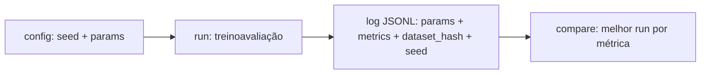

# تولید و پیگیری آزمایشات

> "فانکشنو ایستا" نتیجه علمی نیست.

**Type:** Build
**Languages:** Python
**Prerequisites:** 01-estatistica-descritiva, 08-clean-code-testes-ds
**Time:** ~60 minutes

## اهداف یادگیری

- توضیح به عنوان سه منبع غیر تعیین کننده: دانه های نه ثابت، مجموعه داده های sem version، hyperparâmetros não registrados
- دانه های ثابت`random`(e `numpy`-بله .`torch`استفاده نکنید) برای تکرار تقسیم و نمرات
- نسخه ای از مجموعه داده ها با hash SHA-256 do conteúdo canônico
- register runs (params + metrics + dataset_hash) em JSONL com stdlib
- مقایسه اجرا و انتخاب بهترین برای متریکا com função pura

## مشکل

شما دو بار در حال رانندگی هستید و دقت 0.87 و 0.83 را به دست می آوریم. چه گزارشگر؟ بدتر: یک ماه بعد، یا مجموعه داده ها به روز شده، یا نوت بوک به ویرایش رسیده، و هیچ کس نمی داند که ترکیب شما 0.87 یا 0.87 است. یا "بهترین مدل" به lenda urbana.

بدون محور، هر مخلوط/شکست/نمایش تغییر می کند. بدون محور، شما نمی دانید که از چه داده هایی استفاده می کنید. بدون log de param/metrics، هیچ گونه مقایسه و بررسی وجود ندارد.

## مفهوم

### دانه: o ponto de partida do aleatório

Geradores pseudo-aleatórios são determinísticos به عنوان یک دانه:

```python
import random
random.seed(42)
print(random.random())  # sempre 0.6394267984578837
```

وقتی شروع می شود یک دانه را درست کنید (`set_seed(42)`) و همه نوع پس از تکرار. بیضه های مختلف = آزمایش های مختلف؛ بنابراین یک بیضه نیز یک پارام ثبت شده است.

### Verão de dataset = hash do conteúdo

نام آرکائیو (`dados_final_v2_REAL.csv`) نه:

```
versão = sha256(representação_canônica_das_linhas)
```

دو جدول با همان محتوا، باط یک باط.

### ردیابی minimalista: یک خط JSON به طور اجرا



هر روز ثبت`timestamp`،`seed`،`dataset_hash`،`params`،`metrics`. آرکائیو JSONL فقط به عنوان یک آرکائیو اضافه شده: تاریخی غیر قابل تغییر، قابل خواندن توسط هر ابزار.

```figure
reproducibility-tracking-overview
```

## آن را بسازید

### مرحله ی اول: یک دانه را ثابت کنید و به صورت مشخص تقسیم کنید

```python
import random

def set_seed(seed):
    random.seed(seed)

def train_test_split(rows, test_ratio=0.2, seed=42):
    rng = random.Random(seed)  # instância local: não polui o global
    idx = list(range(len(rows)))
    rng.shuffle(idx)
    k = int(len(rows) * (1 - test_ratio))
    return [rows[i] for i in idx[:k]], [rows[i] for i in idx[k:]]
```

تخم مسما + همان داده ها = mesmo تقسیم، همیشه.

### مرحله 2: hash canônico do مجموعه داده ها

```python
import hashlib, json

def dataset_hash(rows):
    canon = json.dumps(rows, sort_keys=True, ensure_ascii=False)
    return hashlib.sha256(canon.encode("utf-8")).hexdigest()[:12]
```

`sort_keys=True`تضمین دستور قنونیک کلید ها؛ o prefixo de 12 chars basta como versão legible.

### مرحله 3: ردیابی JSONL

```python
import json, datetime

def log_run(path, params, metrics, seed, dhash):
    record = {
        "timestamp": datetime.datetime.now(datetime.timezone.utc).isoformat(),
        "seed": seed, "dataset_hash": dhash,
        "params": params, "metrics": metrics,
    }
    with open(path, "a", encoding="utf-8") as f:
        f.write(json.dumps(record, ensure_ascii=False) + "\n")
    return record

def load_runs(path):
    with open(path, encoding="utf-8") as f:
        return [json.loads(line) for line in f if line.strip()]

def best_run(runs, metric="accuracy", higher=True):
    return (max if higher else min)(runs, key=lambda r: r["metrics"][metric])
```

## ازش استفاده کن

یا حتی با یک دسته تولید (`mlflow`شهر`numpy`برای دانه ها):

```python
# import mlflow, numpy as np
#
# np.random.seed(42)  # além de random.seed(42)
# # import torch; torch.manual_seed(42)
#
# # mlflow.start_run()
# # mlflow.log_params({"lr": 0.01, "seed": 42, "dataset_hash": "abc..."})
# # mlflow.log_metric("accuracy", 0.87)
# # mlflow.end_run()
```

JSONL e o mlflow registram o mesmo contrato: params + metrics + dataset_hash + seed.

## -باده

آرتیفاتو:`outputs/skill-reprodutibilidade-tracking.md` چک لیست تمام آزمایش: "بزرگ ثابت و ثبت شده، مجموعه داده ها با هاش، یک JSON به صورت اجرا، بهترین اجرا به عنوان عملکرد خالص".

## تمرینات

1. عصا`train_test_split`دو بار با تخم 42 و یک بار با تخم 7.
2. تغییر ارزش هیچ مجموعه داده ای و محاسبه مجدد hash.`sort_keys=True`مهمه؟
3. Logue 3 اجرا می کنه با تغییر param، بعد از استفاده`best_run`.`higher=False`تو يه اشتباه بزرگي داري، يا پيروز مرد؟

## اصطلاحات کلیدی

| Term | O que dizem | O que realmente é |
|---|---|---|
| Seed | "número mágico" | Estado inicial do gerador pseudo-aleatório; fixa toda a sequência sorteada |
| Dataset hash | "versão dos dados" | SHA-256 do conteúdo canônico; prova em quais dados você treinou |
| Run | "um treino" | Uma execução com seed + params + dataset fixos e métricas registradas |
| JSONL | "log de runs" | Um objeto JSON por linha, append-only; histórico auditável |
| Tracking | "acompanhar modelo" | Registrar params/metrics/versões para comparar e reproduzir |
| Determinismo | "sempre igual" | Mesma seed + mesmos dados + mesmo código = mesmo resultado |

## خواندن بیشتر

- [MLflow Tracking docs](https://mlflow.org/docs/latest/tracking.html) تولیدات
- [hashlib docs](https://docs.python.org/3/library/hashlib.html) استناد
- [NumPy random seed docs](https://numpy.org/doc/stable/reference/random/index.html) دانه ها در تولید
