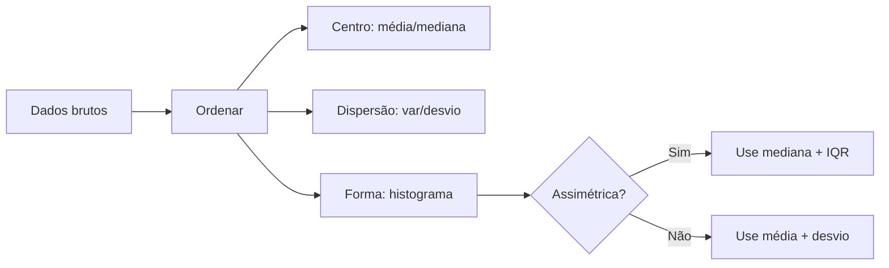

# Statística Descritiva do Zero est une technique de calcul de la valeur de l'argent.

> La médiane et la variance racontent une histoire qu'une table cache à l'apprenant d'une extra-la sem panda.

**Type:** Build
**Languages:** Python
**Prerequisites:** None
**Time:** ~60 minutes

## Objectifs d'apprentissage

- Calculer média, médiana, moda, variância, desvio-padrão e quartis en utilisant seulement stdlib
- Construire un historiogramme et un boxplot en texte/ASCII avant d'utiliser un matplotlib
- Détecter des valeurs inhabituelles avec le score IQR et l'expliquer lorsque chaque erreur
- Comparer une distribution empirique à une normale et interprétation équivalente et courte

## Le problème

Vous recevez un CSV avec 10 000 salaires.$ 8.500, mas 70% das pessoas ganham menos que isso. Por quê? Um único CEO com R$Si vous ne faites que des reportages, vous ne voulez pas.

En science des données, résumer les données comme une métrique est l'erreur la plus commune et la plus chère.

## Le concept

### Centre: médias vs médiana vs moda

```
dados = [2, 3, 3, 5, 500]
média   = (2+3+3+5+500)/5 = 102.6  <- sensível a outlier
mediana = valor do meio ordenado = 3  <- robusta
moda    = valor mais frequente = 3
```

Régra: distribution simétrique -> média ~= médiana. Assimétrique à droite -> média > mediana (caso salariaux).

### Disperão: variância e desvio-padrão

```
variância = média((x - média)^2)
desvio    = sqrt(variância)
```

Desvio responde: "en média, combien chaque point se distant du centre?" Utilisé pour comparer les groupes.

### Quartis et RQ (robusto)

L'ordre des données. Q1 = 25%, Q2 = médiane, Q3 = 75%.
Le QR = Q3 - Q1 (amplitude de 50% de centrais).

Règles de Tukey en termes de points de départ:
```
limite_inf = Q1 - 1.5*IQR
limite_sup = Q3 + 1.5*IQR
```

### Score Z (paramétrique)

```
z = (x - média) / desvio
```
|z| > 3 = candidato a outlier, mas assume distribuição ~normal. Em dados assimétricos, IQR é melhor.



```figure
stats-descriptive-overview
```

## Faites-le

### Étape 1: Centres statistiques et dispersion de zéro

```python
import math

def mean(data):
    return sum(data) / len(data)

def median(data):
    s = sorted(data)
    n = len(s)
    mid = n // 2
    return s[mid] if n % 2 == 1 else (s[mid-1] + s[mid]) / 2

def variance(data, sample=False):
    m = mean(data)
    div = len(data) - 1 if sample else len(data)
    return sum((x - m)**2 for x in data) / div

def std(data, sample=False):
    return math.sqrt(variance(data, sample))

def mode(data):
    freq = {}
    for x in data:
        freq[x] = freq.get(x, 0) + 1
    return max(freq, key=freq.get)

data = [2, 3, 3, 5, 500]
print(f"média={mean(data):.1f} mediana={median(data)} moda={mode(data)} std={std(data):.1f}")
```

### Étape 2: Quartis e IQR

```python
def percentile(data, p):
    s = sorted(data)
    k = (len(s)-1) * p / 100
    f = math.floor(k)
    c = math.ceil(k)
    if f == c:
        return s[int(k)]
    return s[f] * (c - k) + s[c] * (k - f)

def quartiles(data):
    return percentile(data, 25), percentile(data, 50), percentile(data, 75)

def iqr(data):
    q1, _, q3 = quartiles(data)
    return q3 - q1

q1, q2, q3 = quartiles([1,2,3,4,5,6,7,8,9,100])
print(f"Q1={q1} Q2={q2} Q3={q3} IQR={iqr([1,2,3,4,5,6,7,8,9,100])}")
# outlier: 100 > Q3+1.5*IQR ?
```

### Étape 3: Histogram ASCII

```python
def histogram(data, bins=5):
    lo, hi = min(data), max(data)
    width = (hi - lo) / bins
    counts = [0]*bins
    for x in data:
        idx = min(int((x - lo) / width), bins-1) if width else 0
        counts[idx] += 1
    for i, c in enumerate(counts):
        bar = "#" * c
        print(f"{lo + i*width:6.1f} | {bar} ({c})")

histogram([1,1,2,2,2,3,3,5,8,9], bins=4)
```

## Utilisez-le

Même calcul com `numpy`- Je suis là.`statistics`- Le numéro de la liste:

```python
import statistics
import numpy as np

data = [2, 3, 3, 5, 500]
print(statistics.mean(data), statistics.median(data), statistics.stdev(data))
print(np.mean(data), np.median(data), np.std(data, ddof=0))
print(np.percentile(data, [25,50,75]))
# histograma real
# import matplotlib.pyplot as plt
# plt.hist(data, bins=10); plt.show()
```

Le code de zéro et de numpy doit être composé de la 2e maison décimale.

## La faire partir

Artefato: `outputs/skill-estatistica-descritiva.md` liste de contrôle pour toute EDA: "antes de formation, reporte média/mediana, dévio/IQR, histogramme et % de valeurs inhabituelles".

## Exercices

1. 1 000 échantillons de`exp(λ=1)`Il compare les médias contre les médias.
2. Implementer l'assimétrie (skew) = E[(x-média) ^3]/desvio^3 sem libs.
3. Je suis en train de changer la règle de l'IQR de 1,5 à 3,0.

## Les termes clés

| Term | O que dizem | O que realmente é |
|---|---|---|
| Média | "valor típico" | Soma/n, sensível a outliers; só típica se distribuição simétrica |
| Mediana | "meio dos dados" | Valor que corta 50% abaixo/acima; robusta |
| Desvio-padrão | "erro médio" | Raiz da variância; distância típica até a média |
| IQR | "caixa do boxplot" | Q3-Q1; amplitude dos 50% centrais |
| Z-score | "quantos desvios" | (x-média)/desvio; assume normalidade |
| Outlier | "ponto estranho" | Observação além de Q3+1.5*IQR ou |z|>3 |

## Pour en savoir plus

- [Seeing Theory — Descriptive Stats](https://seeing-theory.brown.edu/) interatif visuel
- [NIST Engineering Statistics Handbook](https://www.itl.nist.gov/div898/handbook/) référence
- [SciPy stats docs](https://docs.scipy.org/doc/scipy/reference/stats.html) pour la production
