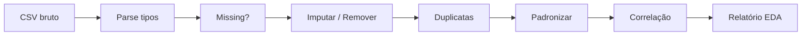

# Limpeza e EDA faire zéro

> Les données réelles que je vous donne sont les mêmes que celles que vous conservez manquantes, les duplicates et les types antérieurs que le modèle apprend ou erreur.

**Type:** Build
**Languages:** Python
**Prerequisites:** 01-estatistica-descritiva
**Time:** ~70 minutes

## Objectifs d'apprentissage

- Détecter les valeurs imputées (média, médiana, moda) en tant que pandas
- Normalité des types, suppression des duplicates et normalisation des chaînes manuellement
- Calcul de Pearson de la correlation de zéro et montar matrice de correlation
- Généralement un rapport EDA minimum reproductible

## Le problème

On estime que 80% du temps d'un scientifique est net.`""`- Je suis là .`"N/A"`- Je suis là .`"null"`Les modèles ne sont pas conservés et les ruines sont amplifiées.

## Le concept

### Manque: types

- Le MCAR (perda aleatória)  imputar ok.
- MAR (perda depende de outro campo)  imputar condicional. Il est également possible de faire une demande de règlement.
- Le MNAR (perda depende do propio valor) est imputé à la vie.

Les stratégies: supprimer la ligne, média/mediana/moda, vizinho mais próximo.

### Correlação de Pearson

```
r = cov(X,Y) / (std(X)*std(Y))
cov = mean((x - mx)(y - my))
```
R = 1 correlação perfeita, 0 aucune, -1 inverse.



```figure
eda-pipeline
```

## Faites-le

### Étape 1: Parcourir et détecter les disparitions

```python
def is_missing(v):
    return v is None or str(v).strip().lower() in ("", "na", "n/a", "null", "none", "-")

def column_stats(rows, col):
    vals = [r[col] for r in rows if not is_missing(r[col])]
    nums = [float(v) for v in vals]
    return len(vals), sum(nums)/len(nums) if nums else None
```

### Étape 2: Imputação

```python
def impute(rows, col, strategy="median"):
    vals = [float(r[col]) for r in rows if not is_missing(r[col])]
    vals.sort()
    if strategy == "mean":
        fill = sum(vals)/len(vals)
    elif strategy == "median":
        fill = vals[len(vals)//2]
    else: # mode
        fill = max(set(vals), key=vals.count)
    for r in rows:
        if is_missing(r[col]):
            r[col] = fill
    return fill
```

### Étape 3: Corrélation

```python
def pearson(x, y):
    mx, my = sum(x)/len(x), sum(y)/len(y)
    num = sum((a-mx)*(b-my) for a,b in zip(x,y))
    den = (sum((a-mx)**2 for a in x)*sum((b-my)**2 for b in y))**0.5
    return num/den if den else 0
```

## Utilisez-le

```python
import pandas as pd
df = pd.read_csv("data.csv", na_values=["", "N/A", "null"])
print(df.isna().sum())
df["idade"] = df["idade"].fillna(df["idade"].median())
print(df.corr(numeric_only=True))
```

## La faire partir

`outputs/skill-limpeza-eda.md` pipeline de limpeza reproduitable.

## Exercices

1. Implementation de l'imputation par groupe (ex: médiana de salaire par département).
2. Détection de duplicates par clé de compostage.
3. Comparer Pearson vs. Spearman avec le commentaire de qui est le plus robuste ?

## Les termes clés

| Term | O que é |
|---|---|
| MCAR | Missing completamente aleatório |
| Imputação | Preencher faltantes com estatística |
| Pearson | Correlação linear [-1,1] |
| EDA | Análise exploratória antes de modelar |

## Pour en savoir plus

- [Pandas missing data guide](https://pandas.pydata.org/docs/user_guide/missing_data.html)
- [Hadley Wickham — Tidy Data](https://vita.had.co.nz/papers/tidy-data.pdf)
