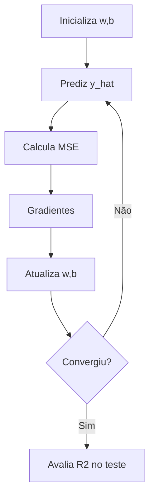

# Regressão Linear do Zero

> Avant de faire des études, vous écrivez le gradient à la main et comprenez pourquoi un mouvement est maintenu.

**Type:** Build
**Languages:** Python
**Prerequisites:** 01-estatistica-descritiva, 02-limpeza-e-eda
**Time:** ~75 minutes

## Objectifs d'apprentissage

- Dérivé de la gradience de l' ESM`y=wx+b`Le régression linéaire de la mise en œuvre est de zéro
- Trainer avec gradiente descendente et comparer avec une équation normale
- Les tests de diagnostic et de sur-équipement sont divisés en trois groupes:
- Estender para regressão múltiple e entender la mise à l'échelle

## Le problème

Il s'agit d'un "bonjour au monde" qui introduit tout le cycle de l'apprentissage: modèle → coût → optimisation.

## Le concept

Modèle: `y = wx + b`- Custo MSE:`(1/n) sum(y_hat - y)^2`- Je suis désolé .
Les résultats: `dw = (2/n) sum((y_hat-y)x)`- Je suis là .`db = (2/n) sum(y_hat-y)`- Je suis désolé .
Mise à jour: `w -= lr*dw`- Je suis désolé .

Équation normale: `w = (X^T X)^{-1} X^T y` solution de la date, O(n3) em caractéristiques.

R2 = 1 - SS_res/SS_tot (quant de variance est explicite).



```figure
linear-regression-fit
```

## Faites-le

- Je vois .`code/main.py`Le numéro de la liste:`LinearRegression`Com `fit`- Je suis là .`predict`- Je suis là .`r2`- Inclure plusieurs prévisualisations de Ridge.

## Utilisez-le

```python
from sklearn.linear_model import LinearRegression
model = LinearRegression().fit(X_train, y_train)
print(model.coef_, model.intercept_, model.score(X_test, y_test))
```

## La faire partir

`outputs/skill-regressao.md` quand utiliser la gradiente versus normale, quand escalader, quand régulariser.

## Exercices

1. Implementer SGD par rapport à GD de lot.
2. Les tests de 10 degrés sur les quadratiques sont plus adaptés.
3. Implementer Ridge (L2).

## Les termes clés

| Term | Significado |
|---|---|
| MSE | Erro quadrático médio |
| R² | Variância explicada |
| Learning rate | Passo do gradiente |
| Scaling | Padronizar para convergir |

## Pour en savoir plus

- [ISLR cap 3](https://www.statlearning.com/)
- [CS229 notes](https://cs229.stanford.edu/main_notes.pdf)
