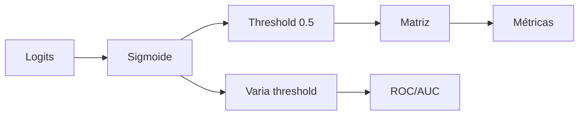

# Classification et évaluation

> Accurácia mente em dados déséquilibrés  vous avez besoin de précision, rappelez-vous le ROC.

**Type:** Build
**Languages:** Python
**Prerequisites:** 03-regressao-do-zero
**Time:** ~70 minutes

## Objectifs d'apprentissage

- Régressation logistique de la mise en œuvre
- Construire la matrice de confusion et dériver l'acuité, la précision, le rappel, F1
- Traçar courbe ROC et calculer manuellement AUC
- Choisir le seuil optimal et expliquer la précision de l'échange par rapport au rappel

## Le problème

Le modèle avec 95% de précision semble optimal jusqu'à ce que l'on découvre que 95% des cas sont négatifs et qu'il prévient toujours négatifs.

## Le concept

Sigmoïde: `σ(z)=1/(1+e^-z)`, mapeia par (0,1).
Custo: BCE = -[y log(p) + (1-y) log(1-p)].
Gradiente: `dw = (1/n) sum((p-y)x)`- Je suis désolé .

Je suis en train de vous dire:
```
        Pred 0  Pred 1
Real 0   TN      FP
Real 1   FN      TP
```
Pour les produits de la production de produits de haute qualité, la valeur de la production de produits de haute qualité doit être déterminée.

ROC: variable de 0 à 1, plota TPR contre FPR.



```figure
roc-curve
```

## Faites-le

```python
def sigmoid(z): return 1/(1+math.exp(-z))
def bce(y,p): return -(y*math.log(p+1e-15)+(1-y)*math.log(1-p+1e-15))
# treino: p=sigmoid(w*x+b), erro=p-y
```

- Je vois .`code/main.py`- Je suis complètement.

## Utilisez-le

```python
from sklearn.linear_model import LogisticRegression
from sklearn.metrics import classification_report, roc_auc_score
model = LogisticRegression().fit(X_train, y_train)
print(classification_report(y_test, model.predict(X_test)))
print(roc_auc_score(y_test, model.predict_proba(X_test)[:,1]))
```

## La faire partir

`outputs/skill-avaliacao.md` guide de métriques par cas d'utilisation.

## Exercices

1. - Le seuil de modification pour maximiser F1.
2. Le déséquilibre est similaire à 95/5 et compare l'acurace contre F1.
3. Mettre en œuvre un CV en k-fold.

## Les termes clés

| Term | Definição |
|---|---|
| Precisão | Fração de positivos previstos que são reais |
| Recall | Fração de positivos reais capturados |
| F1 | Média harmônica P/R |
| AUC | Probabilidade de ordenar positivo acima de negativo |

## Pour en savoir plus

- [Google ML — Classification](https://developers.google.com/machine-learning/crash-course/classification)
- [Sklearn metrics](https://scikit-learn.org/stable/modules/model_evaluation.html)
