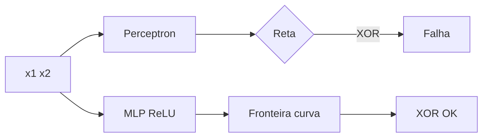

# La perception et l'apprentissage profond ne sont pas

> De une ligne qui sépare les points jusqu'à une ligne qui apprend tout ce qui est nécessaire.

**Type:** Build
**Languages:** Python
**Prerequisites:** 03-regressao-do-zero, 04-classificacao-e-avaliacao
**Time:** ~80 minutes

## Objectifs d'apprentissage

- La répertoire de la répartition des valeurs de la valeur de la valeur de la valeur de la valeur de la valeur de la valeur de la valeur de la valeur de la valeur de la valeur de la valeur de la valeur de la valeur de la valeur de la valeur de la valeur de la valeur de la valeur de la valeur de la valeur de la valeur de la valeur de la valeur de la valeur de la valeur de la valeur de la valeur de la valeur de la valeur de la valeur de la valeur de la valeur de la valeur de la valeur de la valeur de la valeur de la valeur de la valeur de la valeur de la valeur de la valeur de la valeur de la valeur de la valeur de la valeur de la valeur de la valeur de la valeur de la valeur de la valeur de la valeur de la valeur de la valeur de la valeur de la valeur de la valeur de la valeur de la valeur de la valeur de la valeur de la valeur de la valeur de la valeur de la valeur de la valeur de la valeur de la valeur de la valeur de la valeur de la valeur de la valeur de la valeur de la valeur de la valeur de la valeur de la valeur de la valeur de la valeur de la valeur de la valeur de la valeur de la valeur de la valeur de la valeur de la valeur de la valeur de la valeur de la valeur de la valeur de la valeur de la valeur de la valeur de la valeur de la valeur de la valeur de la valeur de la valeur de la valeur de la valeur de la valeur de la valeur de la valeur de la valeur de la valeur de la valeur de la valeur de la valeur de la valeur de la valeur de la valeur de la valeur de la valeur de la valeur de la valeur de la valeur de la valeur de la valeur de la valeur de la valeur de la valeur de la valeur de la valeur de la valeur de la valeur de la valeur de la valeur de la valeur de la valeur de la valeur de la valeur de la valeur de la valeur de la valeur de la valeur de la valeur de la valeur de la valeur de la valeur de la valeur de la valeur de la valeur est est est de la valeur de la valeur de la valeur de la valeur de la valeur est est est est de la valeur de la valeur de la valeur de la valeur de la valeur de la valeur de la valeur de la valeur de la valeur de la valeur de la valeur de la valeur de la valeur de la valeur de la valeur de la valeur de la valeur de la
- Extender pour MLP com ReLU/sigmoide, manuel de propulsion avant et arrière
- Trainer avec des gradients descendants et comparer avec`torch.nn.Linear`
- Visualizer la frontière de décision et expliquer la perception de la défaillance de l'ORX

## Le problème

Les données sont données en cercle ou en XOR, mais elles ne sont pas résolues.

## Le concept

Perceptron:`y = sign(w·x + b)`, mise à jour: `w += lr*(y_true - y_pred)*x`- Je suis désolé .

Il faut se séparer linéairement.

MLP 1 oculta: `h=ReLU(W1 x + b1)`- Je suis là .`y=sigmoid(W2 h + b2)`- Des dérivés de l'encade de l'arrière-prop.

RELU: `max(0,z)` gradiente 1 est z> 0, au contraire.



```figure
perceptron-vs-mlp
```

## Faites-le

- Je vois .`code/main.py`Les résultats de l'étude ont été obtenus en fonction des résultats obtenus par le rapport à la recherche de l'analyse de l'impact de la réaction de l'équipe de recherche.

## Utilisez-le

```python
import torch
model = torch.nn.Sequential(torch.nn.Linear(2,8), torch.nn.ReLU(), torch.nn.Linear(8,1), torch.nn.Sigmoid())
# treino com torch.optim.SGD
```

Le MLP n'est pas égal à la PYTORCH et n'a pas de XOR.

## La faire partir

`outputs/skill-perceptron.md` lorsque l'utilisation de linéaire contre MLP, comme débogage frontière.

## Exercices

1. Les résultats de la recherche ne convergent pas en XOR (prouver).
2. Troque ReLU par sigmoide na oculta  ou que muda no treino ?
3. Il y a aussi la caméra cachée et la mésa ganho.

## Les termes clés

| Term | Definição |
|---|---|
| Perceptron | Classificador linear com update erro-dirigido |
| ReLU | max(0,z) |
| Backprop | Regra da cadeia para gradientes |
| XOR | Problema não-linear que exige oculta |

## Pour en savoir plus

- [Rosenblatt 1958 — Perceptron](https://psycnet.apa.org/record/1959-09865-001)
- [3Blue1Brown — Neural Networks](https://www.3blue1brown.com/topics/neural-networks)
- [PyTorch basics](https://pytorch.org/tutorials/beginner/basics/intro.html)
