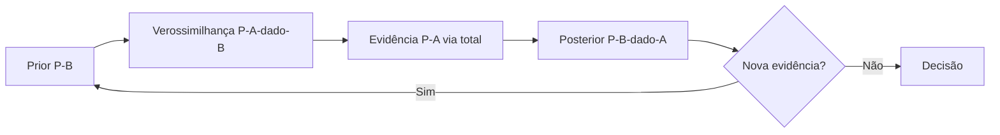

# Probabilidad do Zero: Condicional, Total et Bayes

> Si vous êtes positif, quelle est la vraie chance que vous soyez malade ?

**Type:** Build
**Languages:** Python
**Prerequisites:** 01-estatistica-descritiva
**Time:** ~60 minutes

## Objectifs d'apprentissage

- Calcul de la probabilité conditionnelle P  A  B) et de l'indépendance du test selon une règle de produit
- Appliquer une loi de probabilité totale pour décomposer un événement en scénarios mutuellement exclusifs
- Dériver et appliquer le théorème de Bayes pour les conditions d'inversion (teste médicale, spam, churn)
- Construire un PMF discrète à zéro et calculer l'espérance et la variance des libs

## Le problème

Un test de maladie rare avec 99% de sensibilité et 95% de spécificité. Une maladie atteint 1 sur 1000 personnes. Votre test est positif. Quelle est la chance que vous soyez malade?

L'instinct dit 99%. Une réponse correcte est ~2%. L'erreur  confondre Ppositivo doente) com Pdoente positivo)  se nomme faillance de la tax-base, et apparaît en churn, fraude, spam et tout classifiateur de classe rare.

## Le concept

### Probabilité conditionnelle

```
P(A|B) = P(A ∩ B) / P(B),  com P(B) > 0
```

Leia: "la probabilité de ce qui est arrivé" restreint l'univers aux cas où B s'est produit.

Exemple: dado justo, B = "saiu par" {2,4,6}, A = "saiu 6". P(A

### Indépendance

A e B sont indépendants si o conhecimento de B não muda a chance de A:

```
P(A|B) = P(A)  <=>  P(A ∩ B) = P(A) · P(B)
```

Deux lancements de monnaie: carré n°2 carré n°1 = 1/2 = carré indépendants.

### Le total de la probabilité

Se B1..Bn particionam o espaço (mutuamente exclusivos, cobrem tudo):

```
P(A) = Σ P(A|Bi) · P(Bi)
```

Exemple: P positivo) = P positivo de faire des affaires.

### Théorème de Bayes

Inverter une combinaison conditionnelle en deux formules ci-dessus:

```
P(B|A) = P(A|B) · P(B) / P(A)
```

Test médical: P  n'a pas de positifs) = 0,99·0,001 / (0,99·0,001 + 0,05·0,999) ≈ 0,0194 ≈ 2%.



```figure
stats-probability-bayes
```

## Faites-le

### Étape 1: Conditional e independência do zero

```python
def cond_prob(p_ab, p_b):
    if p_b <= 0:
        raise ValueError("P(B) deve ser > 0")
    return p_ab / p_b

def joint_if_independent(p_a, p_b):
    return p_a * p_b

def is_independent(p_a, p_b, p_ab, tol=1e-9):
    return abs(p_ab - p_a * p_b) <= tol

print(cond_prob(1/6, 3/6))          # 0.333: P(6 | par)
print(is_independent(0.5, 0.5, 0.25))  # True: duas moedas
```

### Étape 2: Probabilité totale

```python
def total_prob(cond_probs, priors):
    # cond_probs[i] = P(A|Bi), priors[i] = P(Bi)
    if abs(sum(priors) - 1.0) > 1e-9:
        raise ValueError("priors devem somar 1")
    return sum(c * p for c, p in zip(cond_probs, priors))

p_pos = total_prob([0.99, 0.05], [0.001, 0.999])
print(f"P(positivo) = {p_pos:.4f}")  # ~0.0509
```

### Étape 3: Bayes + PMF, espérance et variance

```python
def bayes(p_a_given_b, p_b, p_a):
    return p_a_given_b * p_b / p_a

print(f"P(doente|+) = {bayes(0.99, 0.001, p_pos):.4f}")  # ~0.0194

def pmf(values, probs):
    if abs(sum(probs) - 1.0) > 1e-9:
        raise ValueError("probs devem somar 1")
    return dict(zip(values, probs))

def expected_value(d):
    return sum(x * p for x, p in d.items())

def variance_dist(d):
    mu = expected_value(d)
    return sum(((x - mu) ** 2) * p for x, p in d.items())

dado = pmf([1,2,3,4,5,6], [1/6]*6)
print(expected_value(dado), variance_dist(dado))  # 3.5, ~2.917
```

## Utilisez-le

O mesmo cálculo com`fractions`(exato) ou contagem empírica:

```python
from fractions import Fraction

# Bayes exato com frações
p = Fraction(99,100) * Fraction(1,1000) / (
    Fraction(99,100)*Fraction(1,1000) + Fraction(5,100)*Fraction(999,1000))
print(p, float(p))  # ~0.0194

# Verificação empírica por simulação (lei dos grandes números)
import random
random.seed(0)
n = 200_000
doente_pos = sum(1 for _ in range(n)
                 if random.random() < 0.001 and random.random() < 0.99)
saud_pos = sum(1 for _ in range(n)
               if random.random() >= 0.001 and random.random() < 0.05)
print(doente_pos / (doente_pos + saud_pos))  # ~0.02
```

La simulation et la formule doivent être concordantes avec la 2a casa decimal com n grande.

## La faire partir

Artefato: `outputs/skill-probabilidade.md` liste de contrôle "pour chaque fois qu'une condition est inversée, déclarer à l'avance, verossimilhança e evidência antes de concluir".

## Exercices

1. Un filtre de spam marque 98% des spams et 2% des non-spams.`bayes()`- Je suis désolé .
2. Prouver avec code que P  A  B  = P  B  A                                                                                                                                                                                                                                                    
3. Construire un PMF de "soma de deux données" et calculer l'espérance et la variance avec`expected_value()`Le dépôt`variance_dist()`- Je suis désolé .

## Les termes clés

| Term | O que dizem | O que realmente é |
|---|---|---|
| Condicional P(A\|B) | "chance de A se B" | P(A∩B)/P(B); restringe o universo a B |
| Independência | "sem relação" | P(A∩B)=P(A)·P(B); saber B não muda A |
| Probabilidade total | "média ponderada" | P(A)=Σ P(A\|Bi)·P(Bi) sobre partição |
| Teorema de Bayes | "inverter a pergunta" | P(B\|A)=P(A\|B)·P(B)/P(A) |
| PMF | "tabela de chances" | P(X=x) para cada valor discreto; soma 1 |
| Esperança | "média teórica" | Σ x·P(x); para onde a média amostral converge |

## Pour en savoir plus

- [Seeing Theory — Probability](https://seeing-theory.brown.edu/) interatif visuel
- [Stat Trek: Bayes Theorem](https://stattrek.com/probability/bayes-theorem) référence com exemples
- [Python `fractions` docs](https://docs.python.org/3/library/fractions.html) calcul exato pour la production
