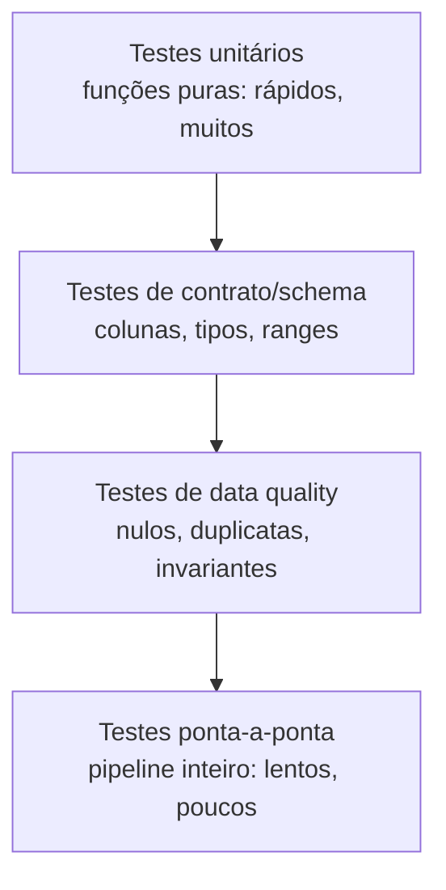

# Codes propres et tests pour la science des données

> Le manuel de calcul est une machine à écrire et à produire.

**Type:** Build
**Languages:** Python
**Prerequisites:** 01-estatistica-descritiva, 02-limpeza-e-eda
**Time:** ~60 minutes

## Objectifs d'apprentissage

- Expliquer par quels cahiers sont en production (estado oculto, ejecución fora de orden, dependências implícitas)
- Réfaitorer un ordinateur monolytique en pipeline modulaire avec des fonctions pures et des contrats de schéma
- Appliquer le RRS, la sécheresse et la validation du code de données du conseil d'administration
- Test de qualité des données (échantillons, nuls, intervalles, invariants)
- Interpréter une pyramide de testes appliquée à un DS: unités rapides, contrat/schéma, ponta-a-ponta lentos

## Le problème

Vous remettez un carnet qui roule parfaitement sur votre machine.`idade`Vous venez comme une corde`"32"`En effet, il est possible de`dropna()`En production, l'agenda de travail est supprimé à minuit comme message utile.

Les livres de note sont des outils de recherche, des outils de recherche, des outils de recherche, des outils de recherche, des outils de recherche, des outils de recherche, des outils de recherche, des outils de recherche, des outils de recherche, des outils de recherche, des outils de recherche, des outils de recherche, des outils de recherche, des outils de recherche, des outils de recherche, des outils de recherche, des outils de recherche, des outils de recherche, des outils de recherche, des outils de recherche, des outils de recherche, des outils de recherche, des outils de recherche, des outils de recherche, des outils de recherche, des outils de recherche, des outils de recherche, des outils de recherche, des outils de recherche, des outils de recherche, des outils de recherche, des outils de recherche, des outils de recherche, des outils de recherche, des outils de recherche, des outils de recherche, des outils de recherche, des outils de recherche, des outils de recherche, des outils de recherche, des outils de recherche, des outils de recherche, des outils de recherche, des outils de recherche, des outils de recherche, des outils de recherche, outils de recherche, outils de recherche, outils de recherche, outils de recherche, outils de recherche, outils de recherche, ou d'autres outils de recherche, outils de recherche, outils de recherche, ou d'autres outils de recherche, ou d'autres outils de recherche, ou d'autres encore, ou encore, ou encore, ou encore, ou encore, ou encore, ou encore, ou encore, ou encore, d'autres encore, d'autres encore, d'autres encore, d'autres.

## Le concept

### Fonctions pures: même entrée, même sortie

Une fonction pure ne se trouve ni n'écrit globalement, ne dépend pas de l'ordre d'exécution:

```python
# impuro: depende de global e muta o argumento
THRESHOLD = 18
def filtrar_adultos(rows):
    return [r for r in rows if r["idade"] >= THRESHOLD]  # quebra se idade for str

# puro: dependências explícitas, sem mutação
def filtrar_adultos(rows, idade_minima=18):
    return [{**r} for r in rows if int(r["idade"]) >= idade_minima]
```

Règles pratiques: un verbe par fonction (`load`- Je suis là .`validate`- Je suis là .`clean`- Je suis là .`featurize`- l'écoulement des conduites (I/O seulement nos bordes), le retour nouveau à la vie.

### SOLID em version DS (seulement ici)

- **S — Single Responsibility:** `validate_schema()`valid, `clean()`Nous ne sommes jamais ensemble.
- **D — Dependency Inversion (na prática):**Une étape est réceptionnée par paramètre (trois, colonnes), non d'importance globale.
- **Contrato na borda:**Il est nécessaire de modifier le code de référence de la page d'accueil.

### Pyramide des testicules pour les données



Une base (unitarios + schéma) roule en secondes à chaque commande. ou le top (pipeline inteiro com dados reais) roule en IC/noturno. si une base est fraca, tout erreur est effectuée en production.

```figure
clean-code-pipeline-overview
```

## Faites-le

### Étape 1: Présenter une table comme liste de dé-dits et de validation du schéma

Sem pandas: chaque ligne est un`dict`, une table é uma `list[dict]`- Je suis désolé .

```python
SCHEMA = {
    "nome": str,
    "idade": int,   # aceita "32" conversível
    "salario": float,
}

def validate_schema(rows, schema):
    errors = []
    for i, row in enumerate(rows):
        for col, tipo in schema.items():
            if col not in row:
                errors.append(f"linha {i}: coluna ausente '{col}'")
                continue
            try:
                tipo(row[col])
            except (ValueError, TypeError):
                errors.append(f"linha {i}: '{col}'={row[col]!r} não converte para {tipo.__name__}")
    return errors
```

### Étape 2: Components modulaires de pipeline

```python
def clean_rows(rows):
    out = []
    for r in rows:
        novo = {"nome": str(r["nome"]).strip(), "idade": int(r["idade"]), "salario": float(r["salario"])}
        if novo["idade"] >= 0 and novo["salario"] >= 0:
            out.append(novo)
    return out

def featurize(rows):
    return [{**r, "adulto": r["idade"] >= 18} for r in rows]

def run_pipeline(rows):
    errors = validate_schema(rows, SCHEMA)
    if errors:
        raise ValueError("schema inválido:\n" + "\n".join(errors[:5]))
    return featurize(clean_rows(rows))
```

### Étape 3: Tests de qualité des données

```python
def check_quality(rows):
    checks = {
        "sem_nulos": all(v is not None and v != "" for r in rows for v in r.values()),
        "idades_validas": all(0 <= r["idade"] <= 120 for r in rows),
        "sem_duplicatas": len({(r["nome"], r["idade"]) for r in rows}) == len(rows),
    }
    return checks
```

Chaque chèque retourne à Boolean Nomado: quand il tombe, vous savez exactement quel est l'invariant quebrou.

## Utilisez-le

O mesmo padrão com a biblioteca de produção (`pandera`pour les régimes, `pytest`comme coureur):

```python
# import pandera.pandas as pa
# import pandas as pd
# from pandera import Column, DataFrameSchema, Check
#
# schema = DataFrameSchema({
#     "nome": Column(str),
#     "idade": Column(int, Check.between(0, 120)),
#     "salario": Column(float, Check.ge(0)),
# })
# df = pd.DataFrame([{"nome": "ana", "idade": 30, "salario": 5000.0}])
# print(schema.validate(df))
# # pytest: mesmos asserts do unittest, com fixtures e mensagens melhores
```

Seu validador estdlib e `pandera`Il faut concorder: ligne valide passe nos deux, ligne invalide faille nos deux.

## La faire partir

Artefato: `outputs/skill-clean-code-ds.md` liste de contrôle pour convertir tout portefeuille en pipeline: "funções puras, schéma na boorda, contrôles de qualité només, tests rapides embaixo e ponta-a-ponta em cima".

## Exercices

1. Quebre propositalmente: passe `idade="trinta"`et une ligne de séminaire`salario`Un message d'erreur dans la colonne ?
2. - Je vous en prie .`salario_mediano_positivo`Un test qui se produit lorsque tous les salaires sont à 0, pourquoi une invariante de commerce vaut-elle le test de type ?
3. Il est également possible de modifier la fonction de la fonction de la personne à la fonction de la personne à la fonction de la personne à la fonction de la personne à la fonction de la personne à la fonction de la personne à la fonction de la personne à la fonction de la personne à la fonction de la personne à la fonction de la personne à la fonction de la personne à la fonction de la personne à la fonction de la personne à la fonction de la personne à la fonction de la personne à la personne à la personne à la personne à la personne à la personne à la personne à la personne à la personne à la personne à la personne à la personne à la personne à la personne à qui elle est confiée.

## Les termes clés

| Term | O que dizem | O que realmente é |
|---|---|---|
| Função pura | "função limpa" | Mesma entrada -> mesma saída, sem global nem mutação; testável em isolamento |
| Schema | "formato dos dados" | Contrato de colunas + tipos; validado na borda, falha rápido |
| Data quality check | "teste de dados" | Invariante nomeado (nulos, ranges, duplicatas) que explica o que quebrou |
| SRP | "uma coisa só" | Cada função/etapa tem um único motivo para mudar |
| Pirâmide de testes | "testar tudo" | Muitos testes rápidos na base (unit/schema), poucos lentos no topo (e2e) |
| Falhe rápido | "validar cedo" | Erro na entrada com mensagem útil em vez de corrupção silenciosa adiante |

## Pour en savoir plus

- [PEP 8 — Style Guide](https://peps.python.org/pep-0008/) conventions officielles
- [unittest docs](https://docs.python.org/3/library/unittest.html) coureur stdlib
- [Pandera docs](https://pandera.readthedocs.io/) validation de schéma en production
