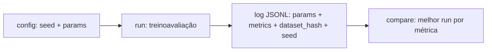

# Réproductivité et suivi des expériences

> "Functionou hier" n'est pas un résultat scientifique  apprenant une fixar des semences, des ensembles de données de version et enregistrer chaque course.

**Type:** Build
**Languages:** Python
**Prerequisites:** 01-estatistica-descritiva, 08-clean-code-testes-ds
**Time:** ~60 minutes

## Objectifs d'apprentissage

- Expliquer comme trois sources de non-determinisme: semence non fixée, ensemble de données sem version, hyperparamètres non enregistrés
- Sémines fixes de`random`(e `numpy`- Je suis là.`torch`non Utilisez- le) pour répéter les fractions et les amostragens
- Versionar um dataset com hash SHA-256 do conteúdo canônico
- Le registre est exécuté (paramètres + métriques + dataset_hash) en JSONL com stdlib
- Comparer les courses et les meilleures par métrique avec fonction pure

## Le problème

Vous avez roulé ou entraîné deux fois et obtenu des précisions de 0,87 et 0,83 sans changer quoi que ce soit.

Les données sont calculées par rapport à la méthode de calcul de l'analyse, et les données sont calculées par rapport à la méthode de calcul de l'analyse.

## Le concept

### Semence: o ponto de partida do aleatório

Les geradores pseudo-aléatórios sont déterminísticos donnant une semence:

```python
import random
random.seed(42)
print(random.random())  # sempre 0.6394267984578837
```

Fixer une semence une fois au début (`set_seed(42)`Les semences différentes = expériences différentes; par conséquent, une semence est également un paramètre enregistré.

### Versão de dataset = hash du contenu

Nom de l'archivage (`dados_final_v2_REAL.csv`Il n' y a pas de

```
versão = sha256(representação_canônica_das_linhas)
```

Deux tables avec le même contenu, un byte, un virgula, un muda ou un hash.

### Tracker minimaliste: une ligne JSON par exécution



Chaque enregistrement`timestamp`- Je suis là .`seed`- Je suis là .`dataset_hash`- Je suis là .`params`- Je suis là .`metrics`. Le JSONL archiv est uniquement annexe: historique immutable, lisible par tout outil.

```figure
reproducibility-tracking-overview
```

## Faites-le

### Étape 1: Fixer une semence et faire une fraction déterministique

```python
import random

def set_seed(seed):
    random.seed(seed)

def train_test_split(rows, test_ratio=0.2, seed=42):
    rng = random.Random(seed)  # instância local: não polui o global
    idx = list(range(len(rows)))
    rng.shuffle(idx)
    k = int(len(rows) * (1 - test_ratio))
    return [rows[i] for i in idx[:k]], [rows[i] for i in idx[k:]]
```

Les graines de mesma + mêmes dados = même divisé, toujours.

### Étape 2: Hash canônico faire le jeu de données

```python
import hashlib, json

def dataset_hash(rows):
    canon = json.dumps(rows, sort_keys=True, ensure_ascii=False)
    return hashlib.sha256(canon.encode("utf-8")).hexdigest()[:12]
```

`sort_keys=True`garantie de l'ordre canonique des clés; ou préfixe de 12 chars basta como version legible.

### Étape 3: JSONL de suivi

```python
import json, datetime

def log_run(path, params, metrics, seed, dhash):
    record = {
        "timestamp": datetime.datetime.now(datetime.timezone.utc).isoformat(),
        "seed": seed, "dataset_hash": dhash,
        "params": params, "metrics": metrics,
    }
    with open(path, "a", encoding="utf-8") as f:
        f.write(json.dumps(record, ensure_ascii=False) + "\n")
    return record

def load_runs(path):
    with open(path, encoding="utf-8") as f:
        return [json.loads(line) for line in f if line.strip()]

def best_run(runs, metric="accuracy", higher=True):
    return (max if higher else min)(runs, key=lambda r: r["metrics"][metric])
```

## Utilisez-le

O mesmo com une pile de production (`mlflow`La ville de la ville`numpy`pour les semences):

```python
# import mlflow, numpy as np
#
# np.random.seed(42)  # além de random.seed(42)
# # import torch; torch.manual_seed(42)
#
# # mlflow.start_run()
# # mlflow.log_params({"lr": 0.01, "seed": 42, "dataset_hash": "abc..."})
# # mlflow.log_metric("accuracy", 0.87)
# # mlflow.end_run()
```

Le système de suivi JSONL et de l'enregistrement de flux de l'entreprise: paramètres + métriques + dataset_hash + graines.

## La faire partir

Artefato: `outputs/skill-reprodutibilidade-tracking.md` liste de contrôle de tout l'expérience: "seed fixed and registered, dataset com hash, json par run, best run selected per function pure".

## Exercices

1. La roue`train_test_split`Deux fois avec la graine 42 et une fois avec la graine 7.
2. Je change de valeur à aucun ensemble de données et je recalcule le hash.`sort_keys=True`Ça vous intéresse ?
3. Logue 3 fonctionne en variant par paramètre, après utilisation `best_run`Com `higher=False`Une métrique d'erreur.

## Les termes clés

| Term | O que dizem | O que realmente é |
|---|---|---|
| Seed | "número mágico" | Estado inicial do gerador pseudo-aleatório; fixa toda a sequência sorteada |
| Dataset hash | "versão dos dados" | SHA-256 do conteúdo canônico; prova em quais dados você treinou |
| Run | "um treino" | Uma execução com seed + params + dataset fixos e métricas registradas |
| JSONL | "log de runs" | Um objeto JSON por linha, append-only; histórico auditável |
| Tracking | "acompanhar modelo" | Registrar params/metrics/versões para comparar e reproduzir |
| Determinismo | "sempre igual" | Mesma seed + mesmos dados + mesmo código = mesmo resultado |

## Pour en savoir plus

- [MLflow Tracking docs](https://mlflow.org/docs/latest/tracking.html) padrão de production
- [hashlib docs](https://docs.python.org/3/library/hashlib.html) référence stdlib
- [NumPy random seed docs](https://numpy.org/doc/stable/reference/random/index.html) semences en production
