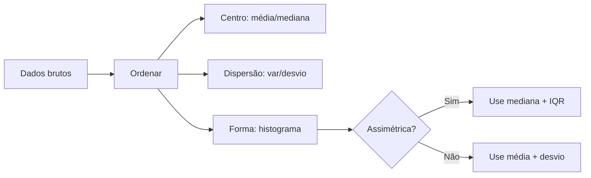

# एटस्टिस्टिकल डेस्क्रिटिवा डू शून्य

> मीडिया, मीडिया और वेरिएन्सी एक इतिहास को बताती है जो एक तालिका छिपा करती है  एक अतिरिक्त सेम पांडा को सीखती है।

**Type:** Build
**Languages:** Python
**Prerequisites:** None
**Time:** ~60 minutes

## सीखने के लक्ष्य

- मात्रक मीडिया, मध्य, मोड, वेरिएन्सी, डिस्विओ-पॅड्रॉइओ इ क्वार्ट्स्
- मैटप्लोटलिब का उपयोग करने से पहले एक हिस्टोग्राम और बॉक्सप्लोट का निर्माण करें
- IQR e z-score के साथ असाधारण मानकों का पता लगाना और यह स्पष्ट करना कि जब कोई त्रुटि होती है
- सामान्य व्याख्यात्मक असिमट्रिया और संक्षिप्तता के साथ एक अनुभवजन्य वितरण की तुलना करें

## समस्या

आपको 10,000 वेतन के साथ सीएसवी प्राप्त होगा।$ 8.500, mas 70% das pessoas ganham menos que isso. Por quê? Um único CEO com R$500 हजार एक मीडिया के लिए. अगर आप केवल एक मीडिया रिपोर्ट, मैं चाहता हूँ.

डेटा विज्ञान में, डेटा को एक मेट्रिक के रूप में सारांशित करना केवल एक सामान्य और सबसे महंगी गलती है। किसी भी मॉडल से पहले, आपको यह वर्णन करना होगाः जहां केंद्र है, जहां डेटा फैलता है, वितरण का एक रूप है।

## अवधारणा

### केंद्र: मीडिया बनाम मीडिया बनाम मोडा

```
dados = [2, 3, 3, 5, 500]
média   = (2+3+3+5+500)/5 = 102.6  <- sensível a outlier
mediana = valor do meio ordenado = 3  <- robusta
moda    = valor mais frequente = 3
```

नियम: वितरण simétrica -> média ~= mediana. Assimétrica à direita -> média > mediana (कैसो सैलरी) ।

### विसारण: विविधता और जीवन-शैली

```
variância = média((x - média)^2)
desvio    = sqrt(variância)
```

Desvio responde: "em media, quanto se afasta cada ponto do centro?" तुलनात्मक समूहों के लिए उपयोगी।

### क्वार्टिस ई आईक्यूआर (रोबस्टो)

क्रमशः दी गई है। Q1 = प्रतिशत 25, Q2 = मध्य, Q3 = प्रतिशत 75.
IQR = Q3 - Q1 (amplitude dos 50% centrais) ।

नियम डी तुकेई पैरा आउटलेटर्सः
```
limite_inf = Q1 - 1.5*IQR
limite_sup = Q3 + 1.5*IQR
```

### Z-स्कोर (पारामेट्रिक)

```
z = (x - média) / desvio
```
|z| > 3 = candidato a outlier, mas assume distribuição ~normal. Em dados assimétricos, IQR é melhor.



```figure
stats-descriptive-overview
```

## इसे बनाओ

### चरण 1: स्टैटिस्टिक्स सेंटर और डिस्पैरेसोन शून्य

```python
import math

def mean(data):
    return sum(data) / len(data)

def median(data):
    s = sorted(data)
    n = len(s)
    mid = n // 2
    return s[mid] if n % 2 == 1 else (s[mid-1] + s[mid]) / 2

def variance(data, sample=False):
    m = mean(data)
    div = len(data) - 1 if sample else len(data)
    return sum((x - m)**2 for x in data) / div

def std(data, sample=False):
    return math.sqrt(variance(data, sample))

def mode(data):
    freq = {}
    for x in data:
        freq[x] = freq.get(x, 0) + 1
    return max(freq, key=freq.get)

data = [2, 3, 3, 5, 500]
print(f"média={mean(data):.1f} mediana={median(data)} moda={mode(data)} std={std(data):.1f}")
```

### चरण 2: क्वार्टिस ई आईक्यूआर

```python
def percentile(data, p):
    s = sorted(data)
    k = (len(s)-1) * p / 100
    f = math.floor(k)
    c = math.ceil(k)
    if f == c:
        return s[int(k)]
    return s[f] * (c - k) + s[c] * (k - f)

def quartiles(data):
    return percentile(data, 25), percentile(data, 50), percentile(data, 75)

def iqr(data):
    q1, _, q3 = quartiles(data)
    return q3 - q1

q1, q2, q3 = quartiles([1,2,3,4,5,6,7,8,9,100])
print(f"Q1={q1} Q2={q2} Q3={q3} IQR={iqr([1,2,3,4,5,6,7,8,9,100])}")
# outlier: 100 > Q3+1.5*IQR ?
```

### चरण 3: हिस्टोग्राम एएससीआईआई

```python
def histogram(data, bins=5):
    lo, hi = min(data), max(data)
    width = (hi - lo) / bins
    counts = [0]*bins
    for x in data:
        idx = min(int((x - lo) / width), bins-1) if width else 0
        counts[idx] += 1
    for i, c in enumerate(counts):
        bar = "#" * c
        print(f"{lo + i*width:6.1f} | {bar} ({c})")

histogram([1,1,2,2,2,3,3,5,8,9], bins=4)
```

## इसका प्रयोग करें

समोच्च गणना`numpy`/`statistics`:

```python
import statistics
import numpy as np

data = [2, 3, 3, 5, 500]
print(statistics.mean(data), statistics.median(data), statistics.stdev(data))
print(np.mean(data), np.median(data), np.std(data, ddof=0))
print(np.percentile(data, [25,50,75]))
# histograma real
# import matplotlib.pyplot as plt
# plt.hist(data, bins=10); plt.show()
```

अपने कोड को शून्य और नंबरी को दशमलव के घर में जोड़ना चाहिए।

## इसे भेजें

आर्टिफैटो: `outputs/skill-estatistica-descritiva.md` सभी ईडीए के लिए चेकलिस्टः "अंत्रेन, रिपोर्ट मीडिया/मीडियाना, डेसियो/आईक्यूआर, हिस्टोग्राम ई % डी आउटरीयर"

## व्यायाम

1. 1000 से अधिक का प्रदर्शन`exp(λ=1)`और मीडिया बनाम मीडियाना की तुलना करें।
2. समरूपता (स्केव) = E[(x-média) ^3]/desvio^3 सेमी लिब्स को लागू करें।
3. एक नियम IQR से 1.5 से 3.0 के लिए बदलें. आप कितने आउटलियर खोते हैं?

## प्रमुख शर्तें

| Term | O que dizem | O que realmente é |
|---|---|---|
| Média | "valor típico" | Soma/n, sensível a outliers; só típica se distribuição simétrica |
| Mediana | "meio dos dados" | Valor que corta 50% abaixo/acima; robusta |
| Desvio-padrão | "erro médio" | Raiz da variância; distância típica até a média |
| IQR | "caixa do boxplot" | Q3-Q1; amplitude dos 50% centrais |
| Z-score | "quantos desvios" | (x-média)/desvio; assume normalidade |
| Outlier | "ponto estranho" | Observação além de Q3+1.5*IQR ou |z|>3 |

## आगे पढ़ना

- [Seeing Theory — Descriptive Stats](https://seeing-theory.brown.edu/) दृश्य इंटरएटिव
- [NIST Engineering Statistics Handbook](https://www.itl.nist.gov/div898/handbook/) संदर्भ
- [SciPy stats docs](https://docs.scipy.org/doc/scipy/reference/stats.html) उत्पादन के लिए
