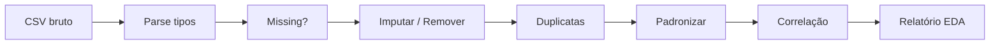

# Limpeza e EDA do Zero

> वास्तविक डेटा जो मैं अपने आप को याद करता हूँ वह गायब है, दोहराता है और मॉडल से पहले की तरह सीखता है या गलत करता है।

**Type:** Build
**Languages:** Python
**Prerequisites:** 01-estatistica-descritiva
**Time:** ~70 minutes

## सीखने के लक्ष्य

- मानकों की अनुपस्थिति (मध्य, मध्य, मोड) के लिए पंडा का पता लगाना
- सामान्य प्रकार, डुप्लिकेट हटाने और मैन्युअल रूप से स्ट्रिंगों को अनुकूलित
- पियरसन के गणना कर रहे हैं शून्य और माउंट मैट्रिक्स के साथ correlation
- न्यूनतम प्रतिलिपि योग्य

## समस्या

वैज्ञानिकों का अनुमान है कि 80% का समय साफ है।`""`,`"N/A"`,`"null"`नकल की प्रक्रिया में गिरावट की संभावना है।

## अवधारणा

### गायब: प्रकार

- MCAR (perda aleatória)  imputar ठीक है।
- MAR (perda depende de outro campo)  मुत्तारिज संशर्त
- एमएनएआर (पार्डा डिपेंड डू प्रोपोजिवल वैल्यू)  इम्प्युटर वेसेडो।

रणनीतियाँः रिमूवर लाइन, मीडिया/मीडियाना/मोडा, विज़िन्हो मस प्रोविओ।

### पीरसन का संबंध

```
r = cov(X,Y) / (std(X)*std(Y))
cov = mean((x - mx)(y - my))
```
r=1 correlação perfeita, 0 nenhuma, -1 inversa. Só captura relação linear.



```figure
eda-pipeline
```

## इसे बनाओ

### चरण 1: गायब होने का पता लगाने के लिए जांच करें

```python
def is_missing(v):
    return v is None or str(v).strip().lower() in ("", "na", "n/a", "null", "none", "-")

def column_stats(rows, col):
    vals = [r[col] for r in rows if not is_missing(r[col])]
    nums = [float(v) for v in vals]
    return len(vals), sum(nums)/len(nums) if nums else None
```

### चरण 2: इम्प्युटेशन

```python
def impute(rows, col, strategy="median"):
    vals = [float(r[col]) for r in rows if not is_missing(r[col])]
    vals.sort()
    if strategy == "mean":
        fill = sum(vals)/len(vals)
    elif strategy == "median":
        fill = vals[len(vals)//2]
    else: # mode
        fill = max(set(vals), key=vals.count)
    for r in rows:
        if is_missing(r[col]):
            r[col] = fill
    return fill
```

### चरण 3: संबद्धता

```python
def pearson(x, y):
    mx, my = sum(x)/len(x), sum(y)/len(y)
    num = sum((a-mx)*(b-my) for a,b in zip(x,y))
    den = (sum((a-mx)**2 for a in x)*sum((b-my)**2 for b in y))**0.5
    return num/den if den else 0
```

## इसका प्रयोग करें

```python
import pandas as pd
df = pd.read_csv("data.csv", na_values=["", "N/A", "null"])
print(df.isna().sum())
df["idade"] = df["idade"].fillna(df["idade"].median())
print(df.corr(numeric_only=True))
```

## इसे भेजें

`outputs/skill-limpeza-eda.md` रिप्रोडक्टिबल लिम्पेज पाइपलाइन।

## व्यायाम

1. समूह द्वारा प्रतिदान लागू करना (उदाहरण के लिए, विभाग द्वारा वेतन के बीच) ।
2. अतिरिक्त कम्पोस्टे द्वारा दोहराए गए प्रतिलिपि का पता लगाना।
3. Pearson vs Spearman की तुलना करें और उन्हें अधिक आकर्षक कैसे बनाएं?

## प्रमुख शर्तें

| Term | O que é |
|---|---|
| MCAR | Missing completamente aleatório |
| Imputação | Preencher faltantes com estatística |
| Pearson | Correlação linear [-1,1] |
| EDA | Análise exploratória antes de modelar |

## आगे पढ़ना

- [Pandas missing data guide](https://pandas.pydata.org/docs/user_guide/missing_data.html)
- [Hadley Wickham — Tidy Data](https://vita.had.co.nz/papers/tidy-data.pdf)
