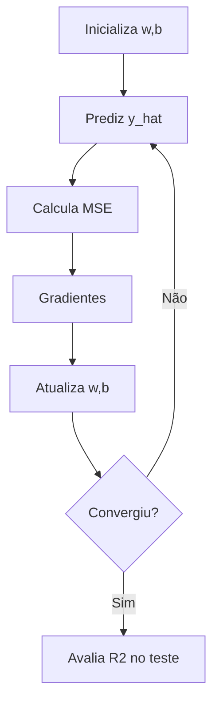

# रेग्रेसão रैखिक शून्य

> इससे पहले कि आप सीखें, आप एक गति को बनाए रखने के लिए एक गति को समझते हैं।

**Type:** Build
**Languages:** Python
**Prerequisites:** 01-estatistica-descritiva, 02-limpeza-e-eda
**Time:** ~75 minutes

## सीखने के लक्ष्य

- एमएसई के लिए व्युत्पन्न या ग्रेडिएंट`y=wx+b`क्रियान्वयन रेखीय शून्य
- ट्रेनिंग के साथ नीचे की तरंग और सामान्य समीकरण के साथ तुलना
- एवलियर कॉम एमएसई, आरएमएसई और आर2ई डायग्नोस्टिक ओवरफिटिंग कॉम ट्रेनो/टेस्ट
- बहुवचन पुनरावृत्ति के लिए स्टैंडर्ड और स्केलिंग को समझने के लिए

## समस्या

एक "हैलो वर्ल्ड" जो एमएल के पूरे चक्र को शुरू करता हैः मॉडल → लागत → अनुकूलन।

## अवधारणा

मॉडलः `y = wx + b`. Custo MSE: `(1/n) sum(y_hat - y)^2`. .
ग्रेडिएंट्स: `dw = (2/n) sum((y_hat-y)x)`,`db = (2/n) sum(y_hat-y)`. .
अद्यतन: `w -= lr*dw`. .

सामान्य समीकरण: `w = (X^T X)^{-1} X^T y` समाधान तिथि, O(n3) em विशेषताएं।

R2 = 1 - SS_res/SS_tot (quanto da variância é explicada) ।



```figure
linear-regression-fit
```

## इसे बनाओ

देखिये`code/main.py``LinearRegression`com `fit`,`predict`,`r2`. कई बार रिंग पूर्वावलोकन शामिल है.

## इसका प्रयोग करें

```python
from sklearn.linear_model import LinearRegression
model = LinearRegression().fit(X_train, y_train)
print(model.coef_, model.intercept_, model.score(X_test, y_test))
```

## इसे भेजें

`outputs/skill-regressao.md` जब सामान्य के विपरीत gradient का उपयोग करें, जब escalar, जब नियमित.

## व्यायाम

1. SGD बनाम बैच GD लागू करें।
2. 10 डिग्री पर क्वाड्रैटिकस  अति-फिटिंग के परीक्षण।
3. Ridge (L2) को लागू करें।

## प्रमुख शर्तें

| Term | Significado |
|---|---|
| MSE | Erro quadrático médio |
| R² | Variância explicada |
| Learning rate | Passo do gradiente |
| Scaling | Padronizar para convergir |

## आगे पढ़ना

- [ISLR cap 3](https://www.statlearning.com/)
- [CS229 notes](https://cs229.stanford.edu/main_notes.pdf)
