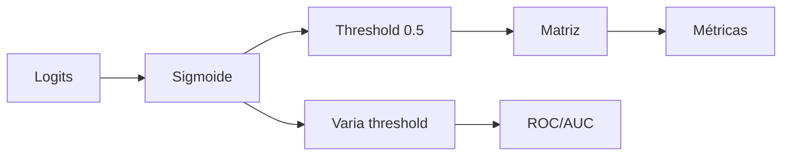

# वर्गीकरण एवं मूल्यांकन

> सटीकता में असंतुलित डेटा  आप सटीकता की आवश्यकता है, आरओसी को याद रखें।

**Type:** Build
**Languages:** Python
**Prerequisites:** 03-regressao-do-zero
**Time:** ~70 minutes

## सीखने के लक्ष्य

- कार्यान्वयन में वापसी logística com sigmoide e entropia cruzada do zero
- कन्फ्यूजन मैट्रिक्स का निर्माण और सटीकता, सटीकता, याद, F1
- Traçar वक्र ROC और गणना AUC मैन्युअल रूप से
- इष्टतम चुनने की सीमा और व्यापार-बदला सटीकता बनाम वापसी को स्पष्ट करना

## समस्या

95% सटीकता के साथ मॉडल सबसे अच्छा लगता है जब तक यह पता नहीं चलता कि 95% मामले नकारात्मक हैं और यह हमेशा नकारात्मक होता है।

## अवधारणा

सिग्मोइड: `σ(z)=1/(1+e^-z)`, mapeia para (0,1) ।
Custo: BCE = -[y log(p) + (1-y) log(1-p)].
ग्रेडिएंट: `dw = (1/n) sum((p-y)x)`. .

मैट्रिस:
```
        Pred 0  Pred 1
Real 0   TN      FP
Real 1   FN      TP
```
Precisão = TP/(TP+FP), Recall = TP/(TP+FN), F1 = 2PR/(P+R।

आरओसीः चर सीमा 0→1, प्लोट टीपीआर बनाम आरपीआर। एयूसी = क्षेत्र के नीचे वक्र।



```figure
roc-curve
```

## इसे बनाओ

```python
def sigmoid(z): return 1/(1+math.exp(-z))
def bce(y,p): return -(y*math.log(p+1e-15)+(1-y)*math.log(1-p+1e-15))
# treino: p=sigmoid(w*x+b), erro=p-y
```

देखिये`code/main.py`पूर्ण।

## इसका प्रयोग करें

```python
from sklearn.linear_model import LogisticRegression
from sklearn.metrics import classification_report, roc_auc_score
model = LogisticRegression().fit(X_train, y_train)
print(classification_report(y_test, model.predict(X_test)))
print(roc_auc_score(y_test, model.predict_proba(X_test)[:,1]))
```

## इसे भेजें

`outputs/skill-avaliacao.md` उपयोग के मामले में मैट्रिक्स की मार्गदर्शिका।

## व्यायाम

1. अधिकतम F1 के लिए सीमा को संशोधित करें।
2. 95/5 के समान संतुलन में कमी है और सटीकता बनाम F1 की तुलना करें।
3. k-fold CV को लागू करें।

## प्रमुख शर्तें

| Term | Definição |
|---|---|
| Precisão | Fração de positivos previstos que são reais |
| Recall | Fração de positivos reais capturados |
| F1 | Média harmônica P/R |
| AUC | Probabilidade de ordenar positivo acima de negativo |

## आगे पढ़ना

- [Google ML — Classification](https://developers.google.com/machine-learning/crash-course/classification)
- [Sklearn metrics](https://scikit-learn.org/stable/modules/model_evaluation.html)
