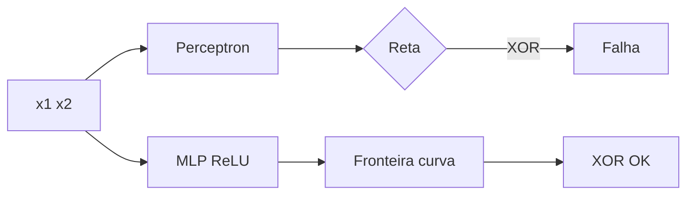

# धारणा और गहन शिक्षा शून्य

> एक रेखा से जो बिंदुओं को अलग करती है, एक रेखा तक जो सब कुछ सीखती है।

**Type:** Build
**Languages:** Python
**Prerequisites:** 03-regressao-do-zero, 04-classificacao-e-avaliacao
**Time:** ~80 minutes

## सीखने के लक्ष्य

- अभिसरण/विभेदन के समय प्रमाणीकरण (Rosenblatt नियम)
- MLP के लिए स्टैंडर्ड ReLU/sigmoide, आगे और पीछे की ओर समर्थन मैनुअल
- ट्रेनिंग के साथ-साथ नीचे की ओर और तुलनात्मक रूप से`torch.nn.Linear`
- निर्णय की सीमा को देखने और किसी भी XOR की त्रुटि की धारणा को समझाने के लिए

## समस्या

एक चक्र या XOR में डेटा को कैसे व्यवस्थित किया जाए? एक चक्र या XOR में डेटा को कैसे व्यवस्थित किया जाए? एक चक्र या XOR में डेटा को कैसे व्यवस्थित किया जाए? एक चक्र या XOR में डेटा को कैसे व्यवस्थित किया जाए? एक चक्र या XOR में डेटा को कैसे व्यवस्थित किया जाए? एक चक्र या XOR में डेटा को कैसे व्यवस्थित किया जाए? एक चक्र या XOR में डेटा को कैसे व्यवस्थित किया जाए? एक चक्र या XOR में डेटा को कैसे व्यवस्थित किया जाए? एक चक्र या XOR में डेटा को कैसे व्यवस्थित किया जाए? एक चक्र या XOR में डेटा को कैसे व्यवस्थित किया जाए? एक चक्र या XOR में डेटा को कैसे व्यवस्थित किया जाए? एक चक्र या XOR में डेटा को कैसे व्यवस्थित किया जाए? एक चक्र या XOR में डेटा को विभाजित किया जाए? एक चक्र या XOR में डेटा को विभाजित किया जाए? एक चक्र या XOR में डेटा को परिभाषित किया जाए? एक चक्र या XOR में डेटा को परिभाषित किया जाए। एक चक्र या XOR में डेटा को परिभाषित करने के लिए एक सीमाओं को परिभाषित करने के लिए गहन सीखने के लिए गहन सीखने के लिए गहन सीखने के लिए गहन सीखने का उपयोग किया जाता है।

## अवधारणा

पर्सेप्ट्रोन: `y = sign(w·x + b)`, अद्यतन: `w += lr*(y_true - y_pred)*x`. .

सीमा: केवल रैखिक रूप से अलग। XOR छिपी हुई कैमरा की आवश्यकता है।

एमएलपी 1 oculta: `h=ReLU(W1 x + b1)`,`y=sigmoid(W2 h + b2)`. बैकप्रॉप एंकेडीया डेरिवेटिव्स.

रिलू: `max(0,z)` gradient 1 से z>0, अन्यथा।



```figure
perceptron-vs-mlp
```

## इसे बनाओ

देखिये`code/main.py`: perceptron + MLP 2 camadas com backprop numpy.

## इसका प्रयोग करें

```python
import torch
model = torch.nn.Sequential(torch.nn.Linear(2,8), torch.nn.ReLU(), torch.nn.Linear(8,1), torch.nn.Sigmoid())
# treino com torch.optim.SGD
```

MLP के साथ कोई भी एमएलपी नहीं होना चाहिए जो कि XOR के साथ < 5% की सटीकता के साथ हो।

## इसे भेजें

`outputs/skill-perceptron.md` जब रैखिक बनाम एमएलपी का उपयोग करें, तो जैसे कि सीमा को डिबगर करना।

## व्यायाम

1. यह दिखाता है कि धारणाएं XOR में एक-दूसरे से मेल नहीं खाती हैं (प्रमाण) ।
2. क्या आप एक गुप्त रूप से संचालित करने के लिए नहीं जा रहे हैं?
3. और दो और गुमनाम और गुप्त समूहों को जोड़ें।

## प्रमुख शर्तें

| Term | Definição |
|---|---|
| Perceptron | Classificador linear com update erro-dirigido |
| ReLU | max(0,z) |
| Backprop | Regra da cadeia para gradientes |
| XOR | Problema não-linear que exige oculta |

## आगे पढ़ना

- [Rosenblatt 1958 — Perceptron](https://psycnet.apa.org/record/1959-09865-001)
- [3Blue1Brown — Neural Networks](https://www.3blue1brown.com/topics/neural-networks)
- [PyTorch basics](https://pytorch.org/tutorials/beginner/basics/intro.html)
