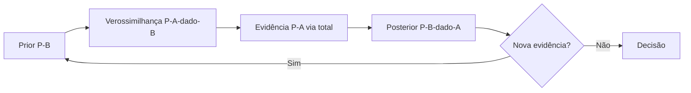

# शून्य की संभावनाः कंडीशनिंग, कुल और बेय

> क्या आप एक सकारात्मक परीक्षण के लिए एक वास्तविक मौका है कि आप बीमार हो जाएगा?

**Type:** Build
**Languages:** Python
**Prerequisites:** 01-estatistica-descritiva
**Time:** ~60 minutes

## सीखने के लक्ष्य

- उत्पाद नियम के साथ परीक्षण की आजादी की गणना
- एक घटना को परस्पर विशेष रूप से दृश्यों में विभाजित करने के लिए एक कुल संभावना के कानून का उपयोग करना
- बेयज़ के सिद्धांत को शर्तों के लिए व्युत्पन्न और लागू करना (चिकित्सा परीक्षण, स्पैम, चर्न)
- एक PMF discreta do zero का निर्माण करना और उम्मीद की गणना करना

## समस्या

एक दुर्लभ बीमारी का परीक्षण 99% संवेदनशीलता और 95% विशिष्टता के साथ किया जाता है। एक बीमारी प्रति 1000 लोगों में से 1 तक पहुंचती है। आपका परीक्षण सकारात्मक है। आपके बीमार होने की संभावना क्या है?

O instinto diz 99%. A resposta correta é ~2%. O erro  confundir P(positivo dizerdoente) com P(doente dizerpositivo)  se chama falácia da taxa-base, e aparece em churn, fraude, spam e qualquer classiador com classe rara. Sem probabilidade condicional, você interpreta todo modelo errado.

## अवधारणा

### संदिग्धता

```
P(A|B) = P(A ∩ B) / P(B),  com P(B) > 0
```

लीः "संभाव्यता के एक तथ्य है कि बी हुआ है". ब्रह्मांड को उन मामलों तक सीमित करता है जहां बी हुआ है।

उदाहरण: dado justo, B = "saiu par" {2,4,6}, A = "saiu 6". P(A

### स्वतंत्रता

A e B são independentes se o conhecimento de B não muda a chance de A:

```
P(A|B) = P(A)  <=>  P(A ∩ B) = P(A) · P(B)
```

दो मुद्राओं के लॉन्चः पप्पर नहीं 2o , पप्पर नहीं 1o = 1/2 = पप्पर) । स्वतंत्र. लेकिन "छोवर" और "लेवर गार्ड-चूवा" नहीं हैं।

### संभावनाओं की कुल संख्या

B1..Bn particionam o espaço (mutuamente exclusivos, cobrem tudo):

```
P(A) = Σ P(A|Bi) · P(Bi)
```

उदाहरण: P positivo) = P positivo de fazer o serviço) P doente) + P positivo de fazer o serviço) P saudável)

### बेयज़ सिद्धांत

उपरोक्त दो सूत्रों के रूप में एक शर्त संयोजन में उलटा करेंः

```
P(B|A) = P(A|B) · P(B) / P(A)
```

मेडिकल टेस्ट: P  Noente Não Positivo) = 0.99·0.001 / (0.99·0.001 + 0.05·0.999) ≈ 0.0194 ≈ 2%.



```figure
stats-probability-bayes
```

## इसे बनाओ

### चरण 1: कंडीशनिंग ई इंडिपेंडेंस do zero

```python
def cond_prob(p_ab, p_b):
    if p_b <= 0:
        raise ValueError("P(B) deve ser > 0")
    return p_ab / p_b

def joint_if_independent(p_a, p_b):
    return p_a * p_b

def is_independent(p_a, p_b, p_ab, tol=1e-9):
    return abs(p_ab - p_a * p_b) <= tol

print(cond_prob(1/6, 3/6))          # 0.333: P(6 | par)
print(is_independent(0.5, 0.5, 0.25))  # True: duas moedas
```

### चरण 2: कुल संभावना

```python
def total_prob(cond_probs, priors):
    # cond_probs[i] = P(A|Bi), priors[i] = P(Bi)
    if abs(sum(priors) - 1.0) > 1e-9:
        raise ValueError("priors devem somar 1")
    return sum(c * p for c, p in zip(cond_probs, priors))

p_pos = total_prob([0.99, 0.05], [0.001, 0.999])
print(f"P(positivo) = {p_pos:.4f}")  # ~0.0509
```

### चरण 3: बेय + पीएमएफ, आशा और विविधता

```python
def bayes(p_a_given_b, p_b, p_a):
    return p_a_given_b * p_b / p_a

print(f"P(doente|+) = {bayes(0.99, 0.001, p_pos):.4f}")  # ~0.0194

def pmf(values, probs):
    if abs(sum(probs) - 1.0) > 1e-9:
        raise ValueError("probs devem somar 1")
    return dict(zip(values, probs))

def expected_value(d):
    return sum(x * p for x, p in d.items())

def variance_dist(d):
    mu = expected_value(d)
    return sum(((x - mu) ** 2) * p for x, p in d.items())

dado = pmf([1,2,3,4,5,6], [1/6]*6)
print(expected_value(dado), variance_dist(dado))  # 3.5, ~2.917
```

## इसका प्रयोग करें

समान गणना`fractions`(exato) ou contagem empírica:

```python
from fractions import Fraction

# Bayes exato com frações
p = Fraction(99,100) * Fraction(1,1000) / (
    Fraction(99,100)*Fraction(1,1000) + Fraction(5,100)*Fraction(999,1000))
print(p, float(p))  # ~0.0194

# Verificação empírica por simulação (lei dos grandes números)
import random
random.seed(0)
n = 200_000
doente_pos = sum(1 for _ in range(n)
                 if random.random() < 0.001 and random.random() < 0.99)
saud_pos = sum(1 for _ in range(n)
               if random.random() >= 0.001 and random.random() < 0.05)
print(doente_pos / (doente_pos + saud_pos))  # ~0.02
```

अनुकरण और सूत्र को 2a decimal com n grande पर संगत होना चाहिए।

## इसे भेजें

आर्टिफैटो: `outputs/skill-probabilidade.md` चेकलिस्ट "जब भी किसी शर्त को उलटता है, तो पूर्व घोषित करें, सत्यता और निष्कर्ष से पहले साक्ष्य।

## व्यायाम

1. एक स्पैम फ़िल्टर स्पैम के 98% और गैर-स्पैम के 2% का है। यदि 30% ईमेल स्पैम हैं, तो स्पैम किसके लिए है?`bayes()`. .
2. यह साबित करें कि P (A) = P (B) = P (B) = P (B) = P (B) = P (B) = P (B) = P (B) = P (B) = P) = P (B) = P (B) = P) = P (B) = P (B) = P) = P (B) = P (B) = P (B) = P) = P (B) = P (B) = P) = P (B) = P (B) = P) = P (B) = P) = P (B) = P (B) = P) = P (B) = P) = P (B) = P) = P (B) = P) = P (B) = P) = P (B) = P) = P) = P (B) = P) = P) = P (B) = P) = P) = P (B) = P) = P) = P) = P (P) = P) = P) = P) = P (P) = P) = P) = P) = P) = P (P) = P) = P) = P) = P) = P (P) = P) = P) = P) = P) = P (P) = P) = P) = P) = P (P) = P) = P) = P) = P) = P (P) = P) = P) = P) = P (P) = P) = P) = P) = P) = P (P) = P) = P) = P) = P (P) = P) = P) = P) = P (P) = P) = P) = P) = P) = P) = P (P) = = = = P) = = = = = = = = = = = = = = = = = = = = = = = = = = = = = = = = = = = = = = = = = = = = = = = = = = = = = = = = = = = = = = = = = = = = = = = = = = = = = = = = = = = = = = = = = = = = = = = = = = = = = = =
3. "दो डेटा के एक समूह" का एक PMF बनाएँ और आशा और भिन्नता की गणना करें`expected_value()`ई `variance_dist()`. .

## प्रमुख शर्तें

| Term | O que dizem | O que realmente é |
|---|---|---|
| Condicional P(A\|B) | "chance de A se B" | P(A∩B)/P(B); restringe o universo a B |
| Independência | "sem relação" | P(A∩B)=P(A)·P(B); saber B não muda A |
| Probabilidade total | "média ponderada" | P(A)=Σ P(A\|Bi)·P(Bi) sobre partição |
| Teorema de Bayes | "inverter a pergunta" | P(B\|A)=P(A\|B)·P(B)/P(A) |
| PMF | "tabela de chances" | P(X=x) para cada valor discreto; soma 1 |
| Esperança | "média teórica" | Σ x·P(x); para onde a média amostral converge |

## आगे पढ़ना

- [Seeing Theory — Probability](https://seeing-theory.brown.edu/) दृश्य इंटरएटिव
- [Stat Trek: Bayes Theorem](https://stattrek.com/probability/bayes-theorem) संदर्भ com उदाहरण
- [Python `fractions` docs](https://docs.python.org/3/library/fractions.html) उत्पादन के लिए सटीक गणना
