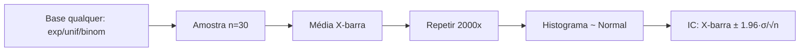

# वितरण और प्रमाणीकरण सेंट्रल डू लिमिट

> क्यों एक औसत 30 "सर्वात सामान्य" मॉडल के भरोसे की अवधि को समझाता है?

**Type:** Build
**Languages:** Python
**Prerequisites:** 01-estatistica-descritiva, 06-probabilidade-fundamentos
**Time:** ~60 minutes

## सीखने के लक्ष्य

- कार्यान्वयन पीएमएफ/पीडीएफ डी बर्नौली, द्विआधारी, पोइसन, सामान्य और एक्सपोनेंशियल केवल उपयोग `math`
- प्रति व्यक्ति वितरण का प्रमाण`random`e validar média/variância teóricas
- सिमुलर ओ थ्योरेमा सेंट्रल डो लिमिटः एक मीडिया एमोस्ट्राल सामान्य के लिए अभिसरण
- शून्य com के कार्यान्वयन की तुलना करें`numpy`/`statistics`जब उपलब्ध

## समस्या

आप एक एपीआई के प्रतिक्रिया समय का उपयोग करते हैं: औसत 200ms, लेकिन 5s के शिखर पर। यह "सामान्य" है? मैं एक औसत ± 2·desvio के रूप में अंतराल का उपयोग कर सकता हूं? यदि एक आधार पर वितरण exponential (असिमेट्रिक), एक व्यक्तिगत प्रतिक्रिया सामान्य नहीं है  लेकिन एक औसत 30 अनुरोधों है। "सामान्य डेटा" को "सामान्य औसत" के साथ भ्रमित करें।

## अवधारणा

### विवशताएंः बर्नौली → द्विपद → पोइसन

- **Bernoulli(p):**1 sucesso com prob. p. E[X]=p, Var=p(1-p) ।
- **Binomial(n,p):**सोमा डी एन बर्नूलिस। `P(X=k) = C(n,k)·p^k·(1-p)^(n-k)`, E=np, Var=np(1-p)
- **Poisson(λ):**घटनाएं प्रति अंतराल दुर्लभ हैं।`P(X=k) = λ^k·e^-λ/k!`, E=Var=λ. जब n grande, p pequeno, np=λ.

### निरंतरता: सामान्य और exponential

- **Normal(μ,σ):** `f(x) = e^(-(x-μ)²/2σ²)/(σ√2π)`. सिमेट्रिक; नियम 68-95-99.7.
- **Exponencial(λ):**पोज़न के घटनाओं के बीच का समय। `f(x) = λ·e^(-λx)`(x≥0), E=1/λ, Var=1/λ2. सेम मेमोरीः P(T>s+t

### थ्योरेमा सेंट्रल डू लिमिट (TCL)

यदि x1..xn são i.i.d. com media μ e variância σ2 finita, तो:

```
X̄ ~ Normal(μ, σ²/n)  quando n cresce
```

किसी भी आधार (समान, घातीय, द्विपद) के लिए  por isso medias de n≥30 se tratam como normais em testes A/B।



```figure
stats-distribuicoes-tcl
```

## इसे बनाओ

### चरण 1: PMF/PDF शून्य (केवल)`math`)

```python
import math

def bernoulli_pmf(k, p):
    return p if k == 1 else (1 - p if k == 0 else 0.0)

def binom_pmf(k, n, p):
    if not 0 <= k <= n:
        return 0.0
    return math.comb(n, k) * p**k * (1-p)**(n-k)

def poisson_pmf(k, lam):
    return lam**k * math.exp(-lam) / math.factorial(k)

def normal_pdf(x, mu=0.0, sigma=1.0):
    return math.exp(-((x-mu)**2)/(2*sigma**2)) / (sigma * math.sqrt(2*math.pi))

def expon_pdf(x, lam):
    return lam * math.exp(-lam*x) if x >= 0 else 0.0

print(binom_pmf(2, 10, 0.5))   # ~0.0439 (= 45/1024)
print(poisson_pmf(3, 2.0))     # ~0.180
print(normal_pdf(0))           # ~0.399
```

### चरण 2: एमोस्ट्रेगेम कॉम`random`

```python
import random

def sample_bernoulli(p, rng):
    return 1 if rng.random() < p else 0

def sample_binomial(n, p, rng):
    return sum(sample_bernoulli(p, rng) for _ in range(n))

def sample_poisson(lam, rng):
    # Knuth: conta eventos até exceder e^-λ
    L = math.exp(-lam)
    k, prod = 0, 1.0
    while True:
        k += 1
        prod *= rng.random()
        if prod <= L:
            return k - 1

def sample_expon(lam, rng):
    return -math.log(1 - rng.random()) / lam  # inversa da CDF

def sample_normal(mu, sigma, rng):
    return rng.gauss(mu, sigma)  # Box-Muller interno do CPython

rng = random.Random(0)
print([sample_binomial(10, 0.5, rng) for _ in range(5)])
```

### चरण 3: सिमुलर या टीसीएल

```python
def sample_means(sampler, n, reps, rng):
    return [sum(sampler() for _ in range(n)) / n for _ in range(reps)]

rng = random.Random(42)
means = sample_means(lambda: rng.expovariate(1.0), n=30, reps=2000, rng=rng)
m = sum(means) / len(means)
v = sum((x-m)**2 for x in means) / len(means)
print(f"base exp(1): E[X̄]={m:.3f} (→1.0) Var={v:.4f} (→1/30≈0.0333)")
```

## इसका प्रयोग करें

सम्मेलन`numpy`/`statistics`(वैकल्पिक):

```python
try:
    import numpy as np
    rng = np.random.default_rng(0)
    s = rng.binomial(10, 0.5, size=50_000)
    print(f"[numpy] binomial(10,.5): média={s.mean():.3f} (→5.0) var={s.var():.3f} (→2.5)")
    e = rng.exponential(1.0, size=(2000, 30)).mean(axis=1)
    print(f"[numpy] TCL exp: E[X̄]={e.mean():.3f} Var={e.var():.4f}")
except ImportError:
    print("numpy não instalado — comparação pulada (pip install numpy)")
```

अपने `math.comb`इस पर एक समझौते पर हस्ताक्षर किए जाने चाहिए।

## इसे भेजें

आर्टिफैटो: `outputs/skill-distribuicoes.md` "कौनसी वितरण उपयोग + जब TCL सामान्य अंतराल को अनुमत करता है"

## व्यायाम

1. द्विपद के रूप में तुलना करेंः n=100, p=0.02) ≈ Poisson(λ=2)
2. TCL के आधार वर्दी का एक अनुकरण करें `random.random()`: E[X̄]→0.5 e Var→1/(12·30)?
3. Quebra do TCL: उपयोग आधार Cauchy (`tan(pi*(u-0.5))`) O histograma das médias "नियमितता"? Por quê? (डिका: विविधता अनंत)

## प्रमुख शर्तें

| Term | O que dizem | O que realmente é |
|---|---|---|
| Bernoulli | "cara ou coroa" | Bloco atômico 0/1 com prob. p |
| Binomial | "k sucessos em n" | Soma de Bernoullis; C(n,k)p^k(1-p)^(n-k) |
| Poisson | "eventos raros" | Limite da Binomial; E=Var=λ |
| Normal | "curva sino" | PDF gaussiana; 68-95-99.7 em ±1/2/3σ |
| Exponencial | "tempo de espera" | Intervalo entre Poissons; sem memória |
| TCL | "média vira normal" | X̄→Normal(μ,σ²/n); exige variância finita |

## आगे पढ़ना

- [Seeing Theory — Distributions & CLT](https://seeing-theory.brown.edu/) दृश्य इंटरएटिव
- [SciPy stats docs](https://docs.scipy.org/doc/scipy/reference/stats.html) उत्पादन के लिए
- [NIST: Probability Distributions](https://www.itl.nist.gov/div898/handbook/eda/section3/eda366.htm) संदर्भ
