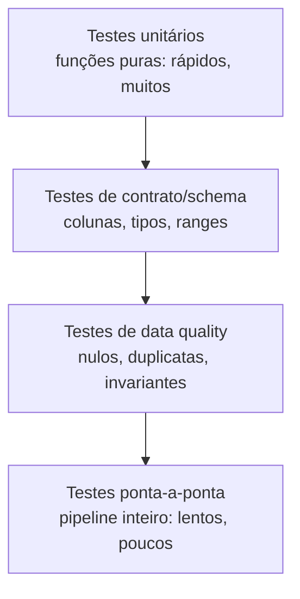

# डेटा विज्ञान के लिए स्वच्छ कोड और परीक्षण

> एक नियोटबुक अपनी मशीन और उत्पादन में क्वेरा  एक ट्रांस्फोरमर विश्लेषण खोजात्मक पाइपलाइन परीक्षण करने के लिए सीखना।

**Type:** Build
**Languages:** Python
**Prerequisites:** 01-estatistica-descritiva, 02-limpeza-e-eda
**Time:** ~60 minutes

## सीखने के लक्ष्य

- स्पष्ट करना कि नोटबुक किस उत्पादन में घटित होते हैं (estado oculto, ejecución fora de orden, dependências implícitas)
- एक नोटबुक को पुनः स्थापित करना
- एसआरपी, ड्राई और वैलिडेशन को लागू करना
- स्कीम, शून्य, सीमा, अपरिवर्तित डेटा गुणवत्ता के लिए एस्क्रवर टेस्ट
- एक डीएस पर लागू एक पिरामिड के परीक्षण की व्याख्याः unitários rápidos, contrato/schema, ponta-a-ponta lentos

## समस्या

आप एक नोटबुक वितरित करते हैं जो अपनी मशीन पर सही तरीके से चलता है। एक सहयोगी "सभी चलाएं" और सेल 7 में एक चर को क्रमादेश के लिए सेल 12 में एक चर के रूप में लिखा जाता है, एक कॉलम।`idade`आया हूँ जैसे स्ट्रिंग `"32"`एक बार में,`dropna()`उत्पादन में, एक नौकरी एजेंडा मध्यरात्रि से उपयोगी संदेश के रूप में विफल रहता है।

नोटबुकों में इष्टतम प्रयोग, नॉन रिपीटशन. स्टेट ग्लोबल म्युटेबल, सेल निष्पादित आउट ऑफ ऑर्डर एण्ड टाइप इम्प्लिकिटस टर्न या नॉन-डिटर्मिनेस्टिक रिजल्ट. ओ कॉस्ट इम्परिएस्ट एटः रिट्राबॉल्हो, मॉडल ट्रेनेडो कॉम डेटा कॉरम्पडोस, एर्रेड डिसीडेंस. ए आउटपुट ए ट्रीट कोड डे डाटा अस सॉफ्टवेयरः फंक्शन स्मॉल, एंट्रेड वैलिडेड, बिहेरिओमेंट टेस्टेड.

## अवधारणा

### कार्यः समान प्रवेश, समान आउटपुट

एक कार्य पूर्ण रूप से वैश्विक नहीं है, कार्य के क्रम पर निर्भर नहीं हैः

```python
# impuro: depende de global e muta o argumento
THRESHOLD = 18
def filtrar_adultos(rows):
    return [r for r in rows if r["idade"] >= THRESHOLD]  # quebra se idade for str

# puro: dependências explícitas, sem mutação
def filtrar_adultos(rows, idade_minima=18):
    return [{**r} for r in rows if int(r["idade"]) >= idade_minima]
```

व्यावहारिक नियम: um verbo por função (`load`,`validate`,`clean`,`featurize`), सेम इ/ओ नो मिओडो डु पाइपलाइन (I/O सोलो ना बोर्डास), रिटर्न नो एम् वेंज डी म्युटर।

### SOLID em versão DS (केवल यहाँ पर ही)

- **S — Single Responsibility:** `validate_schema()`वैलिडा, `clean()`हम दोनों एक साथ कभी नहीं होंगे।
- **D — Dependency Inversion (na prática):**एक चरण प्राप्त करता है जो पैरामीटर (तारे, स्तंभ) द्वारा निर्दिष्ट है, कोई वैश्विक महत्व नहीं है।
- **Contrato na borda:**एक रेखा और एक स्तंभ के रूप में संदेश भेजने के लिए एक प्रारूप के लोगो को मान्य करें।

### दादा के लिए अंडाकार पिरामिड



एक आधार (Unitarios + Schema) प्रत्येक प्रतिबद्धता के सेकंड में चला जाता है। एक टोप (pipeline inteiro com dados reais) कोई आईसी/नोटुरन नहीं चलाता है। यदि एक आधार fraca है, तो सभी त्रुटि केवल उत्पादन में होती है।

```figure
clean-code-pipeline-overview
```

## इसे बनाओ

### चरण 1: एक तालिका को सूची-निर्णय और वैध योजना के रूप में प्रस्तुत करें

सेम पांडाः cada linha é um `dict`, एक तालिका है`list[dict]`. .

```python
SCHEMA = {
    "nome": str,
    "idade": int,   # aceita "32" conversível
    "salario": float,
}

def validate_schema(rows, schema):
    errors = []
    for i, row in enumerate(rows):
        for col, tipo in schema.items():
            if col not in row:
                errors.append(f"linha {i}: coluna ausente '{col}'")
                continue
            try:
                tipo(row[col])
            except (ValueError, TypeError):
                errors.append(f"linha {i}: '{col}'={row[col]!r} não converte para {tipo.__name__}")
    return errors
```

### चरण 2: पाइपलाइन मॉड्यूलर com funções puras

```python
def clean_rows(rows):
    out = []
    for r in rows:
        novo = {"nome": str(r["nome"]).strip(), "idade": int(r["idade"]), "salario": float(r["salario"])}
        if novo["idade"] >= 0 and novo["salario"] >= 0:
            out.append(novo)
    return out

def featurize(rows):
    return [{**r, "adulto": r["idade"] >= 18} for r in rows]

def run_pipeline(rows):
    errors = validate_schema(rows, SCHEMA)
    if errors:
        raise ValueError("schema inválido:\n" + "\n".join(errors[:5]))
    return featurize(clean_rows(rows))
```

### चरण 3: डेटा गुणवत्ता परीक्षण

```python
def check_quality(rows):
    checks = {
        "sem_nulos": all(v is not None and v != "" for r in rows for v in r.values()),
        "idades_validas": all(0 <= r["idade"] <= 120 for r in rows),
        "sem_duplicatas": len({(r["nome"], r["idade"]) for r in rows}) == len(rows),
    }
    return checks
```

प्रत्येक चेक बुलेनो नामोद लौटता हैः जब यह गलत होता है, तो आप जानते हैं कि क्या अपरिवर्तनीय है।

## इसका प्रयोग करें

ओ mesmo padrão com a biblioteca de produção (`pandera`पैरा स्कीम, `pytest`como runner):

```python
# import pandera.pandas as pa
# import pandas as pd
# from pandera import Column, DataFrameSchema, Check
#
# schema = DataFrameSchema({
#     "nome": Column(str),
#     "idade": Column(int, Check.between(0, 120)),
#     "salario": Column(float, Check.ge(0)),
# })
# df = pd.DataFrame([{"nome": "ana", "idade": 30, "salario": 5000.0}])
# print(schema.validate(df))
# # pytest: mesmos asserts do unittest, com fixtures e mensagens melhores
```

अपने वैधकर्ता के लिए आवेदन करें`pandera`अनुच्छेद: लाइन वैलिडा पास नो दो, लाइन इन्वालिडा फाल्हा नो दो।

## इसे भेजें

आर्टिफैटो: `outputs/skill-clean-code-ds.md` किसी भी नोटबुक को पाइपलाइन में परिवर्तित करने के लिए चेकलिस्टः "फंक्शन्स प्यूरास, स्कीम ना बोर्ड, क्वालिटी चेक नॉमेड, टेस्ट्स रैपिडोस एम्बेइक्स इ पोंटा-ए-पोंटा इम् सिमा".

## व्यायाम

1. Quebre propositalmente: पास `idade="trinta"`एक लाइन से`salario`. एक त्रुटि संदेश कॉलम में लाइन में?
2. अतिरिक्त चेक`salario_mediano_positivo`और एक परीक्षण जो गलत होता है जब सभी वेतन 0 हैं क्यों व्यापार वैरिएंट मूल्य है कि मैं प्रकार का परीक्षण?
3. एक कार्य को परिवर्तित करें जो वैश्विक रूप से बदल जाए और शुद्ध कार्य (पेरैमेट्रो स्पष्ट, रिटर्न नोवो) हो।

## प्रमुख शर्तें

| Term | O que dizem | O que realmente é |
|---|---|---|
| Função pura | "função limpa" | Mesma entrada -> mesma saída, sem global nem mutação; testável em isolamento |
| Schema | "formato dos dados" | Contrato de colunas + tipos; validado na borda, falha rápido |
| Data quality check | "teste de dados" | Invariante nomeado (nulos, ranges, duplicatas) que explica o que quebrou |
| SRP | "uma coisa só" | Cada função/etapa tem um único motivo para mudar |
| Pirâmide de testes | "testar tudo" | Muitos testes rápidos na base (unit/schema), poucos lentos no topo (e2e) |
| Falhe rápido | "validar cedo" | Erro na entrada com mensagem útil em vez de corrupção silenciosa adiante |

## आगे पढ़ना

- [PEP 8 — Style Guide](https://peps.python.org/pep-0008/) आधिकारिक सम्मेलन
- [unittest docs](https://docs.python.org/3/library/unittest.html) धावक स्टडीलिब
- [Pandera docs](https://pandera.readthedocs.io/) वैधता योजना उत्पादन
