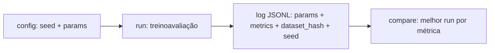

# प्रयोगों की अनुवर्ती क्षमता

> "Funcionou ayer" एक वैज्ञानिक परिणाम नहीं है  एक पक्का बीज, संस्करण डेटासेट और रजिस्ट्रार प्रत्येक रन के बारे में सीखना।

**Type:** Build
**Languages:** Python
**Prerequisites:** 01-estatistica-descritiva, 08-clean-code-testes-ds
**Time:** ~60 minutes

## सीखने के लक्ष्य

- तीन स्रोतों के रूप में व्याख्या करना गैर-निर्धारिताः बीज नहीं निश्चित, डेटासेट सेम संस्करण, हाइपरपरपरमट्रस नॉन रजिस्टर्ड
- फिक्सर बीज`random`(ई `numpy`/`torch`no Use It) को दोहराकर विभाजित करें
- संस्करण एक डेटासेट के साथ हैश SHA-256 do conteúdo canônico
- रजिस्ट्रार चलाता है (पेरम्स + मेट्रिक्स + डेटासेट_हैश) em JSONL com stdlib
- तुलना करें रन ई escolher o melhor por métrica com função pura

## समस्या

आप दो बार ट्रेन चलाते हैं और हमें 0.87 से 0.83 तक सटीकता मिलती है। क्या रिपोर्टर कुछ भी नहीं बदलता है?

कोई बीज निश्चित नहीं, कोई श्लेष्म/विभाजन/मूस्ट्रेज नहीं, कोई डेटासेट नहीं, कोई डेटासेट नहीं, कोई पैरामीटर नहीं, कोई ऑडिट नहीं, कोई तुलना नहीं है।

## अवधारणा

### बीजः o ponto de partida do aleatório

बीज देने वाले जनरॉडरस के नाम से निर्धारित होते हैंः

```python
import random
random.seed(42)
print(random.random())  # sempre 0.6394267984578837
```

एक बार नहीं शुरू होने पर एक बीज फिक्स (`set_seed(42)`) और सब प्रकार के बाद दोहराया जाता है। बीज अलग = विभिन्न प्रयोग; इसलिए एक बीज भी एक पैरा पंजीकृत है।

### डेटासेट संस्करण = सामग्री का ह्यास

नाम अभिलेखागार (`dados_final_v2_REAL.csv`) हैश नहीं:

```
versão = sha256(representação_canônica_das_linhas)
```

दो तालिकाओं के साथ एक ही सामग्री है, एक बाइट.

### ट्रैकर minimalista: एक लाइन JSON प्रति रन



प्रत्येक रजिस्टर`timestamp`,`seed`,`dataset_hash`,`params`,`metrics`. JSONL अभिलेखागार केवल अनुलग्नक: ऐतिहासिक अपरिवर्तनीय, किसी भी उपकरण से पठनीय है.

```figure
reproducibility-tracking-overview
```

## इसे बनाओ

### चरण 1: बीज को तय करें और चेहरे को विभाजित करें

```python
import random

def set_seed(seed):
    random.seed(seed)

def train_test_split(rows, test_ratio=0.2, seed=42):
    rng = random.Random(seed)  # instância local: não polui o global
    idx = list(range(len(rows)))
    rng.shuffle(idx)
    k = int(len(rows) * (1 - test_ratio))
    return [rows[i] for i in idx[:k]], [rows[i] for i in idx[k:]]
```

मेस्मा बीज + समान दादा = समान विभाजित, हमेशा।

### चरण 2: हश कैनोनिक डेटासेट

```python
import hashlib, json

def dataset_hash(rows):
    canon = json.dumps(rows, sort_keys=True, ensure_ascii=False)
    return hashlib.sha256(canon.encode("utf-8")).hexdigest()[:12]
```

`sort_keys=True`गार्तोर्न कैनोनिक ऑर्डर ऑफ चाइसेस; o prefixo de 12 chars basta como verão legible.

### चरण 3: ट्रैकर JSONL

```python
import json, datetime

def log_run(path, params, metrics, seed, dhash):
    record = {
        "timestamp": datetime.datetime.now(datetime.timezone.utc).isoformat(),
        "seed": seed, "dataset_hash": dhash,
        "params": params, "metrics": metrics,
    }
    with open(path, "a", encoding="utf-8") as f:
        f.write(json.dumps(record, ensure_ascii=False) + "\n")
    return record

def load_runs(path):
    with open(path, encoding="utf-8") as f:
        return [json.loads(line) for line in f if line.strip()]

def best_run(runs, metric="accuracy", higher=True):
    return (max if higher else min)(runs, key=lambda r: r["metrics"][metric])
```

## इसका प्रयोग करें

उत्पादन के ढेर के साथ (`mlflow`शहर, `numpy`बीज के लिए):

```python
# import mlflow, numpy as np
#
# np.random.seed(42)  # além de random.seed(42)
# # import torch; torch.manual_seed(42)
#
# # mlflow.start_run()
# # mlflow.log_params({"lr": 0.01, "seed": 42, "dataset_hash": "abc..."})
# # mlflow.log_metric("accuracy", 0.87)
# # mlflow.end_run()
```

अपने ट्रैकर JSONL e o mlflow registram o mesmo contrato: parameters + metrics + dataset_hash + seed.

## इसे भेजें

आर्टिफैटो: `outputs/skill-reprodutibilidade-tracking.md` चेकलिस्ट de todo experimento: "बीज फिक्स्ड और रजिस्टर्ड, डेटासेट कॉम हैश, यूएम JSON प्रति रन, बेस्ट रन चयनित प्रति फ़ंक्शन शुद्ध".

## व्यायाम

1. रड `train_test_split`दो बार सेम 42 और एक सेम 7 सेम 7 सेम 7 सेम 7 सेम 7 सेम 7 सेम 7 सेम 7 सेम 7 सेम 7 सेम 7 सेम 7 सेम 7 सेम 7 सेम 7 सेम 7 सेम 7 सेम 7 सेम 7 सेम 7 सेम 7 सेम 7 सेम 7 सेम 7 सेम 7 सेम 7 सेम 7 सेम 7 सेम 7 सेम 7 सेम 7 सेम 7 सेम 7 सेम 7 सेम 7 सेम 7 सेम 7 सेम 7 सेम 7 सेम 7 सेम 7 सेम 7 सेम 7 सेम 7 सेम 7 सेम 7 सेम 7 सेम 7 सेम 7 सेम 7 सेम 7 सेम 7 सेम 7 सेम 7 सेम 7 सेम 7 सेम 7 सेम 7 सेम 7 सेम 7 सेम 7 सेम 7 सेम 7 सेम 7 सेम 7 सेम 7 सेम 7 सेम 7 सेम 7 सेम
2. किसी भी डेटासेट को बदलने और हश को पुनः गणना करने के लिए।`sort_keys=True`क्या यह महत्वपूर्ण है?
3. लॉग 3 पर चलती है, जो कि पैरामीटर के अनुसार चलती है, फिर उपयोग करें`best_run`com `higher=False`एक त्रुटि की एक मेट्रिक.

## प्रमुख शर्तें

| Term | O que dizem | O que realmente é |
|---|---|---|
| Seed | "número mágico" | Estado inicial do gerador pseudo-aleatório; fixa toda a sequência sorteada |
| Dataset hash | "versão dos dados" | SHA-256 do conteúdo canônico; prova em quais dados você treinou |
| Run | "um treino" | Uma execução com seed + params + dataset fixos e métricas registradas |
| JSONL | "log de runs" | Um objeto JSON por linha, append-only; histórico auditável |
| Tracking | "acompanhar modelo" | Registrar params/metrics/versões para comparar e reproduzir |
| Determinismo | "sempre igual" | Mesma seed + mesmos dados + mesmo código = mesmo resultado |

## आगे पढ़ना

- [MLflow Tracking docs](https://mlflow.org/docs/latest/tracking.html) उत्पादन का स्तर
- [hashlib docs](https://docs.python.org/3/library/hashlib.html) संदर्भ stdlib
- [NumPy random seed docs](https://numpy.org/doc/stable/reference/random/index.html) बीज उत्पादन
