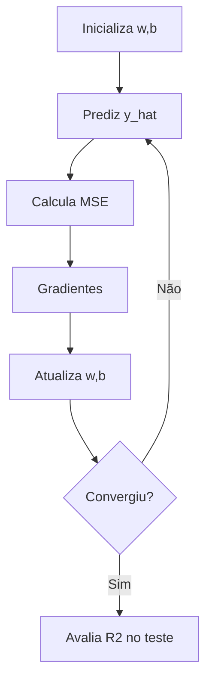

# Regressão Linear do Zero

> Antes de aprender, escreve o gradiente à mão e entenda por que um retém o movimento.

**Type:** Build
**Languages:** Python
**Prerequisites:** 01-estatistica-descritiva, 02-limpeza-e-eda
**Time:** ~75 minutes

## Objetivos de aprendizagem

- Derivar o gradiente do MSE para`y=wx+b`e regressão linear do zero
- Treinar com gradiente descendente e comparar com uma equação normal
- Avaliar com MSE, RMSE e R2 e com excesso de equipamento diagnóstico dividido em treino/teste
- Estender para regressão múltipla e entender escala

## O problema

Prever preço de imóvel dado tamanho Sem regressão você cai Com regressão você aprende um reta que minimiza o erro quadrático É o "olá mundo" que introduz todo o ciclo de ML: modelo → custo → otimização.

## O conceito

Modelo: `y = wx + b`Custo MSE: `(1/n) sum(y_hat - y)^2`- Não .
Gradientes: `dw = (2/n) sum((y_hat-y)x)`- Não .`db = (2/n) sum(y_hat-y)`- Não .
Atualização: `w -= lr*dw`- Não .

Equação normal: `w = (X^T X)^{-1} X^T y` solução fechada, O ((n3) em características.

R2 = 1 - SS_res/SS_tot (quanto da variância é explicada).



```figure
linear-regression-fit
```

## Construí-lo

Verão`code/main.py`- Não .`LinearRegression`com `fit`- Não .`predict`- Não .`r2`Incluir várias visualizações de Ridge.

## Usá-lo

```python
from sklearn.linear_model import LinearRegression
model = LinearRegression().fit(X_train, y_train)
print(model.coef_, model.intercept_, model.score(X_test, y_test))
```

## Envia-o

`outputs/skill-regressao.md`Quando usar gradiente versus normal, quando escalar, quando regularizar.

## Exercícios

1. Implementar SGD vs. GD de lote.
2. Os testes de grau 10 em dados quadráticos  excesso de montagem.
3. Implementar Ridge (L2).

## Termos-chave

| Term | Significado |
|---|---|
| MSE | Erro quadrático médio |
| R² | Variância explicada |
| Learning rate | Passo do gradiente |
| Scaling | Padronizar para convergir |

## Mais leitura

- [ISLR cap 3](https://www.statlearning.com/)
- [CS229 notes](https://cs229.stanford.edu/main_notes.pdf)
