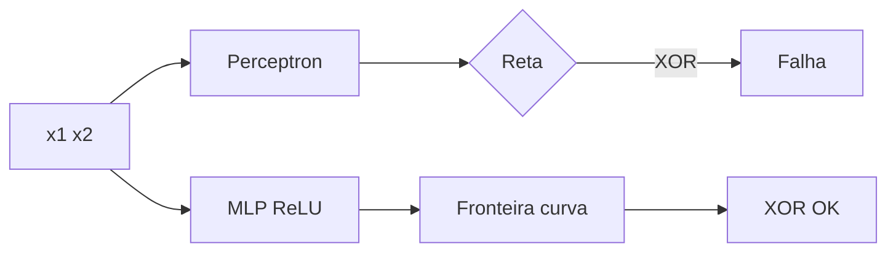

# Percepção e Aprendizagem Profunda

> De uma linha que separa pontos até uma rede que aprende tudo o que é necessário.

**Type:** Build
**Languages:** Python
**Prerequisites:** 03-regressao-do-zero, 04-classificacao-e-avaliacao
**Time:** ~80 minutes

## Objetivos de aprendizagem

- Implementar a regra de Rosenblatt e provar quando convergem/divergem
- Estender para MLP com ReLU/sigmoide, manual de avanço e de apoio
- Treinar com gradiente descendente e comparar com`torch.nn.Linear`
- Visualizar a fronteira de decisão e explicar a percepção de falha no RSE

## O problema

O processo de aprendizagem profunda utiliza redes (camadas) + não lineares (ReLU) para criar fronteiras curvas.

## O conceito

Perceptor:`y = sign(w·x + b)`, actualização: `w += lr*(y_true - y_pred)*x`- Não .

Limite: só separar linearmente.

MLP 1 oculta: `h=ReLU(W1 x + b1)`- Não .`y=sigmoid(W2 h + b2)`- Derivadas de encadeia de apoio.

ReLU: `max(0,z)` gradiente 1 se z> 0, caso contrário.



```figure
perceptron-vs-mlp
```

## Construí-lo

Verão`code/main.py`A primeira é a de "Permotores de Direito" (PEM) e "Permotores de Direito" (PEM).

## Usá-lo

```python
import torch
model = torch.nn.Sequential(torch.nn.Linear(2,8), torch.nn.ReLU(), torch.nn.Linear(8,1), torch.nn.Sigmoid())
# treino com torch.optim.SGD
```

A sua MLP não deve ser comparada com a sua acuração < 5% sem OXR.

## Envia-o

`outputs/skill-perceptron.md`Quando usar linear versus MLP, como debugar fronteira.

## Exercícios

1. Os amostras que não são percebidos convergem em XOR (prova).
2. Troque ReLU por sigmoide na oculta  ou que muda no treino?
3. Adicione 2a camada oculta e meça ganho.

## Termos-chave

| Term | Definição |
|---|---|
| Perceptron | Classificador linear com update erro-dirigido |
| ReLU | max(0,z) |
| Backprop | Regra da cadeia para gradientes |
| XOR | Problema não-linear que exige oculta |

## Mais leitura

- [Rosenblatt 1958 — Perceptron](https://psycnet.apa.org/record/1959-09865-001)
- [3Blue1Brown — Neural Networks](https://www.3blue1brown.com/topics/neural-networks)
- [PyTorch basics](https://pytorch.org/tutorials/beginner/basics/intro.html)
