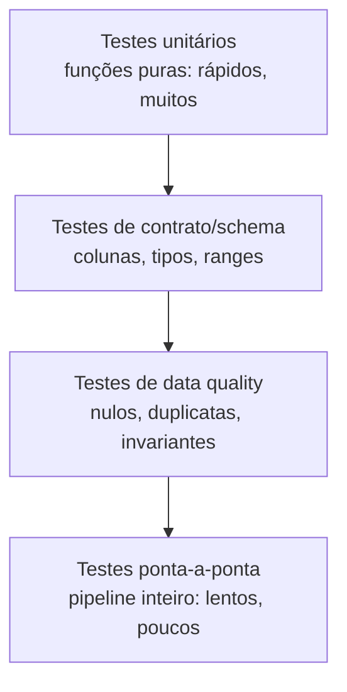

# Código limpo e testes para ciência dos dados

> O notebook roda na sua máquina e quebra em produção aprende uma análise exploratória transformadora em tubo testável.

**Type:** Build
**Languages:** Python
**Prerequisites:** 01-estatistica-descritiva, 02-limpeza-e-eda
**Time:** ~60 minutes

## Objetivos de aprendizagem

- Explicar por que cadernos quebram em produção (estado oculto, execução fora de ordem, dependências implícitas)
- Refazer um notebook monolítico em pipeline modular com funções puras e contratos de esquema
- Aplicar o RRS, DRY e validação na borda em código de dados com o STDlib
- Testes de qualidade dos dados (esquema, nulos, intervalos, invariantes)
- Interpretação de um pirâmide de testes aplicado em um DS: unitários rápidos, contrato/esquema, ponta-a-ponta lentos

## O problema

O colega executa "Run All" e a quebra na célula 7: uma variável foi sobrescrita na célula 12 executada fora de ordem, uma coluna `idade`Vive como uma corda`"32"`Em vez de int, e um `dropna()`Em produção, o trabalho agendado falha à meia-noite como mensagem útil.

O custo aparece depois: retrabalho, modelo treinado com dados corrompidos, decisão errada. A saída é tratar código de dados como software: funções pequenas, entradas validadas, comportamento testado.

## O conceito

### Funções puras: mesma entrada, mesma saída

Uma função pura não é nem escreve global, não depende da ordem de execução:

```python
# impuro: depende de global e muta o argumento
THRESHOLD = 18
def filtrar_adultos(rows):
    return [r for r in rows if r["idade"] >= THRESHOLD]  # quebra se idade for str

# puro: dependências explícitas, sem mutação
def filtrar_adultos(rows, idade_minima=18):
    return [{**r} for r in rows if int(r["idade"]) >= idade_minima]
```

Regras práticas: um verbo por função (`load`- Não .`validate`- Não .`clean`- Não .`featurize`- a) a entrada em circulação de passageiros, a entrada em circulação de passageiros, a entrada em circulação de passageiros, a entrada em circulação de passageiros, a entrada em circulação de passageiros, a entrada em circulação de passageiros, a entrada em circulação de passageiros, a entrada em circulação de passageiros, a entrada em circulação de passageiros, a entrada em circulação de passageiros, a entrada em circulação de passageiros, a entrada em circulação de passageiros, a entrada em circulação de passageiros, a entrada em circulação de passageiros, a entrada em circulação de passageiros, a entrada em circulação de passageiros, a entrada em circulação de passageiros, a entrada em circulação de passageiros, a entrada em circulação de passageiros, a entrada em circulação de passageiros,

### SOLID em versão DS (só o que importa aqui)

- **S — Single Responsibility:** `validate_schema()`valida, `clean()`Nunca os dois juntos.
- **D — Dependency Inversion (na prática):**Uma etapa recebe o que precisa por parâmetro ( limiar, colunas), não importa global.
- **Contrato na borda:**O código de identificação de um sistema de identificação de dados é o código de identificação de dados.

### Pirâmide de testículos para dados



Uma base (unitários + esquema) roda em segundos a cada comitê. O topo (pipeline inteiro com dados reais) roda não CI/noturno. Se uma base é fraca, todo erro é feito apenas em produção.

```figure
clean-code-pipeline-overview
```

## Construí-lo

### Passo 1: Representação de uma tabela como lista de ditos e valid o esquema

Sem pandas: cada linha é um`dict`, uma tabela é uma`list[dict]`- Não .

```python
SCHEMA = {
    "nome": str,
    "idade": int,   # aceita "32" conversível
    "salario": float,
}

def validate_schema(rows, schema):
    errors = []
    for i, row in enumerate(rows):
        for col, tipo in schema.items():
            if col not in row:
                errors.append(f"linha {i}: coluna ausente '{col}'")
                continue
            try:
                tipo(row[col])
            except (ValueError, TypeError):
                errors.append(f"linha {i}: '{col}'={row[col]!r} não converte para {tipo.__name__}")
    return errors
```

### Passo 2: Com funções puras modulares do gasoduto

```python
def clean_rows(rows):
    out = []
    for r in rows:
        novo = {"nome": str(r["nome"]).strip(), "idade": int(r["idade"]), "salario": float(r["salario"])}
        if novo["idade"] >= 0 and novo["salario"] >= 0:
            out.append(novo)
    return out

def featurize(rows):
    return [{**r, "adulto": r["idade"] >= 18} for r in rows]

def run_pipeline(rows):
    errors = validate_schema(rows, SCHEMA)
    if errors:
        raise ValueError("schema inválido:\n" + "\n".join(errors[:5]))
    return featurize(clean_rows(rows))
```

### Passo 3: Teste de qualidade dos dados

```python
def check_quality(rows):
    checks = {
        "sem_nulos": all(v is not None and v != "" for r in rows for v in r.values()),
        "idades_validas": all(0 <= r["idade"] <= 120 for r in rows),
        "sem_duplicatas": len({(r["nome"], r["idade"]) for r in rows}) == len(rows),
    }
    return checks
```

Cada cheque retorna o nome booleano: quando falha, sabe exatamente qual é a quebrou invariante.

## Usá-lo

O mesmo padrão com uma biblioteca de produção (`pandera`para esquemas, `pytest`Como corredor:

```python
# import pandera.pandas as pa
# import pandas as pd
# from pandera import Column, DataFrameSchema, Check
#
# schema = DataFrameSchema({
#     "nome": Column(str),
#     "idade": Column(int, Check.between(0, 120)),
#     "salario": Column(float, Check.ge(0)),
# })
# df = pd.DataFrame([{"nome": "ana", "idade": 30, "salario": 5000.0}])
# print(schema.validate(df))
# # pytest: mesmos asserts do unittest, com fixtures e mensagens melhores
```

Seu validador é o`pandera`Deve concordar: linha válida passa nos dois, linha inválida falha nos dois.

## Envia-o

Artefato: `outputs/skill-clean-code-ds.md` lista de verificação para converter qualquer notebook em pipeline: "funções puras, esquema na borda, verificações de qualidade nomeadas, testes rápidos embaixo e ponta-a-ponta em cima".

## Exercícios

1. Quebre propositalmente: passe `idade="trinta"`e uma linha sem`salario`Uma mensagem de erro na coluna?
2. Adicione um cheque`salario_mediano_positivo`E um teste que falha quando todos os salários são 0, por que a invariante de negócios vale mais que o teste de tipo?
3. Converte uma função sua que muda global em função pura (parâmetros explícitos, retorno novo).

## Termos-chave

| Term | O que dizem | O que realmente é |
|---|---|---|
| Função pura | "função limpa" | Mesma entrada -> mesma saída, sem global nem mutação; testável em isolamento |
| Schema | "formato dos dados" | Contrato de colunas + tipos; validado na borda, falha rápido |
| Data quality check | "teste de dados" | Invariante nomeado (nulos, ranges, duplicatas) que explica o que quebrou |
| SRP | "uma coisa só" | Cada função/etapa tem um único motivo para mudar |
| Pirâmide de testes | "testar tudo" | Muitos testes rápidos na base (unit/schema), poucos lentos no topo (e2e) |
| Falhe rápido | "validar cedo" | Erro na entrada com mensagem útil em vez de corrupção silenciosa adiante |

## Mais leitura

- [PEP 8 — Style Guide](https://peps.python.org/pep-0008/) convenções oficiais
- [unittest docs](https://docs.python.org/3/library/unittest.html) Corredor stdlib
- [Pandera docs](https://pandera.readthedocs.io/) validação de esquema em produção
