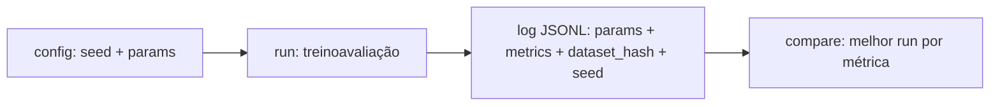

# Reprodutibilidade e Tracking de Experimentos

> "Funcionou ontem" não é resultado científico  aprende uma fixar sementes, datasets de versão e registar cada execução.

**Type:** Build
**Languages:** Python
**Prerequisites:** 01-estatistica-descritiva, 08-clean-code-testes-ds
**Time:** ~60 minutes

## Objetivos de aprendizagem

- Explicar como três fontes de não-determinismo: semente não fixada, conjunto de dados sem versão, hiperparâmetros não registrados
- Sementes fixas de`random`(e `numpy`- Não .`torch`Não Use It) para repetir as divisões e as amostragens
- Versão um conjunto de dados com hash SHA-256 do conteúdo canônico
- Registros executam (parâmetros + métricas + conjunto de dados_hash) em JSONL com stdlib
- Comparar corridas e escolher o melhor por métrica com função pura

## O problema

O relatório foi publicado em 18 de janeiro de 2007, e foi publicado em 18 de janeiro de 2007, no jornal The New York Times.

Sem semente fixada, cada mistura/split/amostragem muda. Sem hash do conjunto de dados, você não sabe em que dados são treinados. Sem log de parâmetros/metricas, não há como comparar nem auditar.

## O conceito

### Semente: o ponto de partida do aleatório

Geradores pseudo-aleatórios são determinísticos dada uma semente:

```python
import random
random.seed(42)
print(random.random())  # sempre 0.6394267984578837
```

Fixar uma semente uma vez no início (`set_seed(42)`As sementes diferentes = experimentos diferentes; por isso uma semente também é um param registrado.

### Versão de conjunto de dados = hash do conteúdo

Nome de arquivo mente (`dados_final_v2_REAL.csv`Não:

```
versão = sha256(representação_canônica_das_linhas)
```

Duas tabelas com o mesmo hash têm o mesmo conteúdo, um byte. Mudou uma vírgula, muda ou hash. É assim que você prova "treinei nestes dados".

### Tracker minimalista: uma linha JSON por execução



Cada registo de execução`timestamp`- Não .`seed`- Não .`dataset_hash`- Não .`params`- Não .`metrics`O arquivo JSONL é apêndice-só: histórico imutável, legível por qualquer ferramenta.

```figure
reproducibility-tracking-overview
```

## Construí-lo

### Passo 1: Fixar uma semente e fazer uma divisão determinística

```python
import random

def set_seed(seed):
    random.seed(seed)

def train_test_split(rows, test_ratio=0.2, seed=42):
    rng = random.Random(seed)  # instância local: não polui o global
    idx = list(range(len(rows)))
    rng.shuffle(idx)
    k = int(len(rows) * (1 - test_ratio))
    return [rows[i] for i in idx[:k]], [rows[i] for i in idx[k:]]
```

Semente de mesma + mesmos dados = mesmo dividido, sempre.

### Passo 2: Hash canônico do conjunto de dados

```python
import hashlib, json

def dataset_hash(rows):
    canon = json.dumps(rows, sort_keys=True, ensure_ascii=False)
    return hashlib.sha256(canon.encode("utf-8")).hexdigest()[:12]
```

`sort_keys=True`garante ordem canônica das chaves; o prefixo de 12 carros basta como versão legível.

### Passo 3: JSONL

```python
import json, datetime

def log_run(path, params, metrics, seed, dhash):
    record = {
        "timestamp": datetime.datetime.now(datetime.timezone.utc).isoformat(),
        "seed": seed, "dataset_hash": dhash,
        "params": params, "metrics": metrics,
    }
    with open(path, "a", encoding="utf-8") as f:
        f.write(json.dumps(record, ensure_ascii=False) + "\n")
    return record

def load_runs(path):
    with open(path, encoding="utf-8") as f:
        return [json.loads(line) for line in f if line.strip()]

def best_run(runs, metric="accuracy", higher=True):
    return (max if higher else min)(runs, key=lambda r: r["metrics"][metric])
```

## Usá-lo

O mesmo com uma pilha de produção (`mlflow`Cidade,`numpy`para sementes):

```python
# import mlflow, numpy as np
#
# np.random.seed(42)  # além de random.seed(42)
# # import torch; torch.manual_seed(42)
#
# # mlflow.start_run()
# # mlflow.log_params({"lr": 0.01, "seed": 42, "dataset_hash": "abc..."})
# # mlflow.log_metric("accuracy", 0.87)
# # mlflow.end_run()
```

Seu rastreador JSONL e o mlflow registram o mesmo contrato: params + metrics + dataset_hash + seed.

## Envia-o

Artefato: `outputs/skill-reprodutibilidade-tracking.md` lista de verificação de todo o experimento: "semente fixada e registrada, conjunto de dados com hash, um JSON por execução, melhor execução selecionada por função pura".

## Exercícios

1. - A rodada .`train_test_split`Duas vezes com semente 42 e uma com semente 7.
2. Mude um valor nenhum conjunto de dados e recalcule o hash.`sort_keys=True`- É importante?
3. Logue 3 funciona variando um param, depois de usar `best_run`com `higher=False`Uma metrica de erro.

## Termos-chave

| Term | O que dizem | O que realmente é |
|---|---|---|
| Seed | "número mágico" | Estado inicial do gerador pseudo-aleatório; fixa toda a sequência sorteada |
| Dataset hash | "versão dos dados" | SHA-256 do conteúdo canônico; prova em quais dados você treinou |
| Run | "um treino" | Uma execução com seed + params + dataset fixos e métricas registradas |
| JSONL | "log de runs" | Um objeto JSON por linha, append-only; histórico auditável |
| Tracking | "acompanhar modelo" | Registrar params/metrics/versões para comparar e reproduzir |
| Determinismo | "sempre igual" | Mesma seed + mesmos dados + mesmo código = mesmo resultado |

## Mais leitura

- [MLflow Tracking docs](https://mlflow.org/docs/latest/tracking.html) padrão de produção
- [hashlib docs](https://docs.python.org/3/library/hashlib.html) referência stdlib
- [NumPy random seed docs](https://numpy.org/doc/stable/reference/random/index.html) sementes em produção
