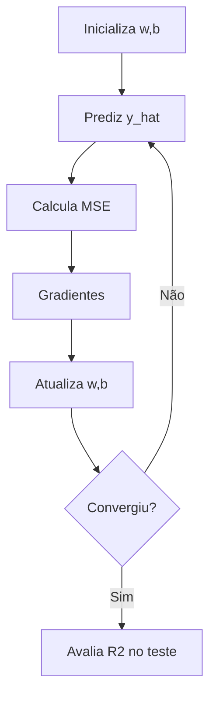

# Regressão Linear do Zero

> Öğrenmeden önce, bir hareketin devam ettiğini anlamak için gradiente a mão yazmalısınız.

**Type:** Build
**Languages:** Python
**Prerequisites:** 01-estatistica-descritiva, 02-limpeza-e-eda
**Time:** ~75 minutes

## Öğrenme Hedefleri

- MSE için gradient derivatif`y=wx+b`E uygulamalı geri dönüşü sıfırdan lineer
- Trenar com gradiente descendente e comparar con una equação normal
- Avaliar Com MSE, RMSE e R2 e Diagnostik ve Yeterli Ekipman Kompartimanı
- Çoklu geri dönüş için bir düzenleme ve ölçeklemeyi anlamak

## Sorun

Ev fiyatı değişir. Sen geri dönmezsin. Geri dönmeden sen, bir ret öğrenirsin ki, o, dörtlü hatayı en aza çıkarır.

## Anlaşım

Modelo: `y = wx + b`Custo MSE:`(1/n) sum(y_hat - y)^2`- Evet .
Gradientes: `dw = (2/n) sum((y_hat-y)x)`- Evet .`db = (2/n) sum(y_hat-y)`- Evet .
Güncelleme: `w -= lr*dw`- Evet .

Normal denklem: `w = (X^T X)^{-1} X^T y` solução fechada, O(n3) em özellikleri.

R2 = 1 - SS_res/SS_tot (quanto da variância é explicada).



```figure
linear-regression-fit
```

## Yapın

- Görüşürüz .`code/main.py`- Evet .`LinearRegression`com `fit`- Evet .`predict`- Evet .`r2`- Çoklu bir Ridge preview de dahil.

## Kullan

```python
from sklearn.linear_model import LinearRegression
model = LinearRegression().fit(X_train, y_train)
print(model.coef_, model.intercept_, model.score(X_test, y_test))
```

## Gönder

`outputs/skill-regressao.md`Normalden aşağıya doğru eğilimi kullanırken, yükseltildiğinde, düzenli hale geldiğinde.

## Egzersizler

1. SGD vs. seri GD uygulamak.
2. 10 derecelik testler, dörtlüklere uygun bir şekilde yapılır.
3. Ridge uygulamak (L2).

## Anahtar Terimler

| Term | Significado |
|---|---|
| MSE | Erro quadrático médio |
| R² | Variância explicada |
| Learning rate | Passo do gradiente |
| Scaling | Padronizar para convergir |

## Daha Fazla Okumak

- [ISLR cap 3](https://www.statlearning.com/)
- [CS229 notes](https://cs229.stanford.edu/main_notes.pdf)
