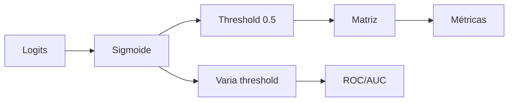

# Sınıflandırma ve değerlendirme

> Düzgünlüğü belirleyen bir bilgiyi doğrulamak için ROC'yi hatırlayın.

**Type:** Build
**Languages:** Python
**Prerequisites:** 03-regressao-do-zero
**Time:** ~70 minutes

## Öğrenme Hedefleri

- Implementar regressão logística com sigmoide e entropia cruzada do zero
- Konstrüksiyon matrisi ve doğruluğu, doğruluk, geri çağırma, F1
- Traçar eğri ROC ve AUC manuel olarak hesaplamak
- Seçim e en iyi açıklama e eşleşme doğruluğu vs geri çağırma

## Sorun

95% doğruluk ile yapılan model, %95'in olumsuz olduğunu ve her zaman olumsuz olduğunu keşfetene kadar en iyi görünüyor.

## Anlaşım

Sigmoid: `σ(z)=1/(1+e^-z)`, mapeia para (0,1).
Custo: BCE = -[y log(p) + (1-y) log(1-p)].
Gradiente: `dw = (1/n) sum((p-y)x)`- Evet .

Matriz:
```
        Pred 0  Pred 1
Real 0   TN      FP
Real 1   FN      TP
```
Precisão = TP/(TP+FP), Hatırlat = TP/(TP+FN), F1 = 2PR/(P+R.

ROC: 0→1 değişen eşiği, plota TPR vs FPR. AUC = area sob curva.



```figure
roc-curve
```

## Yapın

```python
def sigmoid(z): return 1/(1+math.exp(-z))
def bce(y,p): return -(y*math.log(p+1e-15)+(1-y)*math.log(1-p+1e-15))
# treino: p=sigmoid(w*x+b), erro=p-y
```

- Görüşürüz .`code/main.py`Tamamlı.

## Kullan

```python
from sklearn.linear_model import LogisticRegression
from sklearn.metrics import classification_report, roc_auc_score
model = LogisticRegression().fit(X_train, y_train)
print(classification_report(y_test, model.predict(X_test)))
print(roc_auc_score(y_test, model.predict_proba(X_test)[:,1]))
```

## Gönder

`outputs/skill-avaliacao.md` metrikler için kullanımı durumları.

## Egzersizler

1. F1'i en üst düzeyde çıkarmak için sınırını değiştir.
2. Düzden dengesizlik 95/5 e akirlik vs F1.
3. K katlı CV uygulamak.

## Anahtar Terimler

| Term | Definição |
|---|---|
| Precisão | Fração de positivos previstos que são reais |
| Recall | Fração de positivos reais capturados |
| F1 | Média harmônica P/R |
| AUC | Probabilidade de ordenar positivo acima de negativo |

## Daha Fazla Okumak

- [Google ML — Classification](https://developers.google.com/machine-learning/crash-course/classification)
- [Sklearn metrics](https://scikit-learn.org/stable/modules/model_evaluation.html)
