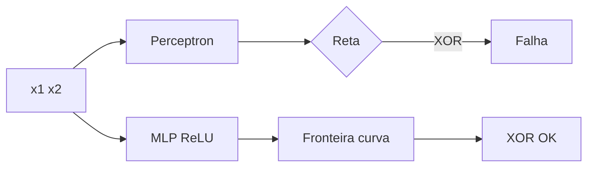

# Perceptron ve Deep Learning sıfır

> Bir çizgiyi birbirinden ayırıp, bir çizgiyi öğrenen bir çizgiye kadar her şey bir arada.

**Type:** Build
**Languages:** Python
**Prerequisites:** 03-regressao-do-zero, 04-classificacao-e-avaliacao
**Time:** ~80 minutes

## Öğrenme Hedefleri

- Uygulama (Rosenblatt kural) ve konverje/diverge zaman deneme
- MLP için Estender Com ReLU/sigmoide, ön ve arka destek el kitabı
- Trenar com gradiente descendente e comparar com`torch.nn.Linear`
- Karar sınırını görme ve bir HOR'nun yanlış algısını açıklama

## Sorun

Bu nedenle, bu süreçte, bir araya gelmek için, bir araya gelmek için, bir araya gelmek için, bir araya gelmek için, bir araya gelmek için, bir araya gelmek için, bir araya gelmek için, bir araya gelmek için, bir araya gelmek için, bir araya gelmek için, bir araya gelmek için, bir araya gelmek için, bir araya gelmek için, bir araya gelmek için, bir araya gelmek için, bir araya gelmek için, bir araya gelmek için, bir araya gelmek için, bir araya gelmek için, bir araya gelmek için, bir araya gelmek için, bir araya gelmek için, bir araya gelmek için, bir araya gelmek için, bir araya gelmek için, bir araya gelmek için, bir araya gelmek için, bir araya gelmek için, bir araya gelmek için, bir araya gelmek için, bir araya gelmek için, bir araya gelmek için, bir araya gelmek için, bir araya gelmek için, bir araya gelmek için, bir araya gelmek için, bir araya gelmek için, bir araya gelmek için, bir araya gelmek için, bir araya gelmek için, bir araya gelmek için, bir araya gelmek için, bir araya gelmek için, bir araya gelmek için, bir araya gelmek için, bir araya gelmek, bir araya gelmek, bir araya gelmek, bir araya gelmek, bir araya gelmek, bir araya gelmek, bir araya gelmek, bir araya gelmek, bir araya gelmek, bir araya gelmek, bir araya gelmek, bir araya gelmek, bir araya gelmek, bir araya gelmek, bir araya gelmek, bir araya gelmek, bir araya gelmek, bir araya gelmek, bir araya gelmek, bir araya gelmek, bir araya gelmek, bir araya gelmek, bir araya gelmek, bir araya gelmek, bir araya gelmek, bir araya gelmek, bir araya gelmek, bir araya gelmek, bir araya gelmek, bir araya gelmek, bir araya gelebilir, bir araya gelebilir, bir bir araya gelebilir, bir bir bir araya gelebilir, bir araya gelebilir, bir bir araya gelebilir, bir bir bir araya gelebilir, bir bir bir araya gelebilir, bir bir bir bir araya gelebilir, bir bir bir bir bir bir araya gelebilir, bir bir bir araya gelebilir, bir bir bir bir araya gelebilir, bir bir

## Anlaşım

Perceptron:`y = sign(w·x + b)`, güncelleştirilme: `w += lr*(y_true - y_pred)*x`- Evet .

Sınır: sadece doğrusal olarak ayrılır.

MLP 1 oculta: `h=ReLU(W1 x + b1)`- Evet .`y=sigmoid(W2 h + b2)`- Arka taraflı zincir derivatifleri.

ReLU:`max(0,z)` gradient 1 se z> 0, 0 caso contrario.



```figure
perceptron-vs-mlp
```

## Yapın

- Görüşürüz .`code/main.py`: perceptron + MLP 2 camadas backprop numpy.

## Kullan

```python
import torch
model = torch.nn.Sequential(torch.nn.Linear(2,8), torch.nn.ReLU(), torch.nn.Linear(8,1), torch.nn.Sigmoid())
# treino com torch.optim.SGD
```

MLP'nin en yüksek düzeyde %5'lik bir DEM'de bulunması gerekir.

## Gönder

`outputs/skill-perceptron.md` Linerel vs MLP kullanırken, como debugar fronteira.

## Egzersizler

1. Görüşün XOR'da (delil) birleştiği gösteriler.
2. Bir süre sonra ne yapacağım?
3. Ayrıca 2a gizli bir grup ve büyük bir ganho.

## Anahtar Terimler

| Term | Definição |
|---|---|
| Perceptron | Classificador linear com update erro-dirigido |
| ReLU | max(0,z) |
| Backprop | Regra da cadeia para gradientes |
| XOR | Problema não-linear que exige oculta |

## Daha Fazla Okumak

- [Rosenblatt 1958 — Perceptron](https://psycnet.apa.org/record/1959-09865-001)
- [3Blue1Brown — Neural Networks](https://www.3blue1brown.com/topics/neural-networks)
- [PyTorch basics](https://pytorch.org/tutorials/beginner/basics/intro.html)
