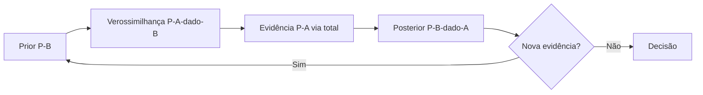

# Probabilidad do Zero: Condicional, Total e Bayes

> Testin pozitif olması için, hastalanma şansın ne?

**Type:** Build
**Languages:** Python
**Prerequisites:** 01-estatistica-descritiva
**Time:** ~60 minutes

## Öğrenme Hedefleri

- Şartlı olasılık hesaplama (P) testin bağımsızlığı bir ürün kuralıyla
- Bir olayın ortak özel olaylarda oluşması için toplam olasılık hukuku uygulanması
- Bayes teoremasını koşul değiştiriciler için uygulayabilir (teste médico, spam, churn)
- Bir PMF'nin sıfırdan ayrılmış olması ve değişikliğin bekleneni hesaplamak

## Sorun

Nadir bir hastalığa test edilmesi, hassasiyetinin %99'u ve spesifikliğinin %95'i ile sonuçlanır.

O içgüdü diz 99%. A resposta correta é ~2%. O erro  confundir P(positivo dizerdoente) com P(doente dizerpositivo)  se chama falácia da taxa-base, e aparece em churn, fraude, spam e qualquer classificador com classe rara. Sem probabilidade condicional, você interpreta todo modelo errado.

## Anlaşım

### Şartlı olasılık

```
P(A|B) = P(A ∩ B) / P(B),  com P(B) > 0
```

Leia: "B'nin gerçekleşmesi olasılığı" B'nin gerçekleşmesi olan durumlara sınırlandırır.

Örnek: dado justo, B = "saiu par" {2,4,6}, A = "saiu 6".

### İndépendência

A e B são independentes se o conhecimento de B não muda uma chance de A:

```
P(A|B) = P(A)  <=>  P(A ∩ B) = P(A) · P(B)
```

İki para birimi: 2'inci karaya, 1'inci karaya, 2'inci karaya, 2'inci karaya, 2'inci karaya, 2'inci karaya, 2'inci karaya, 2'inci karaya, 2'inci karaya, 2'inci karaya, 2'inci karaya, 2'inci karaya, 2'inci karaya, 2'inci karaya, 2'inci karaya, 2'inci karaya, 2'inci karaya, 2'inci karaya, 2'inci karaya, 2'inci karaya, 2'inci karaya, 2'inci karaya, 2'inci karaya, 2'inci karaya, 2'inci karaya, 2'inci karaya, 2'inci karaya, 2'inci karaya, 2'inci karaya, 2'inci karaya, 2'inci karaya, 2'inci karaya, 2'inci karaya, 2'inci karaya, 2'inci karaya, 2'inci karaya, 2'inci karaya, 2'ye, 4'ye, 5'ye, 5'ye, 5'ye, 5'ye, 5'ye, 5'ye, 5'ye, 5'ye, 5'ye, 5'ye, 5'ye, 5'ye, 5'ye, 5'ye, 5'ye, 5'ye, 5'ye, 5'ye, 5ye, 5ye, 5ye, 5ye, 5ye, 5ye, 5ye, 5ye, 5ye, 5ye, 5ye, 5ye, 5ye, 5ye, 7ye, 7ye, 7ye, 7ye, 7ye, 7ye, 7ye, 7yeye, 7ye, 7yeyeyeye, 7yeyeyeyeye, 7yeyeyeyeyeyeyeyeyeyeyeyeyeyeyeyeyeyeyeyeyeyeyeyeyeyeyeyeyeyeyeyeyeyeyeyeyeyeyeyeyeyeyeyeyeyeyeyeyeyeyeyeyeyeyeyeyeyeyeyeyeyeyeyeyeyeyeyeyeyeyeyeyeyeyeyeyeyeyeyeyeyeyeyeyeyeyeyeyeyeyeyeyeyeyeyeyeyeyeyeyeyeyeyeyeyeyeyeyeyeyeyeyeyeyeyeyeyeye

### Büyük olasılıkla

B1..Bn particionam o espaço (mutuamente exclusivos, cobrem tudo):

```
P(A) = Σ P(A|Bi) · P(Bi)
```

İşçi: P positivo) = P positivo de fazer) · P doente) + P positivo de fazer)

### Bayes teoremi

Yukarıdaki iki formül olarak bir şartlı kombinasyon invert:

```
P(B|A) = P(A|B) · P(B) / P(A)
```

Test médico: P(doente não está positivo) = 0.99·0.001 / (0.99·0.001 + 0.05·0.999) ≈ 0.0194 ≈ 2%.



```figure
stats-probability-bayes
```

## Yapın

### Adım 1: Şartlı ve bağımsızlık sıfır

```python
def cond_prob(p_ab, p_b):
    if p_b <= 0:
        raise ValueError("P(B) deve ser > 0")
    return p_ab / p_b

def joint_if_independent(p_a, p_b):
    return p_a * p_b

def is_independent(p_a, p_b, p_ab, tol=1e-9):
    return abs(p_ab - p_a * p_b) <= tol

print(cond_prob(1/6, 3/6))          # 0.333: P(6 | par)
print(is_independent(0.5, 0.5, 0.25))  # True: duas moedas
```

### Adım 2: Büyük ihtimalle toplam

```python
def total_prob(cond_probs, priors):
    # cond_probs[i] = P(A|Bi), priors[i] = P(Bi)
    if abs(sum(priors) - 1.0) > 1e-9:
        raise ValueError("priors devem somar 1")
    return sum(c * p for c, p in zip(cond_probs, priors))

p_pos = total_prob([0.99, 0.05], [0.001, 0.999])
print(f"P(positivo) = {p_pos:.4f}")  # ~0.0509
```

### Adım 3: Bayes + PMF, esperança e variância

```python
def bayes(p_a_given_b, p_b, p_a):
    return p_a_given_b * p_b / p_a

print(f"P(doente|+) = {bayes(0.99, 0.001, p_pos):.4f}")  # ~0.0194

def pmf(values, probs):
    if abs(sum(probs) - 1.0) > 1e-9:
        raise ValueError("probs devem somar 1")
    return dict(zip(values, probs))

def expected_value(d):
    return sum(x * p for x, p in d.items())

def variance_dist(d):
    mu = expected_value(d)
    return sum(((x - mu) ** 2) * p for x, p in d.items())

dado = pmf([1,2,3,4,5,6], [1/6]*6)
print(expected_value(dado), variance_dist(dado))  # 3.5, ~2.917
```

## Kullan

O mesmo cálculo com `fractions`(exato) ou contagem empírica:

```python
from fractions import Fraction

# Bayes exato com frações
p = Fraction(99,100) * Fraction(1,1000) / (
    Fraction(99,100)*Fraction(1,1000) + Fraction(5,100)*Fraction(999,1000))
print(p, float(p))  # ~0.0194

# Verificação empírica por simulação (lei dos grandes números)
import random
random.seed(0)
n = 200_000
doente_pos = sum(1 for _ in range(n)
                 if random.random() < 0.001 and random.random() < 0.99)
saud_pos = sum(1 for _ in range(n)
               if random.random() >= 0.001 and random.random() < 0.05)
print(doente_pos / (doente_pos + saud_pos))  # ~0.02
```

Simülasyon ve formül, 2a casa decimal com n grande ile uyumlu olmalıdır.

## Gönder

Artefato:`outputs/skill-probabilidade.md` kontrol listesi "her koşulunu değiştirdiğinde, sonlama öncesi, doğruluğu ve kanıtları bildirin".

## Egzersizler

1. Spam filtresi, spamın %98'ini ve spam olmayanların %2'sini oluşturur.`bayes()`- Evet .
2. P(A) = P(B) = P(B) = P(B) = P(A) = P(B) sadece geçerli olduğunu kanıtlayın.
3. "Soma de dois dados" için bir PMF oluşturmak ve umut ve değişim hesaplamak`expected_value()`E `variance_dist()`- Evet .

## Anahtar Terimler

| Term | O que dizem | O que realmente é |
|---|---|---|
| Condicional P(A\|B) | "chance de A se B" | P(A∩B)/P(B); restringe o universo a B |
| Independência | "sem relação" | P(A∩B)=P(A)·P(B); saber B não muda A |
| Probabilidade total | "média ponderada" | P(A)=Σ P(A\|Bi)·P(Bi) sobre partição |
| Teorema de Bayes | "inverter a pergunta" | P(B\|A)=P(A\|B)·P(B)/P(A) |
| PMF | "tabela de chances" | P(X=x) para cada valor discreto; soma 1 |
| Esperança | "média teórica" | Σ x·P(x); para onde a média amostral converge |

## Daha Fazla Okumak

- [Seeing Theory — Probability](https://seeing-theory.brown.edu/) visual interativo
- [Stat Trek: Bayes Theorem](https://stattrek.com/probability/bayes-theorem) Reference com examples
- [Python `fractions` docs](https://docs.python.org/3/library/fractions.html) hesaplama için eksato
