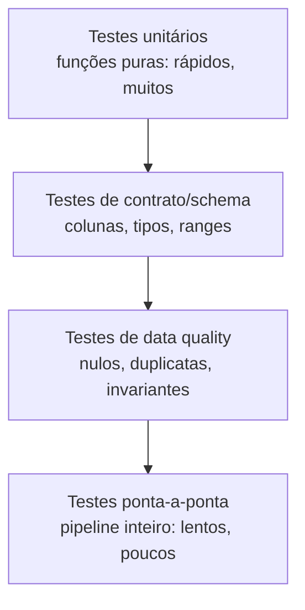

# Data Bilimleri için Temiz Kod ve Testler

> O not defteri bir üretim makinesi ve üretimi devreler.

**Type:** Build
**Languages:** Python
**Prerequisites:** 01-estatistica-descritiva, 02-limpeza-e-eda
**Time:** ~60 minutes

## Öğrenme Hedefleri

- Not defterlerinin üretimde nasıl kırıldığını açıklamak (estado oculto, ejecución fora de orden, dependências implícitas)
- Bir defter tekliçli bir boru hattı modüler olarak düzenlenir.
- SRP, DRY ve validation na borda em código de dados com stdlib uygulamak
- Veri kalitesi testleri (sema, sıfır, aralık, değişken)
- Bir test piramidini DS ile yorumlamak: unitários rápidos, contrato/schema, ponta-a-ponta lentos

## Sorun

Bir arkadaşınız "Run All" i gerçekleştirir ve hücreye 7'e bir değişken gönderir.`idade`Come Como string `"32"`Bu arada,`dropna()`İsteğe bağlı olarak, iş programı gece yarısı mesajı kullanılabilir hale getirir.

Notbuklar optimizam exploração, não repetção. Estado global mutável, células executadas fora de orden e tipos implícitos tornam o resultado não-determinístico. O custo aparece depois: retrabalho, modelo treinado com dados corrompidos, decisão errada. A saída é tratar código de dados como software: funções pequenas, entradas validadas, comportamento testado.

## Anlaşım

### Funções puras: aynı giriş, aynı çıkış

Bir işlev sadece küresel değildir, işlev düzenine bağlı değildir:

```python
# impuro: depende de global e muta o argumento
THRESHOLD = 18
def filtrar_adultos(rows):
    return [r for r in rows if r["idade"] >= THRESHOLD]  # quebra se idade for str

# puro: dependências explícitas, sem mutação
def filtrar_adultos(rows, idade_minima=18):
    return [{**r} for r in rows if int(r["idade"]) >= idade_minima]
```

Pratik kurallar: um verbo por função (`load`- Evet .`validate`- Evet .`clean`- Evet .`featurize`(I/O only nas bordas), yeni dönüşüm.

### SOLID em versão DS (sadece burada önemli)

- **S — Single Responsibility:** `validate_schema()`Valide,`clean()`- Hiç birlikte değiliz.
- **D — Dependency Inversion (na prática):**Bir aşama, bir parametre (eğlence, sütun) açısından belirlenmiş, küresel bir önemi olmayan bir aşama alır.
- **Contrato na borda:**Şema logosu na entrada (yöntemli sütunlar, dönüştürülebilir türler) geçerlidir.

### Döşekler için testis piramidesi



Bir taban (unitarios + schema) her bir komisyon için saniyeler sürer. ya da top (pipeline inteiro com dados reais) bir taban/noturno değildir.

```figure
clean-code-pipeline-overview
```

## Yapın

### Adım 1: Bir tabloyu list-de-dict olarak sun ve geçerli bir şema oluştur

Sem pandas: cada linha é um `dict`, bir tablo e uma `list[dict]`- Evet .

```python
SCHEMA = {
    "nome": str,
    "idade": int,   # aceita "32" conversível
    "salario": float,
}

def validate_schema(rows, schema):
    errors = []
    for i, row in enumerate(rows):
        for col, tipo in schema.items():
            if col not in row:
                errors.append(f"linha {i}: coluna ausente '{col}'")
                continue
            try:
                tipo(row[col])
            except (ValueError, TypeError):
                errors.append(f"linha {i}: '{col}'={row[col]!r} não converte para {tipo.__name__}")
    return errors
```

### Adım 2: Pipeline modüler com funções puras

```python
def clean_rows(rows):
    out = []
    for r in rows:
        novo = {"nome": str(r["nome"]).strip(), "idade": int(r["idade"]), "salario": float(r["salario"])}
        if novo["idade"] >= 0 and novo["salario"] >= 0:
            out.append(novo)
    return out

def featurize(rows):
    return [{**r, "adulto": r["idade"] >= 18} for r in rows]

def run_pipeline(rows):
    errors = validate_schema(rows, SCHEMA)
    if errors:
        raise ValueError("schema inválido:\n" + "\n".join(errors[:5]))
    return featurize(clean_rows(rows))
```

### Adım 3: Veri kalitesini test etmek

```python
def check_quality(rows):
    checks = {
        "sem_nulos": all(v is not None and v != "" for r in rows for v in r.values()),
        "idades_validas": all(0 <= r["idade"] <= 120 for r in rows),
        "sem_duplicatas": len({(r["nome"], r["idade"]) for r in rows}) == len(rows),
    }
    return checks
```

Her çek Booleano isimini geri verir: "Falha, tu sais exactement quel invariante quebrou".

## Kullan

O mesmo padrão com a biblioteca de produção (`pandera`para şemalar,`pytest`Como runner:

```python
# import pandera.pandas as pa
# import pandas as pd
# from pandera import Column, DataFrameSchema, Check
#
# schema = DataFrameSchema({
#     "nome": Column(str),
#     "idade": Column(int, Check.between(0, 120)),
#     "salario": Column(float, Check.ge(0)),
# })
# df = pd.DataFrame([{"nome": "ana", "idade": 30, "salario": 5000.0}])
# print(schema.validate(df))
# # pytest: mesmos asserts do unittest, com fixtures e mensagens melhores
```

Validecilik`pandera`İletişim: Linea válida passa nos dois, Linea inválida falha nos dois.

## Gönder

Artefato:`outputs/skill-clean-code-ds.md` herhangi bir defter için kontrol listesi: "funções puras, schema na borda, kalite kontrolleri, testes rápidos embaixo e ponta-a-ponta em cima".

## Egzersizler

1. Quebre propositalmente: passe `idade="trinta"`E ü ü ü ü ü ü ü ü ü ü ü ü ü ü ü ü ü ü ü ü ü ü ü ü ü ü ü ü ü ü ü ü ü ü ü ü ü ü ü ü ü ü ü`salario`- Bir hatalı mesaj var mı?
2. - Tamam .`salario_mediano_positivo`Tüm maaşlar 0 olduğunda yanlış olan bir test neden iş değişkeninin daha iyi bir tip testine değer?
3. Bu testler, yeni testlerin önemsiz olduğunu gösteriyor.

## Anahtar Terimler

| Term | O que dizem | O que realmente é |
|---|---|---|
| Função pura | "função limpa" | Mesma entrada -> mesma saída, sem global nem mutação; testável em isolamento |
| Schema | "formato dos dados" | Contrato de colunas + tipos; validado na borda, falha rápido |
| Data quality check | "teste de dados" | Invariante nomeado (nulos, ranges, duplicatas) que explica o que quebrou |
| SRP | "uma coisa só" | Cada função/etapa tem um único motivo para mudar |
| Pirâmide de testes | "testar tudo" | Muitos testes rápidos na base (unit/schema), poucos lentos no topo (e2e) |
| Falhe rápido | "validar cedo" | Erro na entrada com mensagem útil em vez de corrupção silenciosa adiante |

## Daha Fazla Okumak

- [PEP 8 — Style Guide](https://peps.python.org/pep-0008/) Official conventions
- [unittest docs](https://docs.python.org/3/library/unittest.html) koşucusu stdlib
- [Pandera docs](https://pandera.readthedocs.io/) validation de schéma em producción
