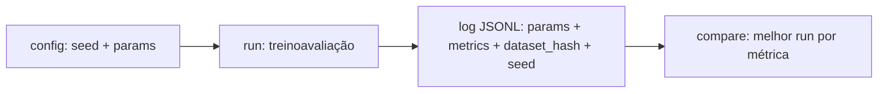

# Reprodutibilidad e Tracking de Experimentos

> "Funcionou yesterday" bilimsel bir sonuç değil.

**Type:** Build
**Languages:** Python
**Prerequisites:** 01-estatistica-descritiva, 08-clean-code-testes-ds
**Time:** ~60 minutes

## Öğrenme Hedefleri

- Üç kaynak olarak açıklamak: tohum sabitlenmemiş, versiyon olarak veri kümesi, hiperparametrler kayıtlı değil
- Sıkı tohumlar`random`(e `numpy`- Ne ?`torch`(Yarıtmak için kullanmayın)
- Versiyonar um dataset com hash SHA-256 do conteúdo canônico
- Kayıtçı çalıştırır (param + metrikler + veri kümesi_hash) em JSONL com stdlib
- E escolher o melhor por metrica com função pura karşılaştır

## Sorun

Bu nedenle, bu durumun bir sonucu olarak, bir raporcuya göre, bir yıl sonra, bir not defteri güncelleştirildi ve kimse hangi kombinasyonun daha iyi olduğunu bilmiyor.

Bu nedenle, bir veri tabanının bir parçası olarak, bir veri tabanının bir parçası olarak, bir veri tabanının bir parçası olarak, bir veri tabanının bir parçası olarak, bir veri tabanının bir parçası olarak, bir veri tabanının bir parçası olarak, bir veri tabanının bir parçası olarak, bir veri tabanının bir parçası olarak, bir veri tabanının bir parçası olarak, bir veri tabanının bir parçası olarak, bir veri tabanının bir parçası olarak, bir veri tabanının bir parçası olarak, bir veri tabanının bir parçası olarak, bir veri tabanının bir parçası olarak, bir veri tabanının bir parçası olarak, bir veri tabanının bir parçası olarak, bir veri tabanının bir parçası olarak, bir veri tabanının bir parçası olarak, bir veri tabanının bir parçası olarak, bir veri tabanının bir parçası olarak, bir veri tabanının bir parçası olarak, bir veri tabanının bir parçası olarak, bir veri tabanının bir parçası olarak, bir veri tabanının bir parçası olarak, bir veri tabanın bir parçası olarak, bir veri tabanın bir parçası olarak, bir diğerinden, bir diğerinden, bir diğerinden, bir diğerinden, bir diğerinden, bir diğerinden, bir diğerinden, bir diğerinden, bir diğerinden, bir diğerinden, bir diğerinden, bir diğerinden, bir diğerinden, bir diğerine, bir diğerinden, bir diğerine, bir diğerine, bir diğerine, bir diğerine, bir diğerine, bir diğerine, bir diğer diğerine, bir diğerine, bir diğerine, bir diğer, bir diğer, bir diğer, bir diğer, bir diğer, diğer, diğer, bir diğer, diğer, diğer diğer, diğer, diğer, diğer diğer diğer, diğer, diğer, diğer diğer, diğer diğer diğer, diğer, diğer, diğer diğer, diğer diğer, diğer, diğer, diğer, diğer diğer, diğer diğer, diğer, diğer, diğer diğer, diğer diğer, diğer diğer diğer, diğer, diğer, diğer diğer diğer diğer, diğer, diğer, diğer, diğer, diğer diğer diğer diğer, diğer, diğer diğer diğer diğer diğer, diğer diğer diğer diğer, diğer, diğer diğer diğer diğer, diğer, diğer diğer diğer diğer, diğer, diğer diğer diğer diğer, diğer, diğer diğer diğer, diğer, diğer, diğer diğer, diğer, diğer diğer diğer diğer diğer, diğer, diğer diğer diğer diğer, diğer, diğer diğer diğer diğer diğer, diğer, diğer diğer diğer, diğer, diğer diğer diğer, diğer, diğer diğer diğer diğer diğer, diğer, diğer, diğer, diğer,

## Anlaşım

### Tohum: o ponto de partida do aleatório

Geradores pseudo-aleatórios são determinísticos dada bir tohum:

```python
import random
random.seed(42)
print(random.random())  # sempre 0.6394267984578837
```

Bir başlangıçta bir tohum sabitleyin (`set_seed(42)`Farklı tohumlar = farklı deneyler; bu nedenle bir tohum da bir param kayıtlıdır.

### Verão de dataset = içerikli bir kısım

Arşiv adı (`dados_final_v2_REAL.csv`Hash no:

```
versão = sha256(representação_canônica_das_linhas)
```

İki tablo aynı içeriğe sahip, bir byte.

### İzleme minimalist: JSON bir çizgi için çalıştır



Her kayıt çalışması`timestamp`- Evet .`seed`- Evet .`dataset_hash`- Evet .`params`- Evet .`metrics`JSONL arşiv sadece eklenir: istorico imutável, legible per qualsiasi utenta.

```figure
reproducibility-tracking-overview
```

## Yapın

### Adım 1: Bir tohum sabitleyin ve belirlenmiş bir bölünme yapın

```python
import random

def set_seed(seed):
    random.seed(seed)

def train_test_split(rows, test_ratio=0.2, seed=42):
    rng = random.Random(seed)  # instância local: não polui o global
    idx = list(range(len(rows)))
    rng.shuffle(idx)
    k = int(len(rows) * (1 - test_ratio))
    return [rows[i] for i in idx[:k]], [rows[i] for i in idx[k:]]
```

Mesma tohum + mesmos dados = mesmo split, siempre.

### Adım 2: Hash canônico do dataset

```python
import hashlib, json

def dataset_hash(rows):
    canon = json.dumps(rows, sort_keys=True, ensure_ascii=False)
    return hashlib.sha256(canon.encode("utf-8")).hexdigest()[:12]
```

`sort_keys=True`garanti ordena canônica das cleves; o prefixo de 12 caros basta como versão legível.

### Adım 3: Takipçi JSONL

```python
import json, datetime

def log_run(path, params, metrics, seed, dhash):
    record = {
        "timestamp": datetime.datetime.now(datetime.timezone.utc).isoformat(),
        "seed": seed, "dataset_hash": dhash,
        "params": params, "metrics": metrics,
    }
    with open(path, "a", encoding="utf-8") as f:
        f.write(json.dumps(record, ensure_ascii=False) + "\n")
    return record

def load_runs(path):
    with open(path, encoding="utf-8") as f:
        return [json.loads(line) for line in f if line.strip()]

def best_run(runs, metric="accuracy", higher=True):
    return (max if higher else min)(runs, key=lambda r: r["metrics"][metric])
```

## Kullan

Aynı zamanda bir üretim (`mlflow`Cittado,`numpy`Para tohumlar):

```python
# import mlflow, numpy as np
#
# np.random.seed(42)  # além de random.seed(42)
# # import torch; torch.manual_seed(42)
#
# # mlflow.start_run()
# # mlflow.log_params({"lr": 0.01, "seed": 42, "dataset_hash": "abc..."})
# # mlflow.log_metric("accuracy", 0.87)
# # mlflow.end_run()
```

JSONL e o mlflow registram o mesmo contrato: parametre + metrikler + dataset_hash + seed.

## Gönder

Artefato:`outputs/skill-reprodutibilidade-tracking.md` checklist de todo experimento: "seed fixed and registered, dataset com hash, um JSON per run, best run selected per function pure".

## Egzersizler

1. Çubuk`train_test_split`İki kez bir tohum 42 ve bir tohum 7.
2. Değiştirme değerleri bir veri kümesi ve hash yeniden hesaplamak.`sort_keys=True`Önemli mi?
3. Logue 3 param değişikliği ile çalışır, sonra kullan `best_run`com `higher=False`Bir hata metrikası mı?

## Anahtar Terimler

| Term | O que dizem | O que realmente é |
|---|---|---|
| Seed | "número mágico" | Estado inicial do gerador pseudo-aleatório; fixa toda a sequência sorteada |
| Dataset hash | "versão dos dados" | SHA-256 do conteúdo canônico; prova em quais dados você treinou |
| Run | "um treino" | Uma execução com seed + params + dataset fixos e métricas registradas |
| JSONL | "log de runs" | Um objeto JSON por linha, append-only; histórico auditável |
| Tracking | "acompanhar modelo" | Registrar params/metrics/versões para comparar e reproduzir |
| Determinismo | "sempre igual" | Mesma seed + mesmos dados + mesmo código = mesmo resultado |

## Daha Fazla Okumak

- [MLflow Tracking docs](https://mlflow.org/docs/latest/tracking.html) üretim alanı
- [hashlib docs](https://docs.python.org/3/library/hashlib.html) referans stdlib
- [NumPy random seed docs](https://numpy.org/doc/stable/reference/random/index.html) Tohum em üretim
