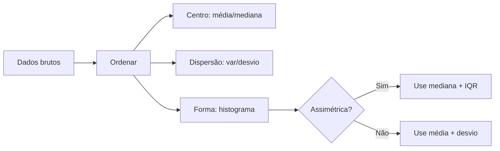

# Statística Descritiva do Zero

> Média, mediana e variância kể một lịch sử mà một bảng ẩn  học thêm một phần sem pandas.

**Type:** Build
**Languages:** Python
**Prerequisites:** None
**Time:** ~60 minutes

## Mục tiêu học tập

- Xét media, mediana, moda, variância, desvio-padrão e quartis sử dụng chỉ có một số
- Xây dựng một lịch sử và boxplot em texto/ASCII trước khi sử dụng matplotlib
- Khám phá các điểm khác nhau với IQR e z-score và giải thích khi mỗi lần lỗi
- So sánh một phân phối kinh nghiệm với một bình thường và giải thích

## Vấn đề

Bạn nhận được một CSV với 10.000 lương.$ 8.500, mas 70% das pessoas ganham menos que isso. Por quê? Um único CEO com R$500k cho một phương tiện truyền thông.

Trong khoa học dữ liệu, tóm tắt dữ liệu như một métrica chỉ là một sai lầm phổ biến nhất và đắt tiền nhất.

## Khái niệm

### Centro: media vs mediana vs moda

```
dados = [2, 3, 3, 5, 500]
média   = (2+3+3+5+500)/5 = 102.6  <- sensível a outlier
mediana = valor do meio ordenado = 3  <- robusta
moda    = valor mais frequente = 3
```

Quy tắc: phân phối đối xứng -> média ~= mediana. Assimétrica à direita -> media > mediana (caso salários).

### Sự phân tán: sự biến đổi và sự biến đổi

```
variância = média((x - média)^2)
desvio    = sqrt(variância)
```

Desvio responde: "em media, quanto cada ponto se afasta do centro?"

### Quartis e IQR (robusto)

Quản lý dữ liệu: Q1 = phần trăm 25, Q2 = trung bình, Q3 = phần trăm 75.
IQR = Q3 - Q1 (tăng cường 50% trung tâm).

Regra de Tukey để các điểm khác biệt:
```
limite_inf = Q1 - 1.5*IQR
limite_sup = Q3 + 1.5*IQR
```

### Điểm Z (paramétrico)

```
z = (x - média) / desvio
```
|z| > 3 = candidato a outlier, mas assume distribuição ~normal. Em dados assimétricos, IQR é melhor.



```figure
stats-descriptive-overview
```

## Hãy xây dựng nó

### Bước 1: Các trung tâm thống kê và phân tán không

```python
import math

def mean(data):
    return sum(data) / len(data)

def median(data):
    s = sorted(data)
    n = len(s)
    mid = n // 2
    return s[mid] if n % 2 == 1 else (s[mid-1] + s[mid]) / 2

def variance(data, sample=False):
    m = mean(data)
    div = len(data) - 1 if sample else len(data)
    return sum((x - m)**2 for x in data) / div

def std(data, sample=False):
    return math.sqrt(variance(data, sample))

def mode(data):
    freq = {}
    for x in data:
        freq[x] = freq.get(x, 0) + 1
    return max(freq, key=freq.get)

data = [2, 3, 3, 5, 500]
print(f"média={mean(data):.1f} mediana={median(data)} moda={mode(data)} std={std(data):.1f}")
```

### Bước 2: Quartis e IQR

```python
def percentile(data, p):
    s = sorted(data)
    k = (len(s)-1) * p / 100
    f = math.floor(k)
    c = math.ceil(k)
    if f == c:
        return s[int(k)]
    return s[f] * (c - k) + s[c] * (k - f)

def quartiles(data):
    return percentile(data, 25), percentile(data, 50), percentile(data, 75)

def iqr(data):
    q1, _, q3 = quartiles(data)
    return q3 - q1

q1, q2, q3 = quartiles([1,2,3,4,5,6,7,8,9,100])
print(f"Q1={q1} Q2={q2} Q3={q3} IQR={iqr([1,2,3,4,5,6,7,8,9,100])}")
# outlier: 100 > Q3+1.5*IQR ?
```

### Bước 3: Histogram ASCII

```python
def histogram(data, bins=5):
    lo, hi = min(data), max(data)
    width = (hi - lo) / bins
    counts = [0]*bins
    for x in data:
        idx = min(int((x - lo) / width), bins-1) if width else 0
        counts[idx] += 1
    for i, c in enumerate(counts):
        bar = "#" * c
        print(f"{lo + i*width:6.1f} | {bar} ({c})")

histogram([1,1,2,2,2,3,3,5,8,9], bins=4)
```

## Sử dụng nó

Mesmo cálculo com `numpy`- Không.`statistics`- Có thể là:

```python
import statistics
import numpy as np

data = [2, 3, 3, 5, 500]
print(statistics.mean(data), statistics.median(data), statistics.stdev(data))
print(np.mean(data), np.median(data), np.std(data, ddof=0))
print(np.percentile(data, [25,50,75]))
# histograma real
# import matplotlib.pyplot as plt
# plt.hist(data, bins=10); plt.show()
```

Cód do zero và numpy phải được đặt vào số thập phân 2a. sử dụng stdlib để hiểu, numpy để sản xuất.

## Chuyển nó

Artefato: `outputs/skill-estatistica-descritiva.md` danh sách kiểm tra cho tất cả EDA: "antes de training, reporte média/mediana, desvio/IQR, histogram e % de outliers".

## Các bài tập

1. Gere 1000 mẫu mực`exp(λ=1)`và so sánh media vs mediana.
2. Thực hiện sự đối xứng (skew) = E[(x-média) ^3]/desvio^3 sem libs.
3. Thay đổi quy tắc IQR từ 1.5 đến 3.0.

## Các điều khoản chính

| Term | O que dizem | O que realmente é |
|---|---|---|
| Média | "valor típico" | Soma/n, sensível a outliers; só típica se distribuição simétrica |
| Mediana | "meio dos dados" | Valor que corta 50% abaixo/acima; robusta |
| Desvio-padrão | "erro médio" | Raiz da variância; distância típica até a média |
| IQR | "caixa do boxplot" | Q3-Q1; amplitude dos 50% centrais |
| Z-score | "quantos desvios" | (x-média)/desvio; assume normalidade |
| Outlier | "ponto estranho" | Observação além de Q3+1.5*IQR ou |z|>3 |

## Đọc thêm

- [Seeing Theory — Descriptive Stats](https://seeing-theory.brown.edu/) visual interativo
- [NIST Engineering Statistics Handbook](https://www.itl.nist.gov/div898/handbook/) Reference
- [SciPy stats docs](https://docs.scipy.org/doc/scipy/reference/stats.html) để sản xuất
