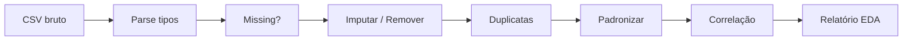

# Limpeza e EDA làm Zero

> Dữ liệu thực sự được tìm thấy trong các bản sao bạn đã tìm thấy bị mất tích, bản sao và các loại trước khi mô hình học được lỗi.

**Type:** Build
**Languages:** Python
**Prerequisites:** 01-estatistica-descritiva
**Time:** ~70 minutes

## Mục tiêu học tập

- Khám phá và tính toán các giá trị không có (média, mediana, moda) như các pandas
- Tiêu chuẩn hóa, loại bỏ bản sao và chuẩn hóa chuỗi bằng tay
- Lượng tính toán của Pearson do zero e montar matrix de correlação
- Gerar um relatório EDA mínimo reproduzível

## Vấn đề

Kagle ước tính 80% tốc độ của một nhà khoa học là sạch.`""`- `"N/A"`- `"null"`Các bản sao sẽ trở lại trong rác rác.

## Khái niệm

### Thiếu: loại

- MCAR (perda aleatória)  imputar ok.
- MAR (perda depende de outro campo)  imputar condicional.
- MNAR (làm mất tự tin)  imputar viesado.

Các chiến lược: loại bỏ linha, média/mediana/moda, vizinho mais próximo.

### Correlação de Pearson

```
r = cov(X,Y) / (std(X)*std(Y))
cov = mean((x - mx)(y - my))
```
r=1 correlação perfeita, 0 nenhuma, -1 ngược lại.



```figure
eda-pipeline
```

## Hãy xây dựng nó

### Bước 1: Tìm kiếm và phát hiện mất tích

```python
def is_missing(v):
    return v is None or str(v).strip().lower() in ("", "na", "n/a", "null", "none", "-")

def column_stats(rows, col):
    vals = [r[col] for r in rows if not is_missing(r[col])]
    nums = [float(v) for v in vals]
    return len(vals), sum(nums)/len(nums) if nums else None
```

### Bước 2: Imputação

```python
def impute(rows, col, strategy="median"):
    vals = [float(r[col]) for r in rows if not is_missing(r[col])]
    vals.sort()
    if strategy == "mean":
        fill = sum(vals)/len(vals)
    elif strategy == "median":
        fill = vals[len(vals)//2]
    else: # mode
        fill = max(set(vals), key=vals.count)
    for r in rows:
        if is_missing(r[col]):
            r[col] = fill
    return fill
```

### Bước 3: Correlação

```python
def pearson(x, y):
    mx, my = sum(x)/len(x), sum(y)/len(y)
    num = sum((a-mx)*(b-my) for a,b in zip(x,y))
    den = (sum((a-mx)**2 for a in x)*sum((b-my)**2 for b in y))**0.5
    return num/den if den else 0
```

## Sử dụng nó

```python
import pandas as pd
df = pd.read_csv("data.csv", na_values=["", "N/A", "null"])
print(df.isna().sum())
df["idade"] = df["idade"].fillna(df["idade"].median())
print(df.corr(numeric_only=True))
```

## Chuyển nó

`outputs/skill-limpeza-eda.md` đường ống de limpeza reproducible.

## Các bài tập

1. Implement imputação por grupo (ví dụ: trung bình lương của một bộ phận).
2. Ngoài ra còn có thể phát hiện các bản sao của một loại chất bôi trơn.
3. So sánh Pearson vs. Spearman bằng cách đưa ra một cách khác.

## Các điều khoản chính

| Term | O que é |
|---|---|
| MCAR | Missing completamente aleatório |
| Imputação | Preencher faltantes com estatística |
| Pearson | Correlação linear [-1,1] |
| EDA | Análise exploratória antes de modelar |

## Đọc thêm

- [Pandas missing data guide](https://pandas.pydata.org/docs/user_guide/missing_data.html)
- [Hadley Wickham — Tidy Data](https://vita.had.co.nz/papers/tidy-data.pdf)
